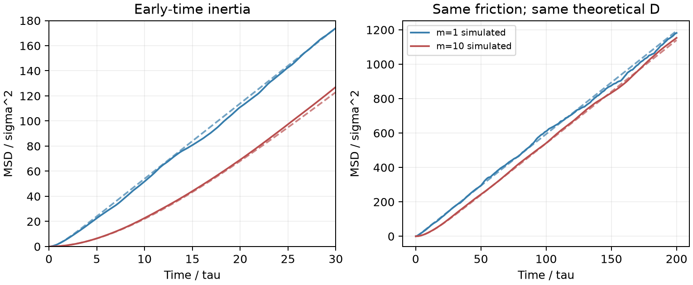

# LAMMPS 布朗运动与质量效应

**适用环境：Linux + PBS（LAMMPS）；Windows / macOS / Linux 可绘图。**

用隐式热浴代替显式溶剂，可以低成本观察粒子的惯性与扩散过渡。这里以两个独立粒子系综为例，质量分别为 1、10，每组 512 个粒子，无保守粒子间作用。

## 固定摩擦系数，而不是固定 damp

Langevin 方程写作 $m\dot v=-\gamma v+R(t)$，其中 $\gamma$ 是摩擦系数。LAMMPS 的 `fix langevin` 使用

$$\gamma=m/\mathrm{damp}.$$

若改变质量而保持 `damp` 不变，摩擦系数也会改变。[最小案例](../../examples/lammps/minimal/brownian-tracer/)的 [in.lammps](../../examples/lammps/minimal/brownian-tracer/in.lammps)特意设置质量与阻尼时间同时增大十倍：

```text
mass 1 1
mass 2 10
fix integrate all nve
fix bath all langevin 1.0 1.0 1.0 918273 scale 2 10.0
```

这样两类粒子均有 $\gamma=1$，温度 $k_BT=1$，理论长时扩散系数均为 $D=k_BT/\gamma=1$，但惯性弛豫时间 $\tau_m=m/\gamma$ 不同。`fix langevin` 只添加阻尼和随机力，必须配合 `fix nve` 等时间积分器；不要再叠加另一套恒温器。

## 运行与解析对照

加载 LAMMPS，安装 [依赖](../../examples/lammps/minimal/brownian-tracer/requirements.txt)，在干净目录执行 `qsub job.pbs`（[PBS 文件](../../examples/lammps/minimal/brownian-tracer/job.pbs)）。步长 0.01，共 20000 步，使用平衡 Maxwell 初速度。

[后处理](../../examples/lammps/minimal/brownian-tracer/postprocess.py)将实际 MSD 与三维解析式比较：

$$\mathrm{MSD}(t)=6D\left[t-\tau_m\left(1-e^{-t/\tau_m}\right)\right].$$

[plot.py](../../examples/lammps/minimal/brownian-tracer/plot.py)同时绘出模拟实线与解析虚线。



短时展开为 $\mathrm{MSD}\simeq3k_BTt^2/m$，重粒子早期位移较小；长时两条曲线的斜率相近。本例 100—200 时间窗口的 $D$ 约为 0.957、1.009；相对于解析曲线的晚时 RMS 相对误差约为 1.9%、1.4%。这些偏差包含有限系综与随机采样误差。

这里是理想隐式溶剂模型，不包含真实大颗粒的排液体积、流体动力学或粒子间碰撞。研究显式溶剂中的大颗粒时，还需检查其尺寸、边界及摩擦来源。系综平均比单个示踪轨迹平稳，但不能替代对模型假设的检验。

参考：单斌、陈征征、陈蓉《计算材料学》配套仓库[第七章 7.4—7.5](https://github.com/stanfordbshan/CompMatBook/tree/main/edition-1-2023/Chapter07)的布朗运动主题；[LAMMPS fix langevin](https://docs.lammps.org/fix_langevin.html)。本例以重新编写的 Langevin 系综演示质量与摩擦的区别。
