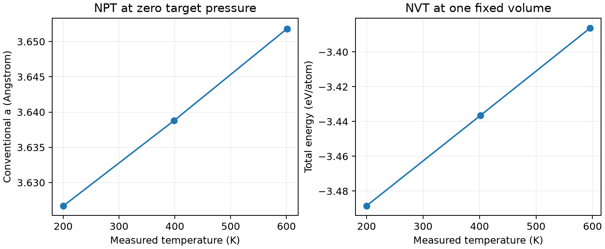

# LAMMPS 热膨胀与定容热容

**适用环境：Linux + PBS（LAMMPS）；Windows / macOS / Linux 可绘图。**

热膨胀需要允许体积随温度变化；定容热容则必须在同一体积下比较能量。以 fcc Cu 为例，分别做零目标压力的 NPT 和固定体积的 NVT，避免把连续升温曲线的斜率直接当作平衡热容。

## 输入与势文件

[最小案例](../../examples/lammps/minimal/thermal-response/)的 [in.lammps](../../examples/lammps/minimal/thermal-response/in.lammps)使用 4×4×4 常规晶胞，共 256 个 Cu，晶格常数初值为 3.615 Å。需要 LAMMPS 随附的 `Cu_u3.eam`（[来源与准备方法](../../examples/lammps/minimal/thermal-response/POTENTIALS.md)）。加载软件时可设置 `LAMMPS_POTENTIALS` 指向势目录，或把势文件放到计算目录。

```text
fix bath all npt temp 400 400 0.1 iso 0 0 1.0
```

此为 400 K、目标压力 0 bar 的 NPT 设置，温控与压控时间常数分别为 0.1、1 ps。NVT 对照改用 `fix nvt`，三个温度下都保持同一个初始体积。`fix npt/nvt` 已包含积分器，不再叠加 `fix nve`。

本例分别计算 200、400、600 K，每个状态先平衡 5 ps、再采样 10 ps，步长 1 fs。加载 LAMMPS，安装 [依赖](../../examples/lammps/minimal/thermal-response/requirements.txt)，在干净目录执行 `qsub job.pbs`（[PBS 文件](../../examples/lammps/minimal/thermal-response/job.pbs)）。

## 分别提取膨胀与热容

线膨胀系数和定容热容分别为

$$\alpha_L=\frac1a\left(\frac{\partial a}{\partial T}\right)_p,
\qquad \frac{C_V}{N}=\left(\frac{\partial\langle E/N\rangle}{\partial T}\right)_V.$$

[后处理](../../examples/lammps/minimal/thermal-response/postprocess.py)检查六个状态的时间轴、实际平均温度和 NVT 体积不变性，以实测温度拟合。能量采用动能与势能之和，而非只用势能。[plot.py](../../examples/lammps/minimal/thermal-response/plot.py)绘图，误差条来自五个 2 ps 块的均值波动。



该小模型在 200—600 K 的拟合给出 $\alpha_L\simeq1.72\times10^{-5}\ \mathrm{K^{-1}}$，固定体积的 $C_V/N\simeq2.997k_B$。后者接近经典谐振固体的 $3k_B$，但短轨迹、势函数与有限尺寸仍会影响结果；经典 MD 不包含低温量子冻结效应。

NVT 中还可用总能涨落交叉估计 $C_V=(\langle E^2\rangle-\langle E\rangle^2)/(k_BT^2)$。本例三个温度的涨落估计约为每原子 3.16、2.97、2.63 $k_B$，比能量斜率更依赖采样长度，不应据此宣称涨落热容已收敛。五个短块也未必充分独立，误差条不作为严格置信区间。

若研究定压热容 $C_p$，应分析焓及相应系综；不能把 NPT 的总能斜率直接标成 $C_V$。正式结果需延长平衡与采样、检查体积和压力稳定性，并验证所用势在目标温度范围的适用性。

参考：单斌、陈征征、陈蓉《计算材料学》配套仓库[第七章 7.6—7.7](https://github.com/stanfordbshan/CompMatBook/tree/main/edition-1-2023/Chapter07)；[LAMMPS npt/nvt](https://docs.lammps.org/fix_nh.html)。本例重新编写独立恒温状态的采样与分析。
