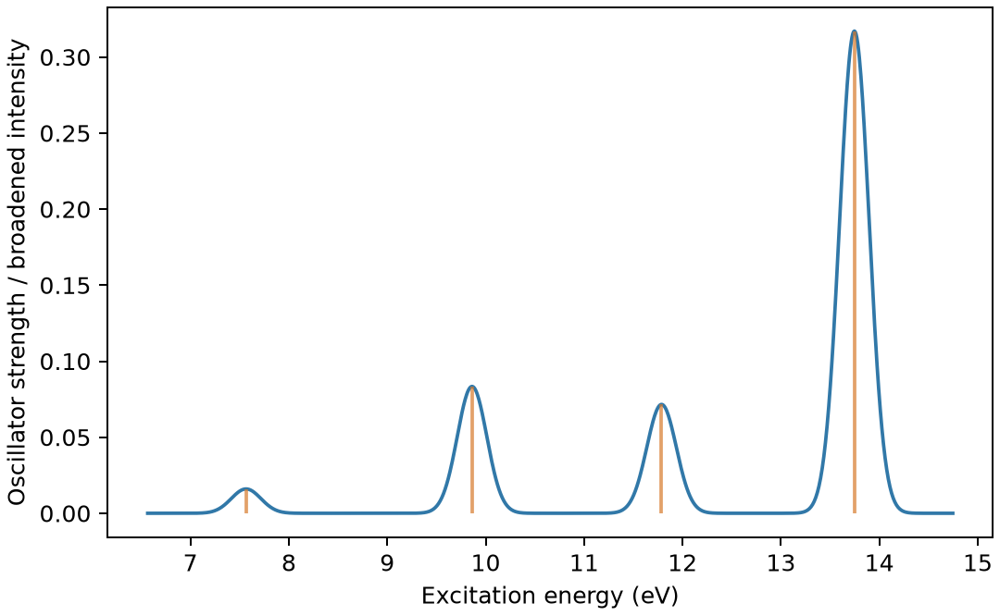

# ORCA电子激发与吸收谱

**适用环境：Linux + PBS 运行计算；Windows / macOS / Linux 可准备结构与分析结果。**

TDDFT 求解给定基态附近的电子激发；吸收谱还需要跃迁强度。把若干能级差直接画成吸收峰，通常不能替代这一响应计算。

## 模型与计算思路

用固定几何水分子演示五个单重激发。采用 PBE0/def2-SVP，`%tddft` 中设 `nroots 5`、`tda false`，明确使用完整 TDDFT。这个小体系便于学习数据链；缺少弥散函数和仅少量激发态的设置不用于定量描述水的完整吸收光谱。

## 准备输入与环境

[最小案例](../../examples/orca/minimal/tddft/)包含：

- [orca.inp](../../examples/orca/minimal/tddft/orca.inp)
- [structure.xyz](../../examples/orca/minimal/tddft/structure.xyz)
- [run.py](../../examples/orca/minimal/tddft/run.py)：组织计算步骤。
- [job.pbs](../../examples/orca/minimal/tddft/job.pbs)：单节点 PBS 作业。
- [postprocess.py](../../examples/orca/minimal/tddft/postprocess.py)：检查并提取结果。
- [requirements.txt](../../examples/orca/minimal/tddft/requirements.txt)：Python 分析依赖。

在集群加载 ORCA 及其匹配的 MPI 环境。`ORCA_EXEC` 可指定 ORCA 驱动的绝对路径；作业使用一个进程、`%maxcore 1000`，PBS 申请 2 GB 内存。ORCA 由驱动启动，不在外面加 `mpirun`；基组由程序安装提供。

在案例目录安装 Python 依赖并提交：

```bash
python3 -m pip install -r requirements.txt
qsub job.pbs
```

作业结束后会自动执行后处理。重新分析已有输出时，可单独运行 `python3 postprocess.py`。PBS 中的软件加载方式与资源语法按集群配置调整；此例不需要多节点。

## 参数怎样选

| 设置 | 选择依据 |
| --- | --- |
| `nroots` | 覆盖目标能区，不能仅按固定态数套用 |
| `tda false` | 使用完整响应；TDA 是另一种近似，应明确说明 |
| 泛函 | 电荷转移、Rydberg 与局域激发的误差不同 |
| 基组 | 弥散态需关注弥散函数与基组收敛 |
| 环境 | 溶剂和几何会影响激发能；垂直激发不等于发射 |

## 结果与检查

后处理读取 ORCA 6.1 的电偶极吸收表，保留 eV、nm 与无量纲振子强度。第一激发能约 7.5656 eV、振子强度约 0.0160；有的态振子强度为零，不能据此认为该电子态不存在。

ORCA 此任务末尾的 `FINAL SINGLE POINT ENERGY` 为所选第一激发态的总能；脚本另从 `E(SCF)` 保存基态能，避免将两者混淆。基态能与单点案例约 −76.27350518 Hartree 一致。



图由案例的 `postprocess.py` 从计算输出生成。

图中竖线为离散跃迁，曲线采用标准差 0.15 eV 的高斯显示展宽；该宽度不代表计算得到的寿命或实验线宽。Multiwfn 可进一步分析受支持的激发态数据和跃迁特征；只看峰位置不能判定态的空间性质。

进一步了解方法与文件规则，可看[ORCA 基础知识](ORCA基础知识.md)。参考：[ORCA TDDFT 手册](https://www.faccts.de/docs/orca/6.1/manual/contents/spectroscopyproperties/tddft.html)。
