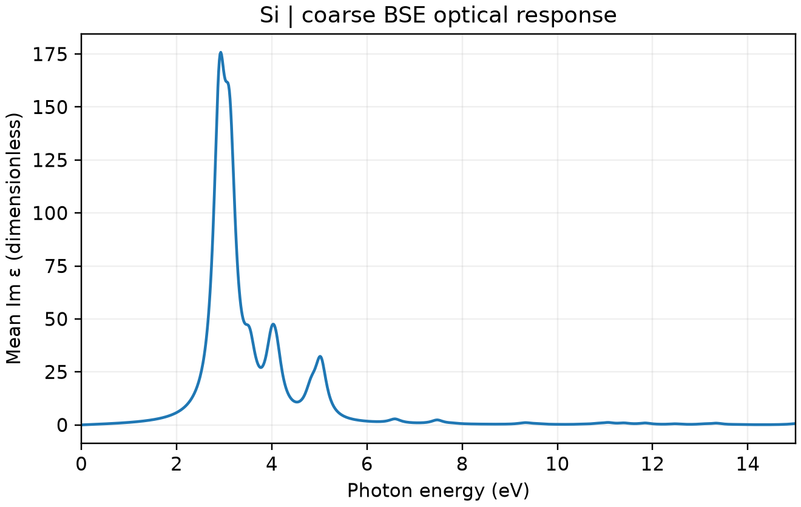

# VASP BSE 光学响应

**适用环境：Linux + PBS（支持 GW/BSE 的 VASP）；Windows / macOS / Linux 可绘图。**

独立粒子光学计算未显式包含电子—空穴吸引。Bethe–Salpeter 方程（BSE）在准粒子能级和屏蔽库仑作用基础上构造激发问题，适合进一步分析光学响应。

## 硅的完整计算链

[最小案例](../../examples/vasp/minimal/bse-optics/)包含 [POSCAR](../../examples/vasp/minimal/bse-optics/POSCAR)、[KPOINTS](../../examples/vasp/minimal/bse-optics/KPOINTS)，以及 [PBE](../../examples/vasp/minimal/bse-optics/INCAR.scf)、[空带对角化](../../examples/vasp/minimal/bse-optics/INCAR.exact)、[GW](../../examples/vasp/minimal/bse-optics/INCAR.gw)、[BSE](../../examples/vasp/minimal/bse-optics/INCAR.bse)输入。准备授权 `Si_GW` POTCAR 和 [依赖](../../examples/vasp/minimal/bse-optics/requirements.txt)，加载 VASP 后提交 [PBS 作业](../../examples/vasp/minimal/bse-optics/job.pbs)。

[run.py](../../examples/vasp/minimal/bse-optics/run.py)依次完成四阶段，并把 GW 的 `WAVECAR`、`WAVEDER`、完整筛选核 `WFULL*.tmp` 等文件传给 BSE。筛选核的响应基组必须一致：本例 GW 与 BSE 均使用 `ENCUTGW = 80`。

```text
ALGO = BSE
NBANDS = 24
NBANDSO = 4
NBANDSV = 4
ENCUTGW = 80
OMEGAMAX = 15
CSHIFT = 0.15
```

`NBANDSO`、`NBANDSV` 选择电子—空穴空间中的占据与空带，不等同于总能带数。`OMEGAMAX` 限制纳入的激发对能量范围；展宽 `CSHIFT` 影响图示峰形，需要结合网格与目标谱线测试。

[后处理](../../examples/vasp/minimal/bse-optics/postprocess.py)核对完整计算链、截断一致性、实际跃迁与介电谱，再调用 [plot.py](../../examples/vasp/minimal/bse-optics/plot.py)。已有输出可执行 `python3 postprocess.py`。

## 介电虚部



图为实际介电张量虚部的三个对角分量平均，反映吸收相关响应；它不是吸收系数，后者还需结合复介电函数求解。本例采用二原子硅、300 eV、`3×3×3` 网格和较小的空带/筛选基组，仅用于认识计算链，峰位和强度均不作定量材料结论。

在讨论激子束缚能前，应比较一致精度下的准粒子连续谱阈值和相应光学激发，区分明、暗态；不能将一个粗谱峰与任意带隙相减。分子、表面及低维体系还需特别处理完整筛选、真空和库仑相互作用收敛。

参考：[VASP 的 BSE 指南](https://vasp.at/wiki/BSE_calculations)。
