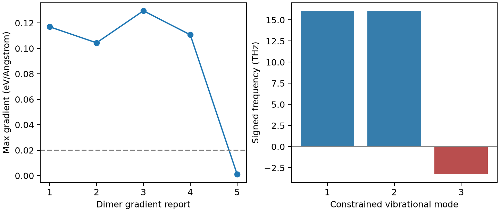

# VASP Dimer 鞍点搜索

**适用环境：Linux + PBS（VASP）；Windows / macOS / Linux 可绘图。**

Dimer 从接近过渡态的结构和一个试探方向出发，通过旋转寻找负曲率方向，再沿该方向爬坡、沿其他方向下坡。与 NEB 不同，它不需要完整的两端路径，但初始结构与方向仍会影响找到哪个鞍点。

## 从接近鞍点的结构开始

[最小案例](../../examples/vasp/minimal/dimer/)沿用 [NEB](NEB过渡态搜索.md)的七原子 Si 空位迁移模型：六个原子固定，仅迁移原子的三个方向自由。起点稍偏离 NEB 的中间构型。

[POSCAR](../../examples/vasp/minimal/dimer/POSCAR)在坐标后空一行，追加七行笛卡尔试探方向：迁移原子为 `1 1 1`，固定原子为零。方向会归一化，不是额外的位置或速度。

[INCAR](../../examples/vasp/minimal/dimer/INCAR)采用 VASP 原生改进 Dimer 方法：

```text
IBRION = 44
NSW = 60
EDIFFG = -0.02
FINDIFF = 2
DIMER_DIST = 0.01
```

本例使用原生 `IBRION=44`，无需 VTST 补丁。`FINDIFF=2` 用中心差分估计曲率，`DIMER_DIST` 单位为 Å。试探方向可根据反应几何设定，也可从试算的虚频本征矢获得。

## 提交与确认

准备授权 Si `POTCAR`，采用 [KPOINTS](../../examples/vasp/minimal/dimer/KPOINTS)，安装 [依赖](../../examples/vasp/minimal/dimer/requirements.txt)，加载 VASP 后提交 [PBS 文件](../../examples/vasp/minimal/dimer/job.pbs)：

```bash
qsub job.pbs
```

[run.py](../../examples/vasp/minimal/dimer/run.py)先执行 Dimer，再以最终结构和 [INCAR.frequency](../../examples/vasp/minimal/dimer/INCAR.frequency)做有限差分振动检查。[后处理](../../examples/vasp/minimal/dimer/postprocess.py)检查收敛、固定原子位移和虚频数，[plot.py](../../examples/vasp/minimal/dimer/plot.py)生成诊断图。



本例最终报告的最大梯度约 0.00102 eV/Å，最近一次曲率约 −1.2587 eV/Ų。三个自由度的频率约为 16.079、16.075 THz 和一个虚频 3.280 THz，支持它是受约束子空间中的一阶鞍点。

固定原子可承受较大的反作用力，所以不能用“所有原子的最大力”判断此例是否收敛。若放开更多原子，必须重新搜索并检查全部自由度；这个小模型不用于定量预测真实 Si 空位迁移势垒。正式分析还应沿虚频方向向两侧微扰并弛豫，确认连接到预期的两个极小值。

参考：[VASP 改进 Dimer 方法](https://vasp.at/wiki/Improved_dimer_method)。
