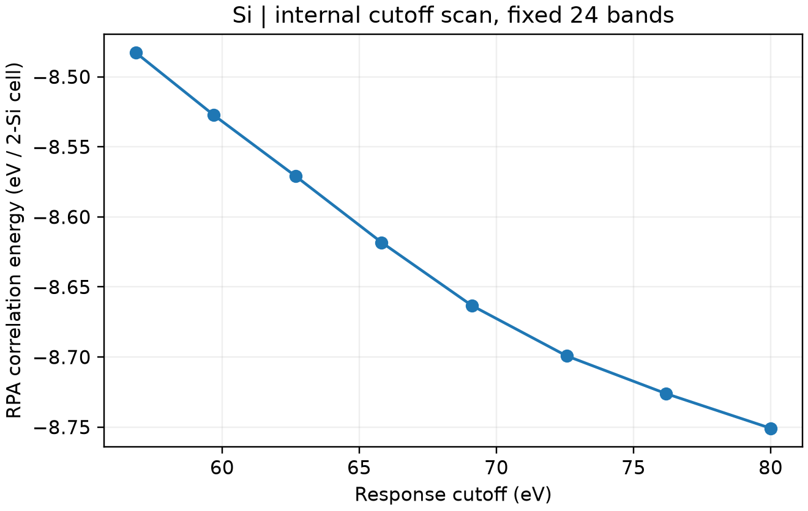

# VASP ACFDT-RPA 关联能

**适用环境：Linux + PBS（支持 ACFDT 的 VASP）；Windows / macOS / Linux 可绘图。**

ACFDT-RPA 总能可写成 `E_RPA = E_HF[PBE轨道] + Ec_RPA`。这里的第一项是使用 PBE 轨道非自洽求得的 Hartree–Fock 总能，包含动能、离子、Hartree 与交换等贡献；并非只取一个交换能项。

## 四阶段最小案例

[硅案例](../../examples/vasp/minimal/rpa-energy/)提供 [POSCAR](../../examples/vasp/minimal/rpa-energy/POSCAR)、[KPOINTS](../../examples/vasp/minimal/rpa-energy/KPOINTS)，以及 [PBE 自洽](../../examples/vasp/minimal/rpa-energy/INCAR.scf)、[空带对角化](../../examples/vasp/minimal/rpa-energy/INCAR.exact)、[非自洽 HF](../../examples/vasp/minimal/rpa-energy/INCAR.exx)、[ACFDT](../../examples/vasp/minimal/rpa-energy/INCAR.rpa)输入。

准备授权 `Si_GW` POTCAR，安装 [依赖](../../examples/vasp/minimal/rpa-energy/requirements.txt)，加载 VASP 后提交 [job.pbs](../../examples/vasp/minimal/rpa-energy/job.pbs)。[run.py](../../examples/vasp/minimal/rpa-energy/run.py)先获得收敛 PBE 轨道及 24 条能带，再分别求 HF 总能与 RPA 关联能。HF 阶段采用 `ALGO = Eigenval`、纯精确交换比例，并关闭半局域相关；不进行新的 HF 轨道自洽优化。

```text
ALGO = ACFDT
NBANDS = 24
ENCUTGW = 80
NOMEGA = 8
```

ACFDT 阶段沿虚频积分。`NOMEGA` 为积分网格参数，`ENCUTGW` 是响应截断；它们不能代替轨道基组、空带和 k 点收敛。[后处理](../../examples/vasp/minimal/rpa-energy/postprocess.py)分开读取两类能量，检查实际内部截断表，并保存相加后的演示总能及 [plot.py](../../examples/vasp/minimal/rpa-energy/plot.py)生成的图。

## 看清截断依赖



图使用一次计算输出的八个内部响应截断点，能量单位为 eV/两原子原胞。它显示在固定 24 条能带时关联能仍明显依赖截断；输出里的自动外推不能证明空带、轨道基组、频率或 k 点已收敛。

本例为 300 eV、`3×3×3` 网格的低成本流程示范。正式能量差应统一赝势、轨道参考和所有数值设置，并对空带与响应截断作联合检查；不要将 DFT 总能直接加上 RPA 关联能，也不要把不同方法的绝对总能差当作结合能。

参考：[VASP 的 ACFDT/RPA 指南](https://vasp.at/wiki/ACFDT/RPA_calculations)。
