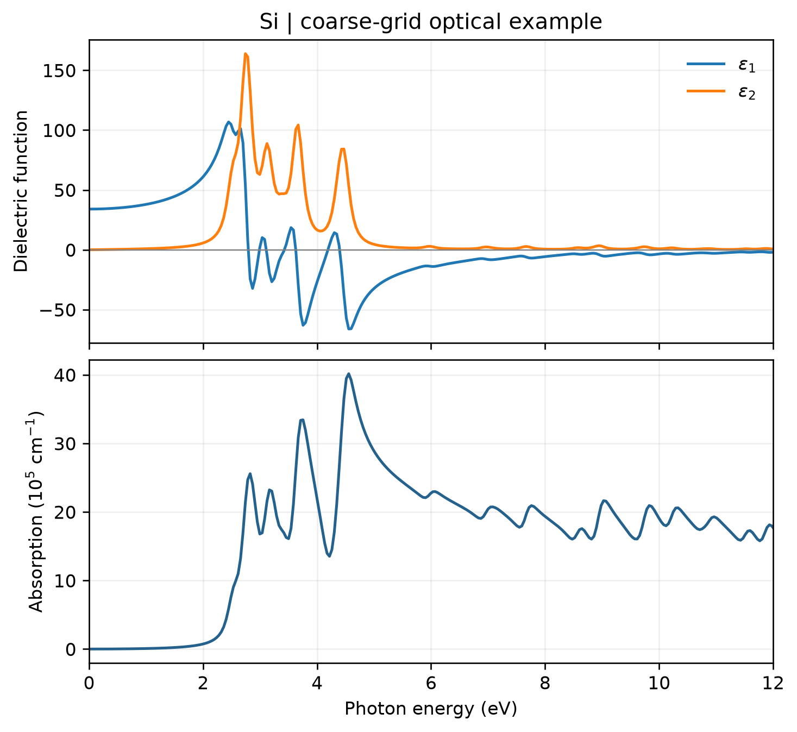

# VASP 光学性质计算

**适用环境：Linux（PBS 计算）；macOS / Linux（VASPKIT 后处理）；Windows（查看结果，运行可用 WSL）。**

贡献者：张烜广、王昌锐

`LOPTICS` 在电子基态计算之后得到随频率变化的介电函数，再用 VASPKIT 提取吸收系数、折射率等光学量。

## 计算与提取

[配套案例](../../examples/vasp/minimal/optical-properties/)采用硅的两原子原胞。准备授权 Si 势，在已收敛结构的静态计算中加入：

```text
LOPTICS = .TRUE.
NBANDS = 16
NEDOS = 401
CSHIFT = 0.1
```

`NBANDS` 控制包含的能带数，需有足够空带；`NEDOS` 控制频率网格，`CSHIFT` 为洛伦兹展宽参数，单位 eV。本例保留较小设置以演示流程；正式计算需同时检查 k 点、空带数、频率网格和展宽。[VASP 官方说明](https://vasp.at/wiki/index.php/LOPTICS)介绍了参数含义及独立粒子近似的范围。

加载 VASP、VASPKIT 和案例 `requirements.txt` 中的依赖后，提交：

```bash
qsub job.pbs
```

作业完成后，`analyze.py` 依照 `vaspkit.in` 调用 VASPKIT 的 `711`，选择 `1`（按能量输出），生成 `REAL.in`、`IMAG.in`、`ABSORPTION.dat` 等文件，再调用 `plot.py`。

已有 VASP 输出时可直接后处理：

```bash
python3 analyze.py
```

## 结果图



图由配套脚本读取 VASPKIT 实际输出生成，上图为介电函数实部和虚部，下图为吸收系数，均取三个对角分量的平均。该模型为立方硅，三个对角分量相同。

这里使用 `ENCUT = 350 eV`、`3 × 3 × 3` k 网格、16 条能带和 `0.1 eV` 洛伦兹展宽；粗网格导致明显尖峰，图用于理解输出和绘图流程，不能据此报告硅的定量光谱。比较实验时，还要考虑带隙误差、激子及电子声子效应；`LOPTICS` 的独立粒子结果不包含这些修正。

输入文件：[POSCAR](../../examples/vasp/minimal/optical-properties/POSCAR)、[INCAR](../../examples/vasp/minimal/optical-properties/INCAR)、[KPOINTS](../../examples/vasp/minimal/optical-properties/KPOINTS)；作业入口：[job.pbs](../../examples/vasp/minimal/optical-properties/job.pbs)；绘图脚本：[plot.py](../../examples/vasp/minimal/optical-properties/plot.py)。

延伸阅读：[知乎帖子1](https://www.zhihu.com/question/287951798)；[知乎帖子2](https://zhuanlan.zhihu.com/p/669635613)；[公众号文章](https://mp.weixin.qq.com/s/or3KbvwAv_h3B68AJAB1fA)。
