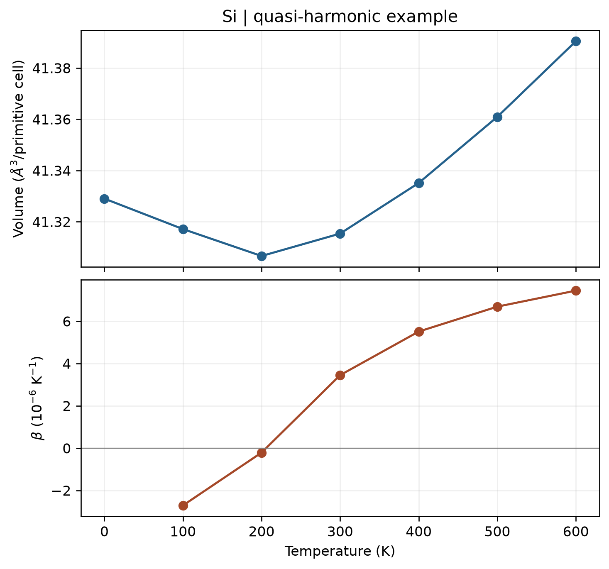

# VASP 准谐近似与热膨胀

**适用环境：Linux（PBS 计算）；macOS / Linux（Phonopy 后处理）；Windows（查看结果，运行可用 WSL）。**

贡献者：张烜广、王昌锐

单一体积的简谐声子可以得到 $C_V$，但不能直接给出热膨胀。准谐近似（QHA）在多个体积下计算声子，用频率随体积的变化描述热膨胀：

$$G(T,p)=\min_V\left[E_{\mathrm{static}}(V)+F_{\mathrm{vib}}(T,V)+pV\right].$$

这里各体积下仍采用简谐近似，振动自由能含零点能。因此 QHA 的 0 K 平衡体积也不必等于纯静态能量曲线的最低点。[Phonopy 官方说明](https://phonopy.github.io/phonopy/qha.html)介绍了拟合与归一化要求。

## 五体积最小案例

[配套目录](../../examples/vasp/minimal/quasi-harmonic/)采用两原子硅原胞，以 `0.96、0.98、1.00、1.02、1.04` 为体积比。晶格向量乘体积比的立方根，而不是直接乘体积比。每个体积扩成 `2 × 2 × 2` 的 16 原子超胞，计算一次静态能量和两组正负位移受力。

| 文件 | 用途 |
| --- | --- |
| [POSCAR](../../examples/vasp/minimal/quasi-harmonic/POSCAR) | 两原子参考原胞 |
| [INCAR](../../examples/vasp/minimal/quasi-harmonic/INCAR) | `ENCUT=450 eV`、`EDIFF=1E-8` 的静态受力设置 |
| [KPOINTS](../../examples/vasp/minimal/quasi-harmonic/KPOINTS) | 16 原子超胞的 Γ 中心 `2 × 2 × 2` 电子 k 网格 |
| [run.py](../../examples/vasp/minimal/quasi-harmonic/run.py) | 生成体积点、Phonopy 位移并计算 |
| [job.pbs](../../examples/vasp/minimal/quasi-harmonic/job.pbs) | PBS 作业入口 |
| [postprocess.py](../../examples/vasp/minimal/quasi-harmonic/postprocess.py) | 检查受力、建立力常数并调用 QHA |
| [plot.py](../../examples/vasp/minimal/quasi-harmonic/plot.py) | 绘制平衡体积和体膨胀系数 |

准备授权 Si 势，加载 VASP，并安装案例 `requirements.txt` 的依赖后，执行：

```bash
qsub job.pbs
```

脚本按顺序运行五个体积，不同时占用多组计算资源。已有全部输出时，可直接运行 `python3 postprocess.py`，无需再次计算 VASP。

## 自由能拟合与检查

本例通过 Phonopy 生成 `±0.01 Å` 位移，从 `vasprun.xml` 提取受力并对称化力常数。用 `8 × 8 × 8` 声子 q 网格积分，再调用 Phonopy 4.8.6 的 `phonopy.run_qha`，以 Birch–Murnaghan 状态方程拟合各温度的自由能。

注意电子 k 网格与声子 q 网格是两种采样。静态能量、位移受力的电子设置应一致；脚本将 16 原子超胞的静态能量除以 8，使其与声子自由能都对应两原子原胞。不能将每原子能量、超胞能量或不同精度的旧 E–V 曲线直接混合。

脚本检查所有计算的电子收敛、各体积的声子稳定性、拟合体积模量及平衡体积是否位于采样区间。若最低点接近或超出边界，应扩展体积范围；若有明显虚频，应先处理结构或数值精度，而不是直接取绝对值或删除虚频后继续拟合。

对有内部自由度的材料，每个固定体积应先弛豫内部坐标；本例金刚石硅的内部位置由对称性确定。强各向异性材料还需考虑晶胞形状变化，不能从等比例缩放自动得到各方向的热膨胀。

## 结果图



图由配套脚本读取实际 QHA 结果生成，体积按两原子原胞归一化。本例 300 K 的平衡体积约为 `41.3154 ų`，体膨胀系数约为 `3.45 × 10⁻⁶ K⁻¹`；低温段出现负膨胀，具体数值与温区仍需结合网格和超胞收敛判断。体膨胀系数为 $\beta=(1/V)(\partial V/\partial T)_p$；对于立方材料，线膨胀系数为 $\alpha=\beta/3$，两者不要混用。

温度积分计算到 700 K，为数值微分保留额外温度点，图示到 600 K；首个膨胀系数是程序的微分占位值，没有作为真实结果绘出。案例用于演示 QHA 工作流，研究结果还需收敛超胞、电子与声子网格、体积范围及温度步长。高温显式非谐性、相变及金属电子自由能的影响，也不能仅靠这一振动 QHA 模型描述。
