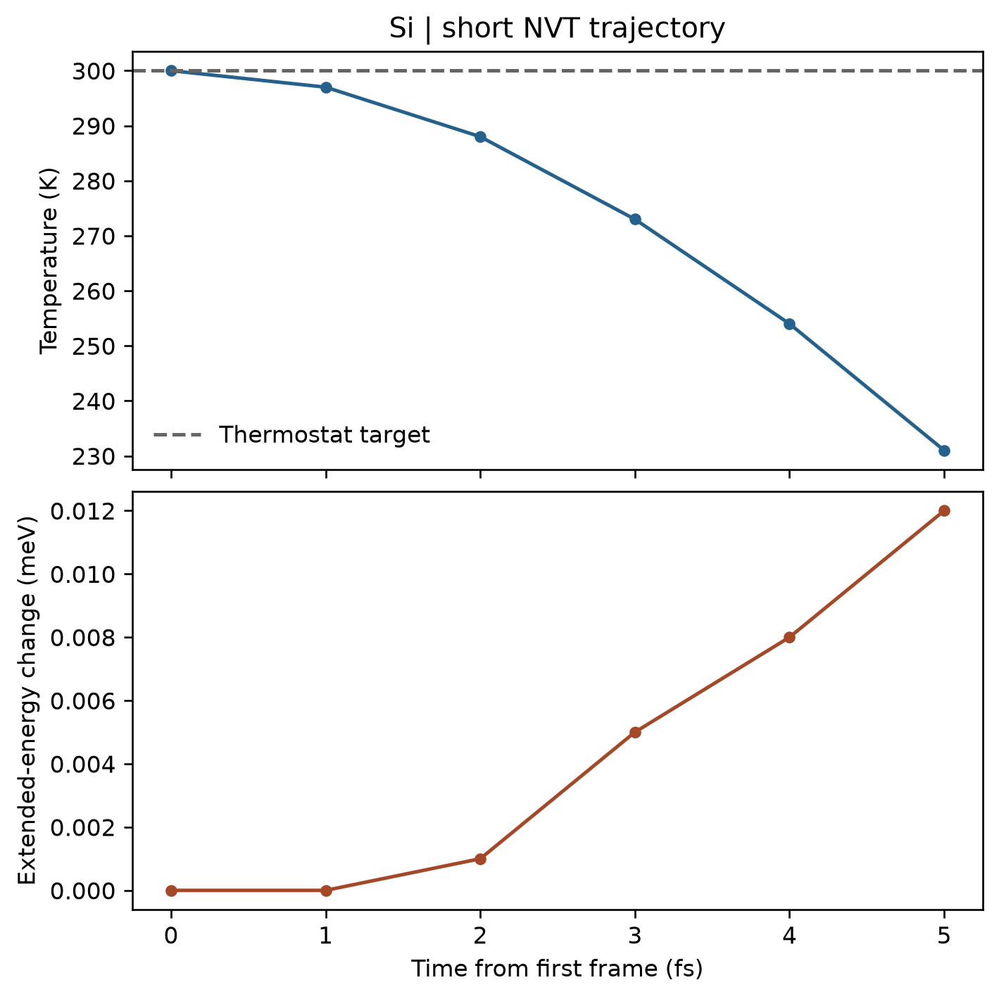

# VASP 第一性原理分子动力学

**适用环境：Windows、macOS、Linux（准备输入与分析）；Linux + PBS（VASP）。**

AIMD 在每个时间步求电子结构与原子受力，再推进原子运动。本例用两个硅原子、固定晶胞和短程 Nosé–Hoover NVT 轨迹，学习输入、提交和输出检查。

## 输入与 PBS 提交

案例提供 [POSCAR](../../examples/vasp/minimal/molecular-dynamics/POSCAR)、[INCAR](../../examples/vasp/minimal/molecular-dynamics/INCAR)、[KPOINTS](../../examples/vasp/minimal/molecular-dynamics/KPOINTS)、[POTCAR.spec](../../examples/vasp/minimal/molecular-dynamics/POTCAR.spec)、[job.pbs](../../examples/vasp/minimal/molecular-dynamics/job.pbs) 和 [postprocess.py](../../examples/vasp/minimal/molecular-dynamics/postprocess.py)。

准备授权 Si 势，加载 VASP、MPI、Python 与[绘图依赖](../../examples/vasp/minimal/molecular-dynamics/requirements.txt)，执行 `qsub job.pbs`。

```text
IBRION = 0
MDALGO = 2
SMASS = 0
POTIM = 1.0
NSW = 6
TEBEG = 300
TEEND = 300
ISYM = 0
```

`IBRION=0` 开启 MD，`POTIM` 此时是以 fs 为单位的时间步长。`MDALGO=2` 使用 Nosé–Hoover 热浴，`SMASS` 控制其质量相关设置，不能仅凭设定温度就认定轨迹已平衡；参数定义见 [MDALGO](https://vasp.at/wiki/MDALGO) 和 [SMASS](https://vasp.at/wiki/SMASS)。

本例只有 6 帧，用于检查程序与后处理，不足以估算平衡温度、扩散系数或材料热稳定性。正式 AIMD 应选择足够大的超胞，先平衡再采样，并通过短程测试选择时间步长和电子精度。

## 查看轨迹与能量

`XDATCAR` 保存位置轨迹，可用 VMD 等工具检查运动和周期边界；`OSZICAR` 包含每步温度、能量与动能。后处理检查电子收敛和设定步数，再由 [plot.py](../../examples/vasp/minimal/molecular-dynamics/plot.py) 绘图。



本例使用 350 eV 截断能、3×3×3 k 网格和 1 fs 帧间隔。横轴以第一帧为时间原点；目标温度虚线不表示每一帧都应等于 300 K，尤其是这种自由度很少的小模型。

Nosé–Hoover 情况下，`OSZICAR` 的 `E` 包含离子动能和热浴能量项；它与电子自由能 `F`、零展宽外推能 `E0` 含义不同，见 [OSZICAR 手册](https://vasp.at/wiki/OSZICAR)。图中第二幅画的是这一扩展体系能量相对第一帧的变化，不能误称为势能曲线或单凭它证明长时间步积分准确。

已有结果时可运行 `python3 postprocess.py` 检查并重画，`python3 plot.py` 则只重画。续算应保留包含速度等信息的重启结构，并检查续算是否衔接，而不是无意中重新赋予初始速度。
