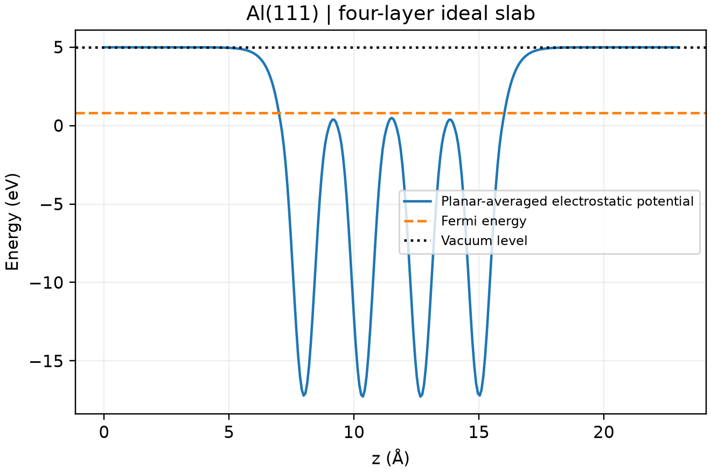

# VASP 功函数计算

**适用环境：Linux + PBS（VASP）；Windows / macOS / Linux 可绘图。**

金属表面功函数为 `Φ = Evac − EF`。真空能级必须从远离表面的平坦势区取得，并与同一次计算的费米能使用相同参考。

## Al(111) 小薄膜

[最小案例](../../examples/vasp/minimal/work-function/)使用四层理想 Al(111)、总计约 16 Å 真空，提供 [POSCAR](../../examples/vasp/minimal/work-function/POSCAR)、[INCAR](../../examples/vasp/minimal/work-function/INCAR)、[KPOINTS](../../examples/vasp/minimal/work-function/KPOINTS)和 [PBS 脚本](../../examples/vasp/minimal/work-function/job.pbs)。

```text
LVHAR = .TRUE.
LVACPOTAV = .TRUE.
IDIPOL = 3
LDIPOL = .TRUE.
DIPOL = 0.5 0.5 0.5
```

`LVHAR` 输出离子与 Hartree 静电势，避免真空区交换相关势带来的不便；`LVACPOTAV` 是较新 VASP 的原生真空势平均功能。本例在 VASP 6.5.1 上使用。z 方向为表面法向，偶极参考位于晶胞中心。

准备授权 Al `POTCAR`，安装 [依赖](../../examples/vasp/minimal/work-function/requirements.txt)，加载 VASP 后执行 `qsub job.pbs`。[后处理](../../examples/vasp/minimal/work-function/postprocess.py)用 ASE 读取 `LOCPOT`，沿面内方向平均，在两端各 2 Å 区间检查平台并取均值；同时与 VASP 原生真空势核对，再由 [plot.py](../../examples/vasp/minimal/work-function/plot.py)绘图。

## 检查真空平台



本例 450 eV、`7×7×1` 网格下，两侧平台约 4.9848 eV，费米能约 0.81005 eV，功函数约 4.1748 eV。两侧相同符合对称薄膜的预期；非对称吸附表面则可能有不同功函数，不应强制要求两侧一致。

四层未弛豫薄膜仅演示提取过程。正式结果需测试层数、真空、面内 k 点及表面弛豫。半导体还需考虑费米能位置、掺杂和带弯曲，不机械套用金属薄膜的解释。

VASPKIT `426` 也可提取平面平均势；输出文件名随版本可能为 `POTPAVG.dat` 或 `PLANAR_AVERAGE.dat`。使用前确认输出有完整的有限数值网格，再按所选真空平台取参考，不能仅凭程序退出码判断提取成功。

参考：[VASP 功函数指南](https://vasp.at/wiki/Computing_the_Workfunction)、[LVACPOTAV](https://vasp.at/wiki/LVACPOTAV)。
