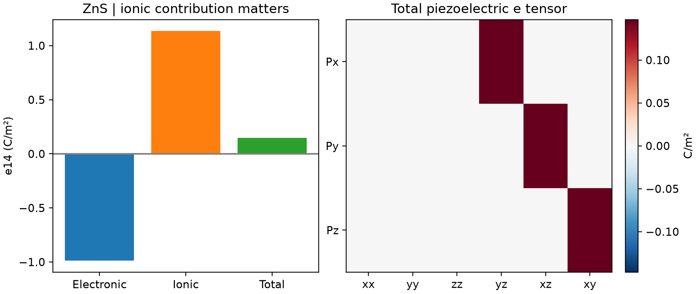

# ZnS 压电张量

**适用环境：Linux + PBS（VASP）；Windows / macOS / Linux 可绘图。**

压电张量描述应变引起的极化变化。以非中心对称的闪锌矿 ZnS 为例，分别计算电子响应和离子弛豫贡献，再相加得到总响应。

## DFPT 输入

[最小案例](../../examples/vasp/minimal/piezoelectric-response/)采用晶格常数 5.41 Å 的两原子 [POSCAR](../../examples/vasp/minimal/piezoelectric-response/POSCAR)、450 eV 的 [INCAR](../../examples/vasp/minimal/piezoelectric-response/INCAR)与 `3×3×3` [KPOINTS](../../examples/vasp/minimal/piezoelectric-response/KPOINTS)。关键设置为：

```text
IBRION = 8
NSW = 1
ISIF = 3
LEPSILON = .TRUE.
```

准备按 Zn、S 顺序拼接的授权 `POTCAR`，安装 [依赖](../../examples/vasp/minimal/piezoelectric-response/requirements.txt)，加载 VASP 后执行 `qsub job.pbs`（[作业文件](../../examples/vasp/minimal/piezoelectric-response/job.pbs)）。DFPT 应检查基态 SCF 和各独立线性响应的收敛，不能把所有响应迭代数相加后与单次 `NELM` 比较。

## 张量顺序与单位

[后处理](../../examples/vasp/minimal/piezoelectric-response/postprocess.py)读取 `OUTCAR` 中以 C/m² 为单位的电子、离子压电表；将 VASP 的 `xx yy zz xy yz zx` 重排为常见 Voigt 顺序 `xx yy zz yz xz xy`，并由 [plot.py](../../examples/vasp/minimal/piezoelectric-response/plot.py)绘图。



在本例取向下，$e_{14}=e_{25}=e_{36}$：电子项约 −0.98827、离子项 +1.13549，总和 +0.14722 C/m²。其余分量接近零，符合该结构的对称性。两项有明显抵消，需要分别检查收敛；交换子晶格或改变坐标取向也可能改变分量符号。

这里得到应力型压电系数 $e$。应变型系数 $d$ 需结合弹性柔量张量计算，不能直接把 C/m² 换成 pm/V。正式计算应先优化结构，再收敛 k 点、截断能和响应参数；本例粗网格数值用于理解流程。

参考：[LEPSILON](https://vasp.at/wiki/LEPSILON)、[DFPT 电场响应](https://vasp.at/wiki/Electric_field_response_from_density-functional-perturbation_theory)。
