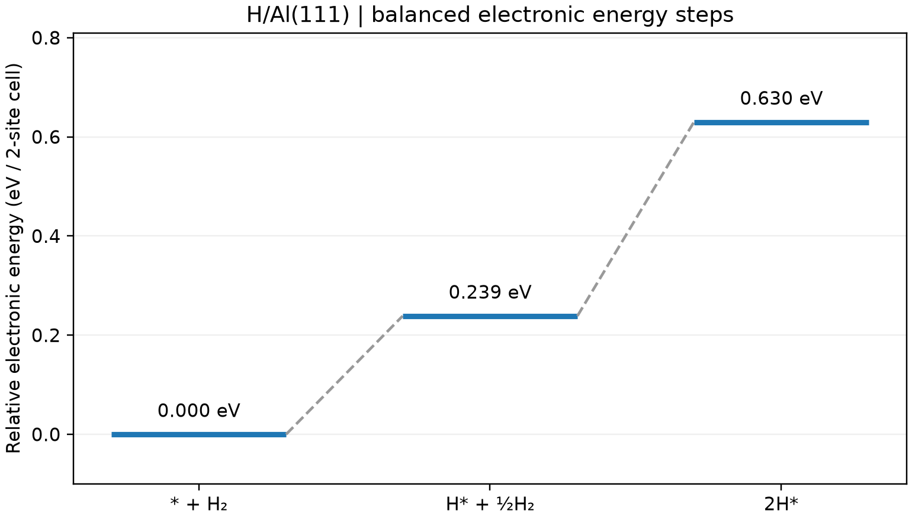

# 吸附反应能台阶图

**适用环境：Linux + PBS（VASP）；Windows / macOS / Linux 可绘图。**

台阶图将各中间态放在统一能量参考下，适合解释逐步吸附或反应的热力学变化。连接线只表示步骤顺序，不提供过渡态势垒。

## 统一参考态

采用[吸附能笔记](VASP吸附能计算.md)的 H/Al(111) 模型，依次比较 `洁净表面 + H₂`、`H* + ½H₂`、`2H*`。星号表示吸附态，三个状态的 H 总数相同。相对能为

$$\Delta E_n=E(\mathrm{slab}+n\mathrm H)-E(\mathrm{slab})-\frac n2E(\mathrm H_2).$$

## 计算与绘图

[最小案例](../../examples/vasp/minimal/energy-diagram/)提供 [吸附态 INCAR](../../examples/vasp/minimal/energy-diagram/INCAR.ads)、[洁净表面 INCAR](../../examples/vasp/minimal/energy-diagram/INCAR.clean)、[H₂ INCAR](../../examples/vasp/minimal/energy-diagram/INCAR.h2)、[结构](../../examples/vasp/minimal/energy-diagram/POSCAR.half)、[k 网格](../../examples/vasp/minimal/energy-diagram/KPOINTS.slab)和 [PBS 作业](../../examples/vasp/minimal/energy-diagram/job.pbs)。按吸附能笔记准备授权势与 Python 依赖后，执行 `qsub job.pbs`。

若已经完成相同输入的吸附能案例，可在本例目录复用输出：

```bash
python3 run.py --reuse ../adsorption-energy
```

[后处理](../../examples/vasp/minimal/energy-diagram/postprocess.py)会核对输入一致性与各态收敛，再由 [plot.py](../../examples/vasp/minimal/energy-diagram/plot.py)生成台阶图。



三个台阶为 0、0.2387、0.6299 eV，单位为每个含两表面位点的晶胞；两步增量约 0.2387、0.3912 eV。这与“每 H 吸附能”的归一化不同。

图中是电子能差。若研究温度、压力或电极电位效应，应按具体体系加入零点能、熵和其他自由能修正，再绘制自由能台阶图。动力学势垒需另做 NEB 等过渡态计算。
