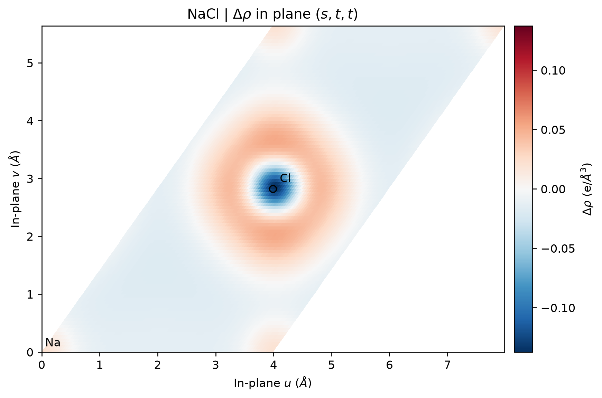

# VASP 差分电荷密度

**适用环境：Linux（PBS 计算）；macOS / Linux（Multiwfn 后处理）；Windows / macOS / Linux（VESTA 查看）。**

贡献者：胡京京、王昌锐

差分电荷密度比较整体与指定参考片段的电子密度：

$$\Delta\rho(\mathbf r)=\rho_{AB}(\mathbf r)-\rho_A(\mathbf r)-\rho_B(\mathbf r).$$

正值表示相对该参考的电子积累，负值表示耗尽。先定义片段、电荷和自旋态，再解释图像；它不是与参考无关的“成键电荷”，也不能直接给出原子转移电子数。

## 准备三个计算

[最小案例](../../examples/vasp/minimal/charge-density-difference/)采用 NaCl 两原子原胞，晶格常数 5.64 Å，参考为同一晶胞内分别保留 Na、Cl 的中性周期子晶格。整体和两片段均不优化原子位置。

| 文件 | 用途 |
| --- | --- |
| [POSCAR](../../examples/vasp/minimal/charge-density-difference/POSCAR) | 整体结构 |
| [POSCAR.na](../../examples/vasp/minimal/charge-density-difference/POSCAR.na)、[POSCAR.cl](../../examples/vasp/minimal/charge-density-difference/POSCAR.cl) | 只删除另一元素，保留晶胞和原子位置 |
| [INCAR](../../examples/vasp/minimal/charge-density-difference/INCAR) | 三组共用的静态参数与 `96³` 细 FFT 网格 |
| [KPOINTS](../../examples/vasp/minimal/charge-density-difference/KPOINTS) | 三组共用 Γ 中心 `5 × 5 × 5` 网格 |
| [run.py](../../examples/vasp/minimal/charge-density-difference/run.py)、[job.pbs](../../examples/vasp/minimal/charge-density-difference/job.pbs) | 准备子目录并提交计算 |

本例使用 `Na_pv`、`Cl` 势，价电子数分别为 7、7。参考片段采用非自旋极化的周期计算，允许部分占据；它们不是孤立 Na、Cl 原子的基态参考。分子、界面和磁性体系应按研究问题选择片段及自旋，不要直接照搬这一参考态。

三组计算必须具有相同晶胞、坐标原点、网格点数、截断能、交换关联泛函及一致的元素势。只删除原子，不重新弛豫片段；仅设置相同 `ENCUT` 不保证 FFT 网格相同，因此这里显式指定 `NGXF=NGYF=NGZF=96`。

准备按 `POTCAR.spec` 排列的授权 POTCAR，加载 VASP、Multiwfn 和 `requirements.txt` 中的 Python 依赖后，执行：

```bash
qsub job.pbs
```

作业建立 `combined`、`na`、`cl` 三个目录，计算后调用后处理。已有三组输出时直接运行 `python3 postprocess.py`，无需重算。

## 用 Multiwfn 相减

[postprocess.py](../../examples/vasp/minimal/charge-density-difference/postprocess.py)先检查晶胞、位置和网格，再依照 [multiwfn.in](../../examples/vasp/minimal/charge-density-difference/multiwfn.in) 调用 Multiwfn。手动操作为：

1. 打开 `combined/CHGCAR`，选择 `y`，将 VASP 存储的密度乘体积转换成实际密度。
2. 进入 `13`（网格处理）→ `11`（网格运算）→ `4`（减去另一网格），输入 `na/CHGCAR`，仍选择 `y` 转换密度。
3. 再次执行 `11` → `4`，减去 `cl/CHGCAR`，同样选择 `y`。
4. 选择 `0` 导出 `cdd.cub`，再返回退出。

上述交互输入针对本例非自旋极化 CHGCAR。含自旋密度的文件会增加选择提示，使用时应相应调整。也可用 VASPKIT 的差分密度功能或在 VESTA 中查看导出的 Cube；相减前的一致性要求不变。

## 结果图与检查



图由 [plot.py](../../examples/vasp/minimal/charge-density-difference/plot.py)读取 Multiwfn 的实际结果生成：分数坐标为 $(s,t,t)$ 的切面包含 Na 和 Cl，保留晶格夹角，直接取 `96³` 网格点而不插值。红色为电子积累，蓝色为耗尽，单位为 $e/\text{Å}^3$。局部颜色反映密度重排，不能只看原子中心的一种颜色就判断整个原子的得失电子。

本例整体与两片段积分分别约为 `14 e`、`7 e`、`7 e`，差分积分接近零。脚本还交叉核对 Cube 与原始 CHGCAR 的差值及单位；三维差分密度范围约为 `−0.1374～0.0527 e/ų`。计算采用 `ENCUT=450 eV`，结果用于演示流程和参考态选择，研究应用还需检查数值参数收敛。

若要报告原子净电荷，可结合 [Bader 分析](VASPBader电荷分析.md)；若要显示电子局域程度，参见 [ELF](VASP电子局域函数.md)。这三类图和数值回答的问题不同。
