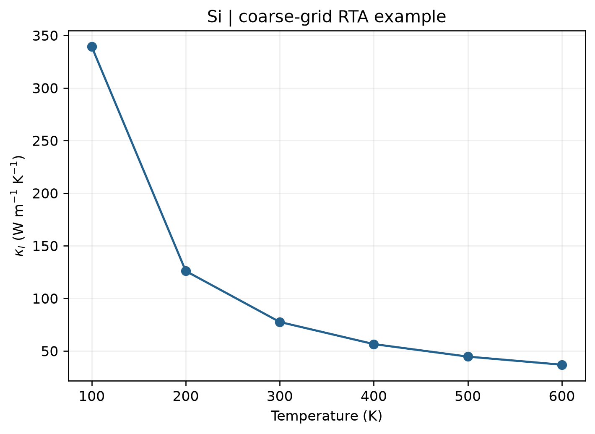

# VASP 晶格热导率计算

**适用环境：Linux（PBS 计算）；macOS / Linux（phono3py 后处理）；Windows（查看结果，运行可用 WSL）。**

贡献者：张烜广、王昌锐

晶格热导率描述声子携带热量的能力。简谐二阶力常数给出声子频率和群速度；计算三声子散射还需三阶力常数，不能只凭声子谱或热容得到热导率。本例用 VASP 计算位移受力，再由 phono3py 求解单模弛豫时间近似（RTA）下的晶格热导率。

## 输入与提交

[最小案例](../../examples/vasp/minimal/lattice-thermal-conductivity/)采用金刚石硅的两原子原胞，扩为 `2 × 2 × 2` 的 16 原子超胞。phono3py 利用对称性生成位移，并采用 `3 Å` 的成对位移距离截断，共需 19 个受力任务。二阶力常数所需位移可从其中复用。

| 文件 | 用途 |
| --- | --- |
| [POSCAR](../../examples/vasp/minimal/lattice-thermal-conductivity/POSCAR) | 两原子参考结构 |
| [INCAR](../../examples/vasp/minimal/lattice-thermal-conductivity/INCAR) | `ENCUT=450 eV`、`EDIFF=1E-8` 的静态受力设置 |
| [KPOINTS](../../examples/vasp/minimal/lattice-thermal-conductivity/KPOINTS) | 16 原子超胞的 Γ 中心 `2 × 2 × 2` 电子 k 网格 |
| [run.py](../../examples/vasp/minimal/lattice-thermal-conductivity/run.py) | 生成位移、顺序计算受力 |
| [job.pbs](../../examples/vasp/minimal/lattice-thermal-conductivity/job.pbs) | PBS 作业入口 |
| [postprocess.py](../../examples/vasp/minimal/lattice-thermal-conductivity/postprocess.py) | 提取受力、建立力常数并计算热导率 |
| [plot.py](../../examples/vasp/minimal/lattice-thermal-conductivity/plot.py) | 绘制热导率随温度的变化 |

准备授权 Si 势，加载 VASP 并安装案例的 Python 依赖后，运行：

```bash
qsub job.pbs
```

计算量大于单点或简谐声子例子，先确认提交资源和时间足够。修改结构后，应重新生成与该结构对应的位移数据，不能沿用旧 `phono3py_disp.yaml`。

## 受力与输运后处理

[phono3py 官方 VASP 流程](https://phonopy.github.io/phono3py/vasp.html)介绍了位移生成、受力收集与输运计算。案例通过其 Python 接口完成相同步骤：

1. 生成幅度 `0.03 Å` 的对称性位移，保存位移顺序。
2. 检查各组电子收敛，并按对应顺序读取 `vasprun.xml` 中的受力。
3. 消除小的整体数值受力漂移，建立并对称化二阶、三阶力常数。
4. 检查声子稳定性，再在 `5 × 5 × 5` q 网格上计算 100～600 K 的 RTA 热导率。

三阶位移对的距离截断减少任务量，也引入额外近似；研究计算应增大截断并复核。不要把截断参数误当作材料固有的相互作用范围。这里采用 `0.2 THz` 的高斯展宽处理散射能量守恒条件，超胞大小、q 网格和展宽都需要收敛测试。

已有全部受力输出时，可直接执行 `python3 postprocess.py`。脚本保存 `thermal-conductivity-results.json`，同时让 phono3py 写出输运数据文件，便于进一步分析。

## 结果图与解释



图由配套脚本读取实际计算结果生成，显示热导张量三个对角元的平均，单位为 W/(m·K)。本例 300 K 的三个对角元均约为 `77.51 W/(m·K)`。立方硅的三个对角元应一致；脚本也检查有限值、纵向分量正值及对称性。

本例只包含三声子散射，未加入同位素、边界、缺陷及四声子散射，且超胞、截断与积分网格较小，用于演示完整流程，不作为硅热导率的定量推荐。若出现明显虚频，应先处理结构和数值精度，而不是将频率取绝对值后继续计算。

另一条常用路线是用 thirdorder 与 ShengBTE 处理三阶力常数和输运。不同工具的文件格式、原子映射、单位及求解近似需逐项对应，不能仅改文件名互用。历史入门视频：[B 站教程](https://www.bilibili.com/video/BV1wo4y1U772?t=30.4)。

电子部分另见[电子输运与电子热导率](VASP电子输运与电子热导率.md)；总热导率中晶格与电子贡献应分别说明。
