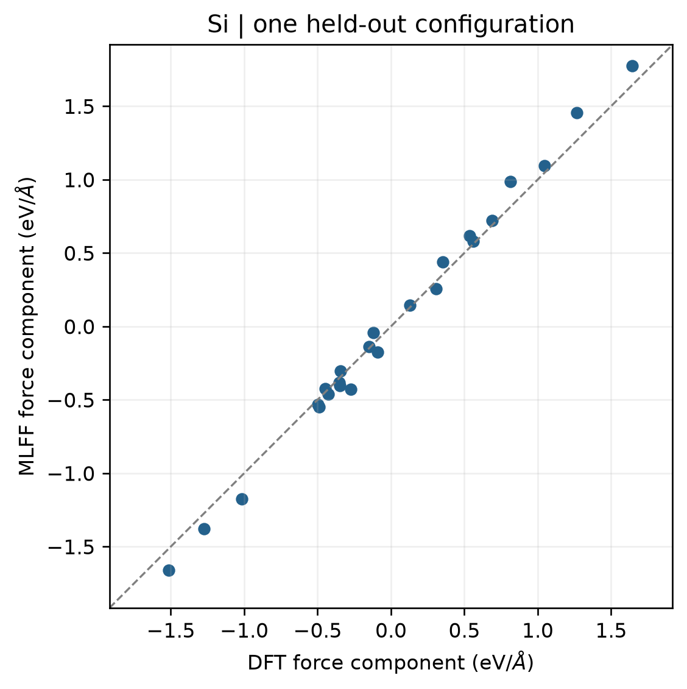

# VASP 机器学习力场

**适用环境：Linux（PBS 计算）；macOS / Linux（支持 MLFF 的 VASP 本机运行）；Windows（准备输入与查看结果）。**

VASP MLFF 可在 MD 中按误差估计调用 DFT、积累参考数据并更新力场。先验证训练与预测流程，再讨论加速和适用范围；程序正常结束不一定意味着已经生成模型。

## 最小训练与独立对照

[案例](../../examples/vasp/minimal/machine-learning-force-field/)使用带小扰动的八原子硅晶胞，进行 12 步、步长 1 fs 的 300 K NVT 训练，再重拟合模型，对另一小扰动构型做一次纯 MLFF 预测和一次 DFT 对照。

| 文件 | 用途 |
| --- | --- |
| [POSCAR](../../examples/vasp/minimal/machine-learning-force-field/POSCAR) | 八原子训练初态 |
| [POSCAR.test](../../examples/vasp/minimal/machine-learning-force-field/POSCAR.test) | 未进入训练轨迹的对照构型 |
| [INCAR.train](../../examples/vasp/minimal/machine-learning-force-field/INCAR.train) | 在线训练，固定随机种子 |
| [INCAR.refit](../../examples/vasp/minimal/machine-learning-force-field/INCAR.refit) | 基于训练数据库重拟合 |
| [INCAR.run](../../examples/vasp/minimal/machine-learning-force-field/INCAR.run) | 只用力场做静态预测 |
| [INCAR.reference](../../examples/vasp/minimal/machine-learning-force-field/INCAR.reference) | 独立构型的 DFT 参考 |
| [KPOINTS](../../examples/vasp/minimal/machine-learning-force-field/KPOINTS) | 电子计算共用 `2 × 2 × 2` 网格 |
| [run.py](../../examples/vasp/minimal/machine-learning-force-field/run.py)、[job.pbs](../../examples/vasp/minimal/machine-learning-force-field/job.pbs) | 分阶段运行及 PBS 入口 |
| [postprocess.py](../../examples/vasp/minimal/machine-learning-force-field/postprocess.py)、[plot.py](../../examples/vasp/minimal/machine-learning-force-field/plot.py) | 状态检查与独立对照图 |

准备授权 Si 势并加载 VASP 与 Python 依赖后，执行 `qsub job.pbs`。已有四阶段输出时，可单独运行后处理。

## 三种模式与文件传递

本例采用 VASP 6.5.1。`ML_MODE` 从 6.4 开始可用，较早版本的 `ML_ISTART` 设置不应与新模式混写。三阶段分别为：

1. `ML_LMLFF=.TRUE.`、`ML_MODE=train`：启动在线学习。固定晶胞 MD 仍需 `ISIF=2` 计算应力，不能沿用普通 MD 的默认 `ISIF=0`。
2. 将训练生成的 `ML_ABN` 复制为重拟合目录的 `ML_AB`，以 `ML_MODE=refit` 生成用于快速求值的 `ML_FFN`。
3. 将该 `ML_FFN` 复制为预测目录的 `ML_FF`，使用 `ML_MODE=run`。这一模式不调用 DFT，也不继续学习。

续训则将已有数据库作为 `ML_AB`，继续使用 `ML_MODE=train`。具体默认设置和文件含义见[官方 ML_MODE 说明](https://vasp.at/wiki/index.php/ML_MODE)。

## 检查训练是否发生

查看 `ML_LOGFILE` 的 `STATUS`、`ERR` 和消息行，并确认 `ML_ABN`、`ML_FFN` 实际生成。`ERR` 是训练数据上的误差，不是独立测试误差。

小体系的局域环境过少或过于相似时，稀疏化后可能达不到最低参考环境数，日志会显示跳过训练。此时即使 MD 完成也不能当作模型训练成功；应改善采样与环境多样性，而不是只为了生成文件降低要求。

本例的短轨迹每步仍调用了 DFT，用于展示训练机制，不能据此宣称已经获得 MD 加速。纯预测阶段另检查日志，确认没有 DFT 调用。

## 独立构型结果

图由实际预测与 DFT 对照生成，每个点是一项笛卡尔力分量。固定随机种子的示例得到能量差约 `0.594 meV/atom`、力分量 RMSE 约 `0.094 eV/Å`。这里仅有一个独立构型，说明了如何检查误差，不能据此判断模型已具备研究所需的泛化精度。

扩大应用前，应覆盖目标温度、体积、缺陷和化学环境，并按独立轨迹或结构族划分测试数据。混合 MLFF/DFT 轨迹不能不加区分地当作纯 DFT 标签导出；训练数据库与力场预测数据应明确区分。
