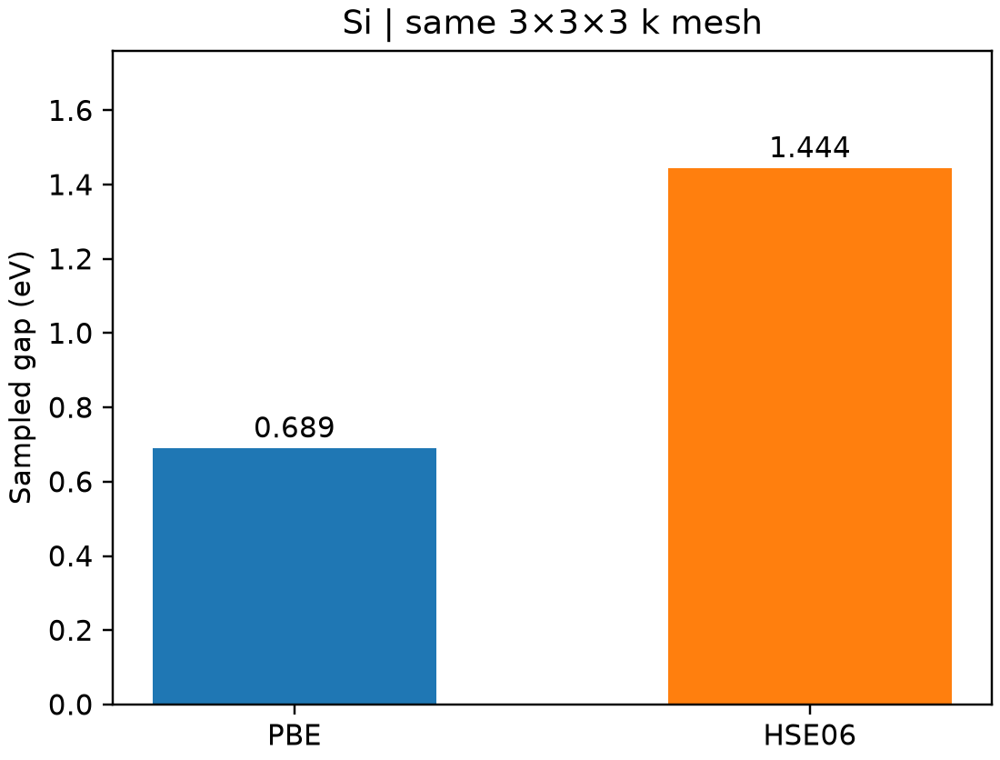

# VASP 杂化泛函 HSE06

**适用环境：Linux + PBS（支持杂化泛函的 VASP）；Windows / macOS / Linux 可绘图。**

HSE06 在 PBE 基础上混入短程精确交换，常用于检查半局域泛函给出的带隙和电子态。它需要计算非局域交换，不能直接沿用普通 PBE 的非自洽能带流程。

## 同网格比较 PBE 与 HSE06

[硅最小案例](../../examples/vasp/minimal/hybrid-hse06/)提供 [POSCAR](../../examples/vasp/minimal/hybrid-hse06/POSCAR)、[KPOINTS](../../examples/vasp/minimal/hybrid-hse06/KPOINTS)、[PBE 参数](../../examples/vasp/minimal/hybrid-hse06/INCAR.pbe)与 [HSE06 参数](../../examples/vasp/minimal/hybrid-hse06/INCAR.hse06)。采用两原子原胞、450 eV 和 `3×3×3` 网格。HSE06 的定义包含：

```text
LHFCALC = .TRUE.
GGA = PE
AEXX = 0.25
HFSCREEN = 0.2
```

`HFSCREEN` 的单位为 Å⁻¹。任意改动交换比例或屏蔽参数后，就不再是标准 HSE06。本例采用阻尼轨道优化 `ALGO = Damped`，`TIME = 0.4` 是优化参数，不是物理时间步长。

准备授权 PBE Si `POTCAR`，安装 [依赖](../../examples/vasp/minimal/hybrid-hse06/requirements.txt)，加载 VASP 后提交 [PBS 作业](../../examples/vasp/minimal/hybrid-hse06/job.pbs)：

```bash
qsub job.pbs
```

[run.py](../../examples/vasp/minimal/hybrid-hse06/run.py)先完成 PBE，再以其波函数初始化 HSE06，随后重新自洽优化。两阶段均检查电子收敛；[后处理](../../examples/vasp/minimal/hybrid-hse06/postprocess.py)核对实际交换参数和相同 k 点上的占据、未占据本征值。[plot.py](../../examples/vasp/minimal/hybrid-hse06/plot.py)生成对照图。

## 结果的范围



本例 PBE、HSE06 的采样网格带隙分别为 0.6890、1.4436 eV。这里只在同一粗网格上寻找价带顶与导带底，可能漏过真正带边，不能把数值直接当作收敛的间接带隙或实验光学带隙。

绘制 HSE06 路径能带时，需采用适合杂化泛函的自洽/零权重路径或其他受支持方案，而非把 `ICHARG = 11` 的 PBE 输入机械替换为 HSE06。缺陷、磁性及金属体系还需另外测试初态和收敛算法。比较结构或反应能时，始终在同一泛函下保持一致精度。

参考：[VASP 杂化泛函列表](https://vasp.at/wiki/index.php/List_of_hybrid_functionals)、[官方杂化泛函教程](https://vasp.at/tutorials/latest/hybrids/part1/)。
