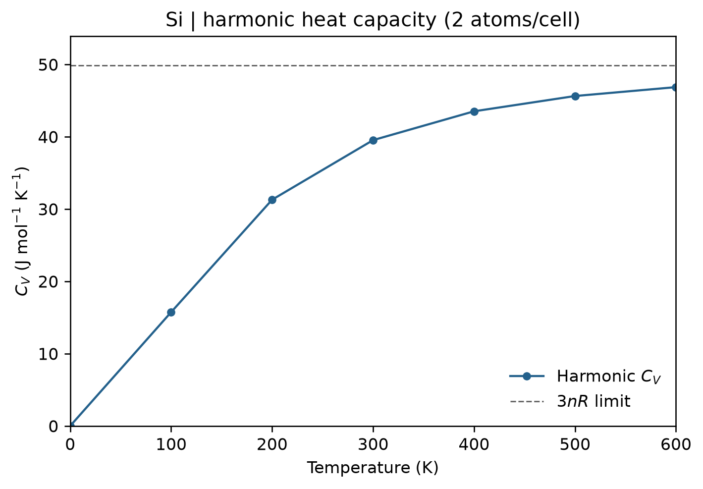

# VASP 与 Phonopy 简谐热容

**适用环境：Windows、macOS、Linux（查看输入与绘图）；Linux + PBS（VASP、Phonopy 或频率计算）。**

贡献者：张烜广、王昌锐

Phonopy 根据声子频率计算固定体积下的振动自由能、熵和定容热容 $C_V$。这些热力学量来自整个布里渊区的声子积分，仅有 Γ 点频率通常不够。

## 准备案例

[热容案例目录](../../examples/vasp/minimal/heat-capacity/)包含 [POSCAR](../../examples/vasp/minimal/heat-capacity/POSCAR)、[INCAR](../../examples/vasp/minimal/heat-capacity/INCAR)、[KPOINTS](../../examples/vasp/minimal/heat-capacity/KPOINTS)、[thermal.conf](../../examples/vasp/minimal/heat-capacity/thermal.conf)、[job.pbs](../../examples/vasp/minimal/heat-capacity/job.pbs) 和[后处理入口](../../examples/vasp/minimal/heat-capacity/postprocess.py)。

授权 Si POTCAR 与计算环境准备好后，执行 `qsub job.pbs`。工作流与[声子谱案例](VASP声子谱计算.md)使用相同的两份 16 原子位移计算；若已完成声子谱案例，可以直接复用其力常数和 `thermal_properties.yaml`，无需再算一次 VASP。

本例的积分设置为：

```text
MESH = 8 8 8
TPROP = .TRUE.
TMIN = 0
TMAX = 600
TSTEP = 100
```

温度单位为 K。已有力常数及位移数据时，在结果目录运行 `phonopy --config thermal.conf` 即可重新调整温度或积分网格。

## 单位和结果检查

`thermal_properties.yaml` 表头会写出单位和 `natom`。本例热容单位为 J/(K·mol)，对应的是**每摩尔含两个 Si 原子的原胞**；若要换成每摩尔 Si 原子，应除以 2。振动自由能常用 kJ/mol，不能直接与 eV 单位的 VASP 总能相加。

检查低温 $C_V$ 是否趋近零，高温是否接近 $3nR$，其中 $n$ 是输出归一化原胞中的原子数。本例 $n=2$，高温极限约为 49.89 J/(K·mol 原胞)，而不是每摩尔 Si 原子的热容值。

简谐结果给出固定体积的振动贡献，不自动包含电子热容、热膨胀或强非谐效应，也不能直接作为实验定压热容 $C_P$。正式结果需收敛超胞与 q 网格，并确认没有影响积分的虚频；热膨胀需另做多个体积下的准简谐计算。

## 结果图

后处理会调用 [plot.py](../../examples/vasp/minimal/heat-capacity/plot.py) 绘图。已有提取数据时，在结果目录单独执行 `python3 plot.py` 即可重画，无需重算 VASP；绘图依赖见 [requirements.txt](../../examples/vasp/minimal/heat-capacity/requirements.txt)。



硅的简谐定容热容；8×8×8 q 网格，按每摩尔两原子原胞归一化，虚线为 6R。
