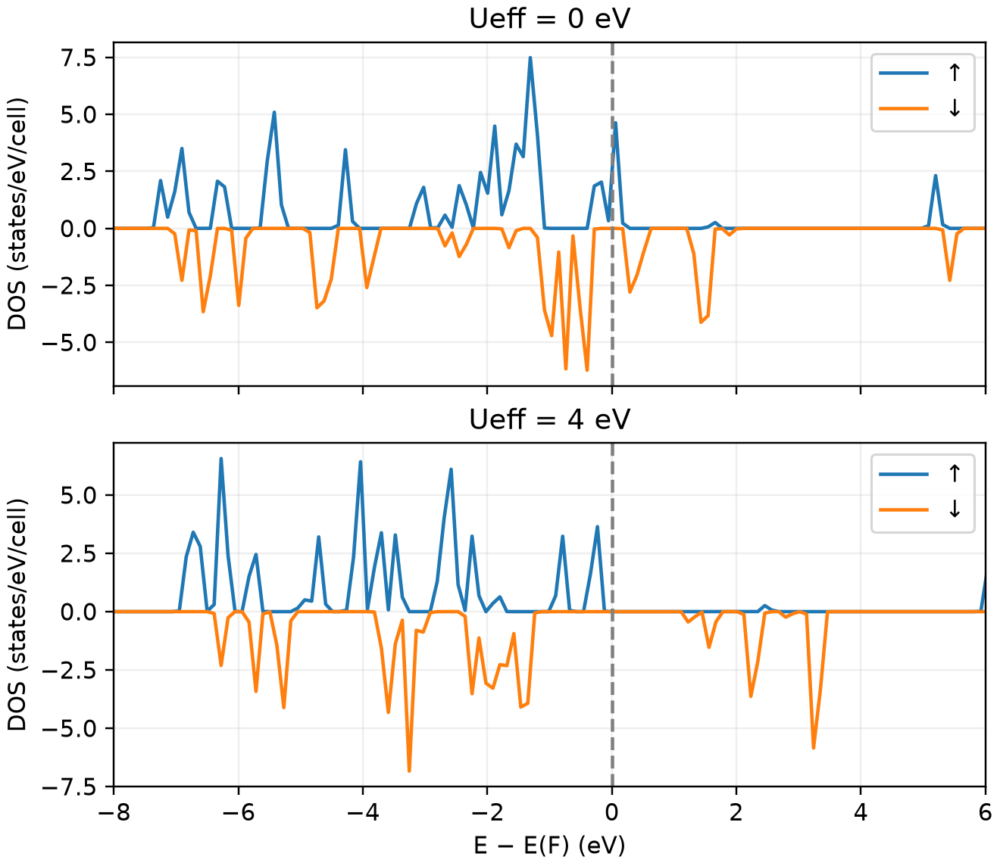

# VASP 的 DFT+U 计算

**适用环境：Linux + PBS（VASP、VASPKIT）；Windows / macOS / Linux 可绘图。**

DFT+U 对选定原子的局域轨道子空间施加修正，常用于过渡金属 d 态或稀土 f 态。U 值依赖体系、泛函、PAW 投影及确定方法，不能把某个材料的参数普遍移用。

## NiO 的参数对照

[最小案例](../../examples/vasp/minimal/dft-plus-u/)比较两原子岩盐 NiO 中 `Ueff = 0` 与 `4 eV` 的自旋态密度。为减少计算量，此处采用铁磁小胞演示参数作用；NiO 的反铁磁基态需要相应磁超胞与磁态比较。

输入：[POSCAR](../../examples/vasp/minimal/dft-plus-u/POSCAR)、[KPOINTS](../../examples/vasp/minimal/dft-plus-u/KPOINTS)、[U 为零](../../examples/vasp/minimal/dft-plus-u/INCAR.u0)、[U 为 4 eV](../../examples/vasp/minimal/dft-plus-u/INCAR.u4)。Ni、O 的顺序对应：

```text
ISPIN = 2
MAGMOM = 2 0
LDAU = .TRUE.
LDAUTYPE = 2
LDAUL = 2 -1
LDAUU = 4 0
LDAUJ = 0 0
LMAXMIX = 4
```

`LDAUTYPE = 2` 使用 Dudarev 形式，主要参数为 `Ueff = U − J`。`LDAUL = 2` 选择 Ni 的 d 子空间，`-1` 不对 O 施加修正。`LMAXMIX = 4` 保留 d 态相关的一中心密度分量，对后续电荷密度重启与非自洽分析也很重要。

准备按 Ni、O 顺序拼接的授权 `POTCAR`，安装 [依赖](../../examples/vasp/minimal/dft-plus-u/requirements.txt)，加载 VASP、VASPKIT 后提交 [PBS 作业](../../examples/vasp/minimal/dft-plus-u/job.pbs)：

```bash
qsub job.pbs
```

[run.py](../../examples/vasp/minimal/dft-plus-u/run.py)分别自洽计算两组输入；[后处理](../../examples/vasp/minimal/dft-plus-u/postprocess.py)检查实际 U、J、轨道选择与收敛，并调用 VASPKIT `111` 提取 `TDOS.dat`，最后由 [plot.py](../../examples/vasp/minimal/dft-plus-u/plot.py)绘图。已有输出可单独运行 `python3 postprocess.py`。

## 如何比较



图采用 450 eV、`3×3×3` 网格与 0.05 eV 展宽，各自以费米能对齐，下自旋镜像显示。它演示 U 对电子谱的影响，不用于确定 NiO 的基态或最优 U。磁态、局域占据及初始条件可能产生不同自洽解，应作比较与检查。

不同 U 对应不同能量泛函，不将两组总能直接相减作为结构稳定性结论。研究能带时，保留一致的 U、J、磁态及合适的 `LMAXMIX`。

参考：[LDAUTYPE](https://vasp.at/wiki/LDAUTYPE)、[LDAUL](https://vasp.at/wiki/LDAUL)。
