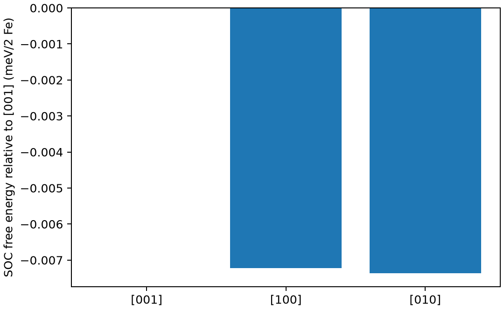

# VASP磁各向异性能

**适用环境：Linux + PBS 运行计算；Windows / macOS / Linux 可准备输入与分析结果。**

磁各向异性能通常是含 SOC 的不同磁化方向之间的微小能量差。它比普通磁序比较更容易受 k 点、展宽和电子数值误差影响。

## 方法与物理量

在固定结构和相同计算方案下，可定义 ΔE=E[100]−E[001]，并注明使用总能/自由能、每胞/每原子还是体积能量密度。正负号的物理解释取决于此定义。

自洽方向计算与磁力定理的非自洽比较是两种方案。后者通常从共同的标量相对论电荷出发，再计算不同 SOC 方向的带能响应；不能把各自独立的默认输出不加说明地称为同一种方法。

## 最小模型与输入

使用轻微四方畸变 Fe 双原子胞（a=b=2.86 Å、c=3.10 Å），分别做沿 z、x、y 的自洽 SOC 单点。ENCUT=350 eV、3×3×3 网格、Gaussian 展宽 0.05 eV，采用较粗设置控制演示成本。

[案例目录](../../examples/vasp/minimal/magnetic-anisotropy/)包含以下科学输入：

[INCAR.x](../../examples/vasp/minimal/magnetic-anisotropy/INCAR.x)、[INCAR.y](../../examples/vasp/minimal/magnetic-anisotropy/INCAR.y)、[INCAR.z](../../examples/vasp/minimal/magnetic-anisotropy/INCAR.z)、[KPOINTS](../../examples/vasp/minimal/magnetic-anisotropy/KPOINTS)、[POSCAR](../../examples/vasp/minimal/magnetic-anisotropy/POSCAR)、[POTCAR.spec](../../examples/vasp/minimal/magnetic-anisotropy/POTCAR.spec)、[stages.json](../../examples/vasp/minimal/magnetic-anisotropy/stages.json)。

结构写在坐标文件或各输入的原子/晶胞段；`stages.json` 列出计算阶段。配套 [run.py](../../examples/vasp/minimal/magnetic-anisotropy/run.py) 顺序组织任务，[job.pbs](../../examples/vasp/minimal/magnetic-anisotropy/job.pbs) 提交作业，[postprocess.py](../../examples/vasp/minimal/magnetic-anisotropy/postprocess.py) 检查结果并绘图。

## 参数与提交

从授权安装中按 `POTCAR.spec` 准备 `POTCAR`，元素顺序与 POSCAR 一致。`VASP_EXEC` 指定程序；磁各向异性使用 `vasp_ncl`，Berry 相示例使用 `vasp_std`。数据文件不随案例分发。

| 设置 | 关键含义 |
| --- | --- |
| `vasp_ncl`、`LSORBIT` | 使用支持 SOC 的自旋器程序 |
| `MAGMOM = 0 0 3 0 0 3` | 在自旋器基底中给两个原子初始矩 |
| `SAXIS` | z/x/y 三个量子化轴，不能仅改 MAGMOM 而忽略坐标约定 |
| `ISYM=-1` | 本例统一关闭对称性 |
| `EDIFF=1e-8` | 仅电子迭代阈值，不能代替 k 点收敛 |

所有方向都从独立初猜自洽，未采用固定电荷的磁力定理流程。

在干净案例目录安装[Python 依赖](../../examples/vasp/minimal/magnetic-anisotropy/requirements.txt)并提交：

```bash
python3 -m pip install -r requirements.txt
qsub job.pbs
```

PBS 中的资源语法和软件加载方式按集群调整。计算结束后自动执行后处理；若只分析已保存的结果，运行 `python3 postprocess.py`。各阶段独立保存输出，便于定位失败步骤。

## 结果与判断

后处理核对正常结束与 SOC 标志，并比较相同定义的有限展宽自由能。当前设置下 x、y 比 z 分别低约 0.00722、0.00737 meV/双原子胞；两等价面内方向之差约 0.00015 meV。

这些能差只有几微电子伏，当前粗网格不足以据此确定真实易轴或材料磁各向异性常数。图用于检查方向、单位和对称一致性，而非展示已收敛的 Fe 常数。PAW 球内投影磁矩之和也不等于包含间隙区的全部磁矩。



图由案例后处理脚本读取实际计算输出生成。

## 扩展到实际研究

固定同一势、网格、空带、占据和电子态，逐级收敛 k 点、截断及展宽，并检查最终磁化方向。精度要求高时比较自洽与共同电荷的力定理流程，明确是否需要约束。使用 VASPKIT 辅助准备结构后，仍须自行确认方向和能量归一化。

参考：[VASP 磁各向异性](https://vasp.at/wiki/Determining_the_Magnetic_Anisotropy)。
