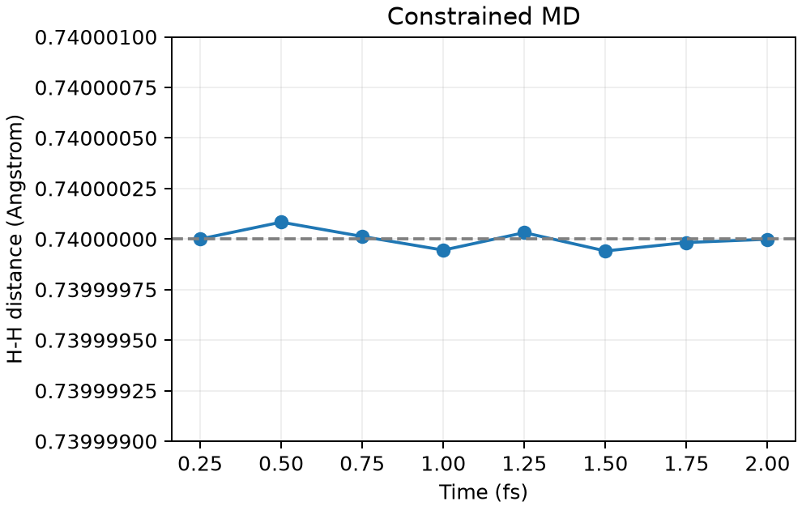

# VASP 约束分子动力学

**适用环境：Linux + PBS（VASP）；Windows / macOS / Linux 可绘图。**

约束 MD 允许体系运动，同时保持指定键长、角度或其他集体变量。它与把原子完全固定不同：约束一个键长后，分子仍可转动。

## H₂ 的固定键长短轨迹

[最小案例](../../examples/vasp/minimal/constrained-md/)采用 8 Å 盒中的 [H₂](../../examples/vasp/minimal/constrained-md/POSCAR)，使用 [Γ 点](../../examples/vasp/minimal/constrained-md/KPOINTS)。[ICONST](../../examples/vasp/minimal/constrained-md/ICONST)只有一行：

```text
R 1 2 0
```

`R` 为原子间距离，`1 2` 是 POSCAR 中的原子序号，末尾 `0` 表示将距离约束到初始值 0.74 Å。[INCAR](../../examples/vasp/minimal/constrained-md/INCAR)使用 `IBRION=0`、`MDALGO=1`、Andersen 温控，100 K、0.25 fs 步长和 8 步短轨迹。`SHAKETOL=1E-8` 控制约束校正精度，`RANDOM_SEED` 固定初始随机序列。

准备授权 H `POTCAR`，安装 [依赖](../../examples/vasp/minimal/constrained-md/requirements.txt)，加载带相应高级 MD 功能的 VASP 后提交 [PBS 作业](../../examples/vasp/minimal/constrained-md/job.pbs)：

```bash
qsub job.pbs
```

## 检查约束是否生效

[后处理](../../examples/vasp/minimal/constrained-md/postprocess.py)核对每一步电子收敛、`REPORT` 中的 SHAKE 收敛记录，并从 `XDATCAR` 直接计算距离；[plot.py](../../examples/vasp/minimal/constrained-md/plot.py)绘图。



8 步均完成 SHAKE，保存轨迹中的最大键长偏差约 8×10⁻⁸ Å；该偏差也包含文本坐标截断误差。H₂ 去掉整体平移并加一个距离约束后只有两个活跃自由度，瞬时温度会有明显涨落，不能用如此短轨迹判断温控采样是否充分。

实际体系需先平衡，再检查步长、约束精度和统计长度。若要用约束平均力求自由能，还需多个反应坐标窗口、正确的约束力估计及相应几何修正；固定一个键长本身不等于完成自由能计算。

参考：[VASP 约束 MD](https://vasp.at/wiki/Constrained_molecular_dynamics)、[ICONST](https://vasp.at/wiki/ICONST)。
