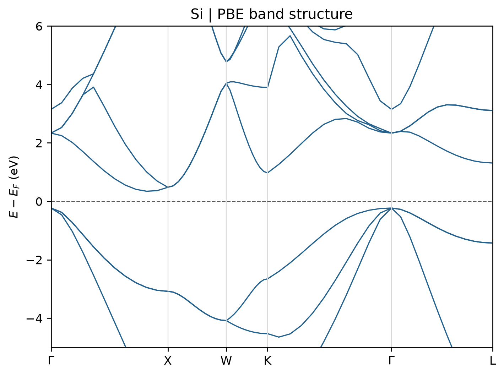

# VASP 能带计算

**适用环境：Windows、macOS、Linux（准备输入与绘图）；Linux + PBS（VASP、VASPKIT）。**

常规 PBE 能带通常分两步：先在均匀 k 网格上得到自洽电荷密度，再固定这份电荷密度计算高对称路径上的本征值。以下使用两个原子的硅原胞。

## 文件与计算顺序

案例目录为 [band-structure](../../examples/vasp/minimal/band-structure/)，主要文件如下：

| 文件 | 用途 |
| --- | --- |
| [POSCAR](../../examples/vasp/minimal/band-structure/POSCAR) | 硅原胞；k 路径与这一晶胞基矢配套 |
| [INCAR.scf](../../examples/vasp/minimal/band-structure/INCAR.scf)、[KPOINTS.scf](../../examples/vasp/minimal/band-structure/KPOINTS.scf) | 均匀网格 SCF，保存 CHGCAR |
| [INCAR.band](../../examples/vasp/minimal/band-structure/INCAR.band)、[KPOINTS.band](../../examples/vasp/minimal/band-structure/KPOINTS.band) | `ICHARG=11`，在固定电荷下求能带 |
| [POTCAR.spec](../../examples/vasp/minimal/band-structure/POTCAR.spec) | 授权势的元素顺序 |
| [run.py](../../examples/vasp/minimal/band-structure/run.py)、[job.pbs](../../examples/vasp/minimal/band-structure/job.pbs) | 依次运行两个阶段 |
| [postprocess.py](../../examples/vasp/minimal/band-structure/postprocess.py)、[vaspkit.in](../../examples/vasp/minimal/band-structure/vaspkit.in) | 调用 VASPKIT 导出能带 |

按 `POTCAR.spec` 准备 Si 的授权 `POTCAR`，放在案例根目录。加载 VASP、MPI、VASPKIT 环境后提交：

```bash
qsub job.pbs
```

脚本建立 `scf/` 与 `band/`，第一步使用 $7\times7\times7$ Γ 中心网格，随后将 `CHGCAR` 复制到第二步。两个阶段必须使用相同结构、势、泛函和截断能。路径计算的总能量不用于与均匀网格的自洽总能比较。

## k 路径怎么准备

本例已提供与硅原胞匹配的 Γ–X–W–K–Γ–L 路径。一般三维材料可用 VASPKIT `303` 生成标准原胞和路径，二维材料用对应的二维功能。若生成器改变了晶胞基矢，应使用其配套原胞重新计算 SCF，不能只把新路径放到原来的常规胞中。

`KPOINTS.band` 第二行控制每段采样点数，增加采样点会使曲线更平滑，但不能补足第一步自洽网格的精度。高对称路径也不保证包含整个布里渊区的带边极值。

## 提取与判断

第二步结束后由 VASPKIT `211` 写出 `BAND.dat`、`KLABELS` 等文件。后处理入口从第一步 `DOSCAR` 读取费米能，写入 `FERMI_ENERGY.in`，使曲线采用自洽网格的能量参考。该文件随新计算更新，避免沿用旧费米能；VASPKIT 的默认置零规则见[官方说明](https://vaspkit.com/tutorials.html#usage-faqs)。

绘图时按 `KLABELS` 设置横轴标签，观察价带顶、导带底的位置。对比 DOS 和投影能带有助于判断带边成分。本例的路径呈现间接带隙特征；PBE 本征值带隙不能直接替代实验光学带隙或准粒子带隙。

## 结果图

后处理会调用 [plot.py](../../examples/vasp/minimal/band-structure/plot.py) 绘图。已有提取数据时，在结果目录单独执行 `python3 plot.py` 即可重画，无需重算 VASP；绘图依赖见 [requirements.txt](../../examples/vasp/minimal/band-structure/requirements.txt)。



硅原胞 PBE 能带；SCF 使用 7×7×7 k 网格，路径每段 12 点，能量参考取自 SCF。
