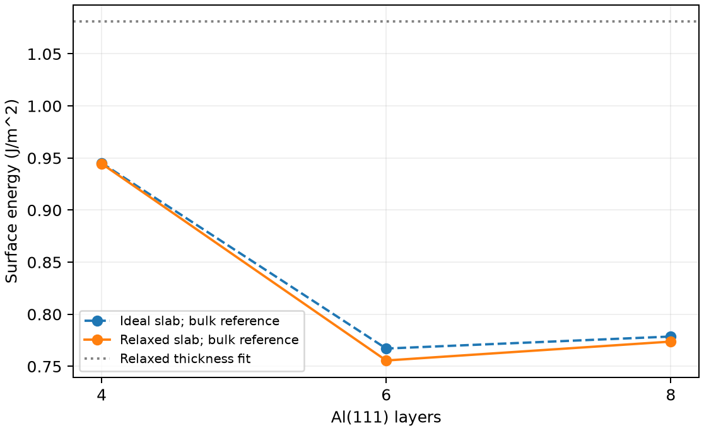

# VASP 表面能与薄膜厚度

**适用环境：Linux + PBS（VASP）；Windows / macOS / Linux 可绘图。**

对两侧等价、化学计量与体相一致的薄膜，单个表面的能量为

$$\gamma_N=\frac{E_\mathrm{slab}(N)-N e_\mathrm{bulk}}{2A}.$$

$N$ 是原子数，$A$ 是一侧表面积。分母中的 2 来自两个等价表面；非对称终止面只能从总能得到两面贡献之和，不能直接把同一公式的结果解释为某一面的独立表面能。

## Al(111) 的三个厚度

[最小案例](../../examples/vasp/minimal/surface-energy/)提供 [体相](../../examples/vasp/minimal/surface-energy/POSCAR.bulk)与 [4 层](../../examples/vasp/minimal/surface-energy/POSCAR.slab4)、[6 层](../../examples/vasp/minimal/surface-energy/POSCAR.slab6)、[8 层](../../examples/vasp/minimal/surface-energy/POSCAR.slab8)薄膜。每层一个 Al，两侧各约 8 Å 真空；面内晶格固定，中央两层固定，其余原子仅沿表面法向弛豫。

使用相同的授权 Al 势、450 eV 截断和能量定义。输入为 [INCAR.bulk](../../examples/vasp/minimal/surface-energy/INCAR.bulk)、[INCAR.slab](../../examples/vasp/minimal/surface-energy/INCAR.slab)，以及 [体相 k 网格](../../examples/vasp/minimal/surface-energy/KPOINTS.bulk)、[薄膜 k 网格](../../examples/vasp/minimal/surface-energy/KPOINTS.slab)。

加载 VASP、安装 [依赖](../../examples/vasp/minimal/surface-energy/requirements.txt)，在干净目录提交 [PBS 作业](../../examples/vasp/minimal/surface-energy/job.pbs)：

```bash
qsub job.pbs
```

[run.py](../../examples/vasp/minimal/surface-energy/run.py)依次计算体相和三个薄膜。[后处理](../../examples/vasp/minimal/surface-energy/postprocess.py)核对逐步 SCF、自由层受力、固定层位移和两表面的镜面对称，统一用 `e_0_energy` 计算。$1\ \mathrm{eV/Å^2}=16.02176634\ \mathrm{J/m^2}$。

## 厚度收敛比单个数值更重要

[plot.py](../../examples/vasp/minimal/surface-energy/plot.py)同时显示理想薄膜和弛豫后的表面能。



本例面积为 7.10249 Ų，体相参照能约 −3.75337 eV/原子。4、6、8 层弛豫表面能依次约为 0.9446、0.7556、0.7738 J/m²；弛豫降低了各薄膜的能量，但厚度依赖仍然存在。

另一种检查是拟合 $E_\mathrm{slab}(N)\simeq N e_\mathrm{fit}+2A\gamma_\mathrm{fit}$。这三个点给出约 1.0809 J/m²，与直接参照法尚不一致，最大总能拟合残差约 0.0612 eV，说明当前厚度范围不足以支持可靠的渐近线性拟合。该拟合结果不能作为“更准确表面能”直接采用。

正式计算应增加厚度点并检查金属薄膜的量子尺寸振荡，同时收敛真空、展宽和 k 网格。体相与薄膜应使用一致的面内晶格与相近的倒空间采样精度；微小的体相每原子参照误差会随 $N$ 放大，造成表面能随厚度漂移。更厚薄膜还需检查固定层数与表层弛豫深度。

VASPKIT 可辅助构建不同取向薄膜，VESTA 可检查层数、约束与表面是否等价。表面能、吸附能和功函数是不同量，应分别定义参考态与单位。

参考：单斌、陈征征、陈蓉《计算材料学》配套仓库[第四章 4.12 表面能](https://github.com/stanfordbshan/CompMatBook/tree/main/edition-1-2023/Chapter04)。本例用重新生成的 Al(111) 小模型演示。
