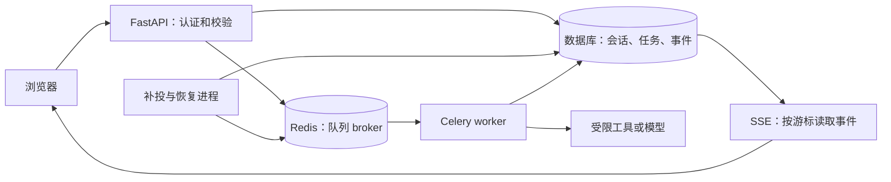

# 后端工程

**适用环境：通用；Python 示例使用 3.12，命令在本机 Linux、macOS 或 Windows 的 WSL 执行。Docker 中运行的是 Linux 容器。**

后端负责把用户请求变成可追踪、可恢复、受权限约束的操作。以科研 Agent 为例，一次“分析上传的研究笔记”会经过登录校验、参数校验、附件读取、任务排队、工具调用、结果持久化和前端展示。模型调用只是其中一个环节。

## 学习路线与分类

| 目录 | 内容与建议顺序 |
| --- | --- |
| [接口与安全](接口与安全/README.md) | 定义接口、项目边界、认证和逐资源权限。 |
| [并发与任务](并发与任务/README.md) | 组织异步调用、持久化数据和可恢复后台任务。 |
| [交付与实战](交付与实战/README.md) | 连接流式前端，部署服务并跟踪实际项目源码。 |

## 学习顺序

| 顺序 | 笔记 | 需要掌握的操作 |
| --- | --- | --- |
| 1 | [HTTP 接口与参数校验](接口与安全/HTTP接口与参数校验.md) | 定义资源、选择方法、接收请求、用 Pydantic 校验 |
| 2 | [项目组织、配置、异常与日志](接口与安全/项目组织配置异常与日志.md) | 拆分模块、加载环境变量、统一错误与日志 |
| 3 | [用户认证、权限与 Agent 安全](接口与安全/用户认证权限与Agent安全.md) | 登录、撤销会话、逐资源授权、限制工具能力 |
| 4 | [同步、异步、线程与进程](并发与任务/同步异步线程与进程.md) | 并发调用、限制并发、超时、异常传播与取消 |
| 5 | [Agent 数据建模与 Redis](并发与任务/Agent数据建模与Redis.md) | 保存会话与执行状态、查询历史、区分数据库与缓存 |
| 6 | [后台任务、队列与恢复](并发与任务/后台任务队列与恢复.md) | Celery worker、重试、幂等、补投与超时收敛 |
| 7 | [流式响应与前端基础](交付与实战/流式响应与前端基础.md) | SSE、断线重放、浏览器读取、React 基本概念 |
| 8 | [Docker 与 Linux 运维](交付与实战/Docker与Linux运维.md) | 镜像、容器、Compose、日志、端口与健康检查 |
| 9 | [Archeos 与 ALKEMIE 源码阅读](交付与实战/Archeos与ALKEMIE源码阅读.md) | 从实际模块定位上述职责，再迁移到自己的应用 |
| 实践 | [完整 Agent 教学 Demo](../../examples/backend/agent-demo/README.md) | 登录、上传、历史会话、后台执行、流式输出与故障练习 |
| 逐步实操 | [请求、数据与恢复实操](../../examples/backend/agent-demo/请求与恢复实操.md) | 固定请求文件、实际输出、SQL、SSE 与故障注入 |

没有前端基础也可以使用 `/docs` 和 `curl` 完成接口练习，再用 Demo 附带的 HTML 页面串联流程。Python 环境准备见 [pip 与 uv](../../getting-started/pip与uv安装与使用.md)。

## 技术栈怎样分工

| 层次 | 本专题使用的技术 | 负责的问题 |
| --- | --- | --- |
| HTTP 服务 | FastAPI、Uvicorn、Pydantic 2 | 路由、请求与响应模型、校验、OpenAPI |
| 业务与数据 | SQLAlchemy 2、SQLite／PostgreSQL | 事务、约束、会话历史、任务状态 |
| 并发 I/O | `asyncio`、异步 HTTP 客户端 | 等待多个工具／模型响应，控制超时与取消 |
| 后台执行 | Celery、Redis broker | 把耗时任务交给独立 worker，削峰与跨进程投递 |
| 实时展示 | SSE、Fetch | 单向逐段推送、事件序号、断线重放 |
| 交付与运维 | Docker、Compose、Linux | 统一运行依赖、启动服务、检查资源与故障 |

入门时还会遇到 Django（完整 Web 框架）、Flask（轻量 Python Web）、Spring Boot（Java）、NestJS／Express（Node.js），以及 MySQL、RabbitMQ 等。先用一种语言跑通完整请求链，再比较框架提供哪些能力。更换 Web 框架不会自动解决事务、授权或任务恢复问题。

## 示例约定

代码以 Archeos 的 FastAPI 分层方式为主线，ALKEMIE 用于补充流式恢复与用户隔离的讨论。项目源码链接固定到明确提交，详见[源码阅读](交付与实战/Archeos与ALKEMIE源码阅读.md)。本专题中的简化表结构、Redis／Celery 架构和 Demo 是教学设计，不表示两个项目已经使用这套实现。

Demo 的模型输出由确定性的文本统计工具模拟，无需 API Key；它用于练习工程链路。接入真实 Agent 时，需要替换工具／模型适配层，并保留认证、持久化、超时和权限边界。

## 配套文件怎样使用

[输入目录](../../inputs/backend/README.md)提供正常、非法、重试、超时请求与小型附件；[练习脚本](../../scripts/backend/README.md)可以在全新目录生成实际 SQLite 库、报告和 SSE 文件。想练习真实网络 I/O，可另启本机 HTTP 工具服务，用相同 JSON 输入比较并发、局部失败和整组期限。

每篇中的源码摘录注明原项目固定提交或本仓库文件；依赖项目上下文的摘录用于阅读，标明启动方式的独立练习才可直接运行。先核对输入、再执行、再检查响应与数据库最终事实，避免只看到一条成功日志就结束验证。
