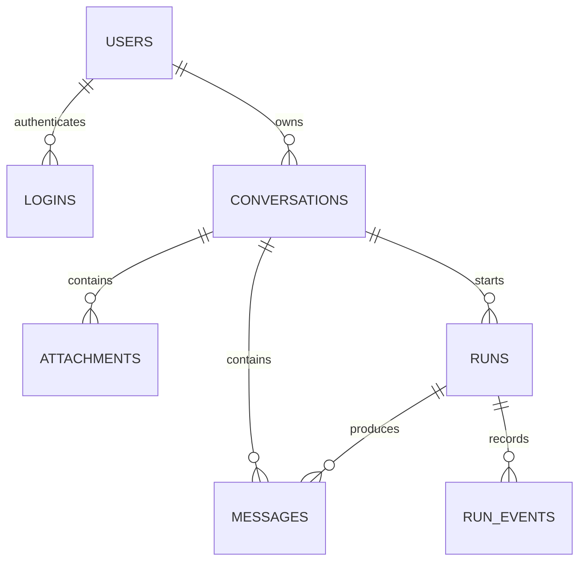

# Agent 数据建模与 Redis

**适用环境：通用；示例使用 SQLAlchemy 2，空库练习使用 SQLite，Compose 使用 PostgreSQL 17。**

## 数据库怎样选

关系数据库适合用户、团队、权限、会话和任务，因为这些数据之间有明确关系，常需要事务与约束。SQLite 安装简单，适合单机学习；PostgreSQL、MySQL 更适合多个服务并发访问。文档数据库适合结构变化较大的文档，但仍需考虑引用一致性、索引和授权。向量数据库解决相似度检索，不能替代用户权限和任务状态的事务存储。

ORM 把表映射到 Python 对象，SQLAlchemy 同时提供 ORM 和 SQL 表达式。它减少重复查询代码，但数据库约束、事务和索引仍需要自己设计。迁移工具 Alembic 记录结构变化；更改 Python 类并不等于线上表已经升级。

## 最小 Agent 数据结构

以 Archeos 的用户、登录会话、科研任务持久化思路为参照，教学 Demo 使用以下表。这里的 `conversation` 是聊天会话，`login` 是认证会话，二者用途不同。

| 表 | 主要字段 | 约束与用途 |
| --- | --- | --- |
| `users` | `id, username, password_hash` | 用户名唯一，密码仅保存哈希 |
| `logins` | `token_hash, user_id, expires_at` | 随机令牌摘要为主键，支持到期和撤销 |
| `conversations` | `id, user_id, title, created_at` | 用户外键，所有读写先查归属 |
| `attachments` | `id, conversation_id, filename, content` | 64 KiB 内 UTF-8 文本；大文件改对象存储 |
| `runs` | `id, conversation_id, client_key, prompt, attachment_id, status` | 一个提交对应一次逻辑执行 |
| `runs` 执行字段 | `attempt, lease, deadline, next_at, cancel_requested, error_code, request_id` | 领取凭据、期限、退避、取消与追踪 |
| `messages` | `id, conversation_id, run_id, role, content, created_at` | `(run_id, role)` 唯一，Demo 每 run 一条输入和一条成功输出 |
| `run_events` | `id, run_id, kind, data, created_at` | 增量文本与阶段事件，可按 ID 重放 |



多团队版本需加入 `teams`、`memberships`，把资源绑定到团队和成员；不能只凭前端传来的 `team_id` 查询。真实 Agent 可增加 `tool_calls`、`run_attempts`、模型用量与对象存储引用，将每次重试的起止时间、输入摘要、错误类别单独记录。

## 从 Python 字段看真实表定义

[demo/db.py::Message](../../../examples/backend/agent-demo/demo/db.py) 完整类定义如下：

```python
class Message(Base):
    __tablename__ = "messages"
    __table_args__ = (UniqueConstraint("run_id", "role"),)
    id: Mapped[int] = mapped_column(primary_key=True, autoincrement=True)
    conversation_id: Mapped[str] = mapped_column(ForeignKey("conversations.id"), index=True)
    run_id: Mapped[str] = mapped_column(ForeignKey("runs.id"))
    role: Mapped[str] = mapped_column(String(16))
    content: Mapped[str] = mapped_column(Text)
    created_at: Mapped[float] = mapped_column(default=time.time)
```

`Mapped[int]`、`Mapped[str]` 表示属性类型；`mapped_column` 指定列的存储与约束。消息 ID 自增供分页使用，`run_id` 外键关联一次逻辑执行。这里 `(run_id, role)` 唯一，是因为 Demo 每次执行只有一条 user 输入与一条最终 assistant 输出；真实工具对话若有多条 tool／assistant 消息，应改成 `(run_id, sequence)`，保留 role 作为普通字段，不能照搬这个唯一约束。

`created_at` 使用 `time.time` 作为可调用默认值，在插入时计算。若错误地写成 `default=time.time()`，值会在加载模块时计算，之后记录可能共用同一时间。Float 存的是 Unix 秒；PostgreSQL 正式业务也可以使用 `TIMESTAMPTZ` 并在接口中返回带时区 ISO 8601。

### 外键不能替代资源归属检查

`Run.attachment_id` 的外键只能保证附件存在，不能保证附件和 run 的会话相同。Demo 在 submit 中检查 `attachment.conversation_id == conversation_id`。高完整性设计还可用联合外键约束 `(conversation_id, attachment_id)`，但仍不能免掉当前用户访问权限检查。

SQLite 的字符串长度声明也不等于 PostgreSQL 的 VARCHAR 长度行为；HTTP 的 Pydantic 长度约束与数据库 CHECK 各自承担不同入口的约束。后台脚本直接写库时不会自动经过 HTTP 输入类。

## 约束、索引与事务

外键保证引用对象存在，唯一约束防止重复，CHECK 约束限制状态和值域。必要索引包括 `(run_id, event_id)`、`(conversation_id, message_id)`、`(status, next_at)` 和用户下的会话排序键。索引增加写入与存储成本，应结合查询计划选择。[PostgreSQL 约束文档](https://www.postgresql.org/docs/current/ddl-constraints.html)解释了外键、唯一性和 CHECK 的边界。

Demo 对 `(conversation_id, client_key)` 设置唯一约束，对事件和待调度状态设置索引。生产可进一步用数据库 CHECK 约束保证状态枚举、尝试次数非负，按真实访问模式细化联合索引。

提交任务时，一次事务应同时保存 `runs`、用户消息与 `queued` 事件：

```python
# 结构示意；模型定义与可运行版本见 demo/main.py::submit。
with session() as db:
    run = Run(conversation_id=cid, client_key=key, prompt=prompt, request_id=request_id)
    db.add(run)
    db.flush()  # 获取默认生成的 run.id；尚未提交
    db.add(Message(conversation_id=cid, run_id=run.id, role="user", content=prompt))
    add_event(db, run.id, "status", {"status": "queued"})
    db.commit()
```

工具执行完成时，最终回复、`succeeded` 状态和 `done` 事件也在同一事务写入，避免状态成功却没有历史记录。调用外部模型期间不要一直持有数据库事务或行锁。SQLAlchemy Session 是一次工作单元，不应在多个并发 Task／线程间共享；每个工作单元创建自己的 Session，参考 [Session 基础](https://docs.sqlalchemy.org/en/20/orm/session_basics.html)。

SQLite 练习启用外键、WAL 和 busy timeout；它仍只有有限的写并发能力。生产并发竞争、隔离级别、`SELECT FOR UPDATE` 与死锁应在 PostgreSQL 实例中验证，不能仅凭 SQLite 测试推断。

## 一次提交为什么要同时写三种记录

[Demo submit](../../../examples/backend/agent-demo/demo/main.py) 的关键事务为：

```python
with session() as db:
    run = Run(conversation_id=conversation_id,
              request_id=request.state.request_id, **body.model_dump())
    db.add(run)
    db.flush()
    db.add(Message(conversation_id=conversation_id, run_id=run.id,
                   role="user", content=body.prompt))
    add_event(db, run.id, "status", {"status": "queued"})
    db.commit()
```

此处省略的是前后的授权、幂等处理与 broker 投递，完整函数见链接。`flush()` 发送 INSERT 并取得主键，不代表事务已经成功提交。后面的消息插入失败时，三类记录都应回滚；不能在每加一条记录后就单独 commit。

同时提交两个相同幂等键时，即使两边都先 SELECT 到“不存在”，唯一约束仍会让一边失败。Demo 捕获 IntegrityError 后显式 rollback，再重新查询旧 run 并核对内容。这是“先查再写”之外不可省掉的并发保护。

`with session() as db` 负责关闭 Session，本身不表示自动提交；如果改用 `with Session.begin()` 等上下文，需要明确正常退出与异常退出的提交／回滚语义。详见 [SQLAlchemy 事务基础](https://docs.sqlalchemy.org/en/20/orm/session_basics.html)。

## 查询历史与保存执行状态

下面是使用绑定参数的查询形状，参数由 SQLAlchemy 传入：

```sql
SELECT m.id, m.role, m.content, m.run_id
FROM messages AS m
JOIN conversations AS c ON c.id = m.conversation_id
WHERE c.id = :conversation_id
  AND c.user_id = :current_user_id
  AND m.id < :before_id
ORDER BY m.id DESC
LIMIT :page_size;
```

首次查询省略 `before_id` 条件。取到最新一页后，在应用中反转为正序展示；下一页使用最小的消息 ID。禁止直接把整段历史无限制交给模型，先按授权查询，再根据上下文预算截断或总结。

历史消息是完成后的对话记录，事件是执行过程。失败任务可能已经输出部分 delta，但不能把这些片段伪装成完整成功回复。前端用 `run_id` 关联输入、事件与最终状态；恢复页面时先查询 run，再决定读历史还是重放事件。

## 在自己的练习库中检查数据

先按[请求与恢复实操](../../../examples/backend/agent-demo/请求与恢复实操.md)生成 `/tmp/agent-backend-lab/demo.db`。SQLite 命令在本机执行：

```bash
sqlite3 /tmp/agent-backend-lab/demo.db '.schema runs'
sqlite3 -header -column /tmp/agent-backend-lab/demo.db < inputs/backend/查看任务.sql
```

这组查询不选择密码哈希与登录令牌摘要。重点核对：成功 normal／retry 各有一条 assistant，其他终态只有输入；retry 的 attempt 是 2，取消前未执行的任务 attempt 是 0；过期 worker 的 late write 不会产生成功消息。

查询历史时采用 `ORDER BY id DESC LIMIT 50` 后再反转，是为了获取**最新一页**并以正序展示；直接 `ORDER BY id ASC LIMIT 50` 会固定读到最早 50 条。查询到的消息数不足 50 并不意味着用户从未有更多历史，还需结合分页游标。

### 检查查询是否使用索引

```sql
EXPLAIN QUERY PLAN
SELECT id, kind, data FROM run_events
WHERE run_id = '替换为练习报告中的run_id' AND id > 0
ORDER BY id LIMIT 100;
```

在 SQLite 练习中观察是否使用 `ix_event_run_cursor` 等索引；PostgreSQL 用 EXPLAIN，性能诊断时按需要使用 `EXPLAIN (ANALYZE, BUFFERS)`。ANALYZE 会实际执行语句，对写操作尤其要谨慎，不在真实业务上随意试验。

## Redis 在哪里起作用

Redis 提供内存数据结构和可配置持久化，常承担缓存、短期会话、计数限流、协调和队列等角色。它是否能作为某类数据的持久存储，取决于部署、持久化、复制与恢复策略；本专题让关系数据库作为会话与执行状态的事实来源。

| 用途 | 示例键／结构 | 失效或丢失后的处理 |
| --- | --- | --- |
| 缓存 | `demo:v1:user:{uid}:conversation:{cid}`，String／Hash | 设置 TTL；先完成授权，未命中回源数据库 |
| 限流 | `demo:rate:{uid}:{window}`，计数器 | 增量与到期设置需原子执行，避免无 TTL 的永久计数 |
| 短期会话 | 随机会话键＋TTL | 明确撤销、过期和 Redis 故障时的登录策略 |
| 互斥协调 | `SET key owner NX PX ...` | TTL 过期后旧持有者可能仍在运行；需要所有权检查与 fencing |
| 实时通知 | Pub/Sub | 不保存离线历史；断线要从数据库／事件存储重放 |
| 带游标事件 | Streams＋消费组 | 维护 pending、确认、重新领取、保留与裁剪策略 |
| 队列 broker | Celery 管理的消息键 | 不手工操作内部键；应用数据库保存待执行意图 |

`redis-cli` 的基础练习：

```bash
redis-cli SET demo:hello backend EX 60
redis-cli GET demo:hello
redis-cli TTL demo:hello
redis-cli DEL demo:hello
```

只在自己的练习实例操作这些键；不要对共享实例执行 `FLUSHALL`。计数加 TTL 可使用事务或 Lua 保证原子性，释放锁也必须原子地比较 owner 再删除，不能随意 `DEL` 可能已经属于其他 worker 的锁。即使使用 Redis 锁，最终数据库写入仍要验证当前领取凭据。

Streams 的消费组和待确认列表见 [Redis Streams 官方说明](https://redis.io/docs/latest/develop/data-types/streams/)。它与 Pub/Sub 的语义不同；也不意味着启用 Streams 就自动拥有端到端“恰好一次”执行。

## 缓存、队列与结果不要混在一起

缓存可以配置淘汰；任务队列被淘汰可能直接丢消息。生产通常把 broker 与可淘汰缓存分实例管理，设置容量、ACL、网络边界和监控。Demo 的 Redis 只做 Celery broker，使用 AOF 和 `noeviction`；内存满会导致写入失败，应报警并扩容，数据库补投意图仍需保留。

备份要包含关系数据库、对象存储和恢复所需密钥，并实际演练恢复。把 Redis `PING` 成功当成“数据安全”或“任务一定执行成功”都不足够。

## Redis 的两个具体实现练习

以下只在自己的练习 Redis 中执行；Compose 用户可先 `docker compose exec redis redis-cli`，键统一使用 `handbook:practice:` 前缀。

### 限流计数与过期要一起完成

```lua
local current = redis.call('INCR', KEYS[1])
if current == 1 then
    redis.call('EXPIRE', KEYS[1], ARGV[1])
end
return current
```

保存到[固定窗口限流.lua](../../../inputs/backend/固定窗口限流.lua)，本机 Redis CLI 执行：

```bash
redis-cli --eval inputs/backend/固定窗口限流.lua handbook:practice:rate:user-demo , 60
redis-cli TTL handbook:practice:rate:user-demo
```

每次返回递增计数，TTL 应为不大于 60 的非负值；计数超限时应用返回 429。Lua 让增加与首次设过期在一个原子操作中完成，避免 INCR 成功后进程退出、EXPIRE 永远没执行。固定窗口允许窗口边缘突发；需要更平滑策略时再比较滑动窗口和 token bucket，不要把这个教学片段称为完整全局限流系统。

### 释放互斥键前先核对持有者

```lua
if redis.call('GET', KEYS[1]) == ARGV[1] then
    return redis.call('DEL', KEYS[1])
end
return 0
```

[按持有者释放锁.lua](../../../inputs/backend/按持有者释放锁.lua) 与 `SET key random-owner NX PX 5000` 配合。如果持有者 A 工作超过 TTL，B 取得同名锁，A 直接 DEL 就会删掉 B 的锁；比较 owner 可以防止误删。但 A 的旧计算本身仍可能继续，因此数据库写回还需要 run 的领取凭据校验。Redis 事务和原子脚本的基础见[官方事务说明](https://redis.io/docs/latest/develop/using-commands/transactions/)。

用自己的练习键验证释放行为，可以连续执行：

```bash
lock_owner=$(python -c 'import secrets; print(secrets.token_hex(16))')
redis-cli SET handbook:practice:lock:run-demo "$lock_owner" NX PX 30000
# 上一步必须返回 OK；若键已存在，应换练习键，不继续假装自己持有锁。
redis-cli --eval inputs/backend/按持有者释放锁.lua handbook:practice:lock:run-demo , another-owner
redis-cli --eval inputs/backend/按持有者释放锁.lua handbook:practice:lock:run-demo , "$lock_owner"
redis-cli EXISTS handbook:practice:lock:run-demo
```

在 30 秒到期前完成时，错误 owner 返回 0，正确 owner 返回 1，最后 EXISTS 返回 0。TTL 已到期则正确 owner 也会返回 0，表示自己已经不再持有锁。[Redis Lua 执行说明](https://redis.io/docs/latest/develop/programmability/eval-intro/)解释了原子执行语义；脚本应保持短小，不能在 Redis 中运行长计算。

关系数据库的“持久任务意图”和 Redis 的“当前互斥／通知”应分开检查。Redis 恢复后，不能只看到键存在就把数据库里已终态的任务重新执行。
