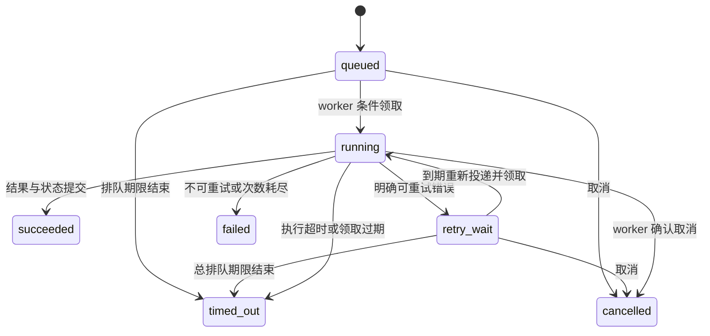

# 后台任务、队列与恢复

**适用环境：通用；示例为 Celery 5、Redis broker、SQLAlchemy 2。生产 worker 以 Linux 为主，macOS 本机练习可用 solo 池。**

## 为什么要独立 worker

HTTP 请求适合快速校验和提交意图，文献检索、模型长推理、文件解析与计算分析可能需要数十秒到数小时。把长任务放入独立 worker，可以让 API 及时返回，并独立控制执行并发、超时和重启。

| 机制 | 适用范围 | API 进程退出后 |
| --- | --- | --- |
| `asyncio.create_task()` | 当前事件循环内的短期任务 | 通常随进程消失，需要保存引用和收尾 |
| FastAPI `BackgroundTasks` | 响应后的轻量附带操作 | 不提供持久队列与跨进程恢复 |
| 线程池／进程池 | 当前进程管理的并发执行 | 不是持久任务调度系统 |
| Celery／RQ 等独立队列 | 跨进程排队、worker 扩展 | 可独立于 API 执行，仍需设计恢复协议 |

FastAPI 对重计算采用队列的建议见[后台任务文档](https://fastapi.tiangolo.com/tutorial/background-tasks/)。队列增加了运维与一致性成本，不必把每个小函数都变成后台任务。

## 最小 Celery 结构

配套 Demo 的 `worker.py` 创建 Celery 应用，注册接收 `run_id` 的任务；`jobs.py` 从数据库读取业务数据。消息只携带标识，不携带用户密码、模型密钥、大附件或整个 ORM 对象。

```python
from celery import Celery

app = Celery("example", broker="redis://127.0.0.1:6379/0")
app.conf.update(task_serializer="json", accept_content=["json"])

@app.task
def analyze(run_id: str):
    # 可运行 Demo 在这里调用 jobs.execute(run_id)。
    return {"run_id": run_id}
```

`analyze.delay(run_id)` 是投递，不是本地函数调用；`.apply()` 或 eager 模式则不能证明真实 broker／worker 链路正常。任务允许的序列化格式应显式限制，避免接收不可信 pickle。Redis broker 的连接与可见性设置见 [Celery Redis 文档](https://docs.celeryq.dev/en/stable/getting-started/backends-and-brokers/redis.html)。

## 状态机比一个布尔值更有用



`202` 表示提交成功，`succeeded` 才表示执行成功。取消接口返回后，运行中的任务可能仍在清理，先记录 `cancel_requested=true`，待 worker 确认或恢复进程收敛终态。外部副作用不确定时，真实系统还应有 `needs_reconciliation` 等待核对状态。

## 双写、重复投递与幂等

数据库提交成功后，向 Redis 投递可能失败；先投递再提交则可能让 worker 看不到任务。数据库与 broker 通常没有共同事务，需要显式协议。

生产常用 transactional outbox：在提交 run 的同一事务插入 outbox 记录，dispatcher 投递并记录结果；允许重复投递，消费端用幂等机制去重。Demo 使用更小的同类机制：`runs.status=queued/retry_wait` 本身是持久投递意图，独立 dispatcher 每 5 秒扫描并补投。

Demo 每次扫描可能再次投递同一 run，worker 通过条件更新把 `queued` 或到期 `retry_wait` 改成 `running`，成功的领取者才执行。持有者使用随机 `lease`，每次写事件／终态时同时验证 `status=running` 和 `lease`。恢复进程使旧领取失效后，迟到的 worker 无权覆盖新状态。

这实现的是业务约束下的重复消息防护，不是外部系统端到端“恰好一次”。例如提交远程计算后网络断开，自动重试可能提交两份作业。应该使用外部系统接受的幂等键，保存外部作业 ID；无法确定提交结果时先查询，必要时进入人工核对。

## 条件领取的 SQL 含义

真实函数位于 [jobs.py::claim](../../../examples/backend/agent-demo/demo/jobs.py)：

```python
def claim(run_id):
    """条件更新领取；重复队列消息只有一个能把 queued 改成 running。"""
    now, lease = time.time(), uid()
    with session() as db:
        result = db.execute(update(Run).where(
            Run.id == run_id, Run.status.in_(["queued", "retry_wait"]), Run.next_at <= now,
            Run.cancel_requested.is_(False), Run.created_at > now - 120,
            Run.attempt < 3,
        ).values(status="running", lease=lease, attempt=Run.attempt + 1,
                 deadline=now + Run.timeout_seconds, error_code=None))
        if result.rowcount != 1:
            db.rollback()
            return None
        run = db.get(Run, run_id)
        add_event(db, run_id, "status", {"status": "running", "attempt": run.attempt})
        db.commit()
        return lease
```

可把它理解为一条带前提的 UPDATE：只有状态仍可领取、退避已到期、没有取消、没超过创建窗口、次数未耗尽才改成 running。`attempt = attempt + 1` 在数据库中完成，避免 Python 中读出旧值再写回的丢失更新。

两个 worker 同时拿到相同 run ID，一边 rowcount=1，另一边 rowcount=0；后者退出，不写 running 事件，也不启动工具。测试 `test_competing_workers_have_one_claim` 用 4 个并发竞争者验证这一行为。

`lease` 是本次领取的随机凭据。它不是用户认证令牌，也不是能让任意外部系统自动拒绝旧调用的单调 fencing token；本例在数据库中比较“是否仍等于当前值”来阻止旧 worker 写回。

## 执行、重试与成功提交分别发生在哪

[jobs.py::execute](../../../examples/backend/agent-demo/demo/jobs.py) 的真实分支如下：

```python
def execute(run_id):
    lease = claim(run_id)
    if lease is None:
        return
    with session() as db:
        run = db.get(Run, run_id)
        request_id, attempt = run.request_id, run.attempt
    logger.info("run_started request_id=%s run_id=%s attempt=%s", request_id, run_id, attempt)
    try:
        asyncio.run(generate(run_id, lease))
    except TransientToolError:
        retry_later(run_id, lease)
    except TimeoutError:
        finish(run_id, lease, "timed_out", "deadline_exceeded")
    except StopRun as exc:
        if str(exc) != "lease_lost":
            finish(run_id, lease, str(exc), str(exc))
    except Exception:
        logger.exception("run_failed request_id=%s run_id=%s attempt=%s", request_id, run_id, attempt)
        finish(run_id, lease, "failed", "tool_failed")
```

可重试错误只由 `TransientToolError` 进入 `retry_later`；普通程序错误直接 failed。`retry_once` 在任何 delta 产生前模拟瞬时故障，所以第二次输出不需要覆盖前一次已显示文本。引入真实模型后，若第一轮已有部分输出，应把 attempt 存进事件，并定义第二轮是替换、继续还是并列展示。

成功写回时，`finish()` 先以 `run_id + lease + running` 做条件写锁定当前执行，再检查取消与数据库期限，最后把 assistant 消息、终态、done 事件一起提交。模型返回成功不一定意味着 run 成功：用户此时已经取消或期限已过，最终仍应为 cancelled／timed_out。

## 超时、确认与失败重试

区分几个时间：连接超时、读取超时、工具期限、一次尝试期限、整个任务预算、broker visibility timeout 和领取租约。一个较长的 Agent 任务需要周期性续租与心跳；Demo 单次执行上限 20 秒，使用固定期限，避免引入续租协议。

Celery 的 `acks_late` 延迟确认，但 worker 子进程被强制终止时存在专门的确认语义；不能推断“任何崩溃都会自动重投”。`task_reject_on_worker_lost` 可以改变部分行为，也可能导致崩溃任务无限重投。软超时给清理机会，硬超时终止 worker 子进程，支持情况取决于执行池与平台。见 [Celery 任务与确认说明](https://docs.celeryq.dev/en/stable/userguide/tasks.html)。

Demo 使用三层约束：工具层与整次 `asyncio.timeout()`、数据库截止时间、Linux prefork worker 的软／硬时间限制。恢复进程发现超时的 running，将其置为 `timed_out`；它不会自动重放可能已经产生副作用的任务。

| 错误 | 重试策略 |
| --- | --- |
| 短暂网络不可用、限流、上游 503 | 先确认幂等，指数退避＋抖动，尊重 Retry-After |
| 参数不合法、权限不足 | 修正输入／权限，不盲目重试 |
| 程序错误、解析逻辑错误 | 保存错误码和追踪，修复后再提交 |
| 提交外部动作后连接断开 | 核对动作是否完成，避免重复副作用 |
| worker 消失、租约过期 | 收敛状态；恢复前核对外部执行状态 |

Demo 最多 3 次尝试，以 `2 ** attempt` 秒退避；教学模式 `retry_once` 在输出产生前模拟一次可重试故障。为便于观察，它不加随机抖动；生产应加入抖动和总预算。`fail` 模式直接失败，`slow` 模式触发超时。部分输出后重试的真实模型请求，需要用 attempt 标识事件并明确前端重置／续接规则。

## 读 worker 配置时对应到具体时间

[worker.py](../../../examples/backend/agent-demo/demo/worker.py) 中的实际配置为：

```python
celery_app.conf.update(
    task_serializer="json", accept_content=["json"], result_serializer="json",
    task_ignore_result=True, task_acks_late=True, worker_prefetch_multiplier=1,
    task_soft_time_limit=25, task_time_limit=30,
    broker_transport_options={"visibility_timeout": 60, "socket_connect_timeout": 2, "socket_timeout": 2},
    broker_connection_timeout=2, task_publish_retry=False,
)
```

| 配置／代码 | 本例值 | 为什么这样搭配 |
| --- | --- | --- |
| HTTP 允许的执行期限 | 1—20 秒 | 防止客户端指定无限期限 |
| asyncio 总期限 | run.timeout_seconds | 覆盖一次生成，优先走可清理的超时 |
| 数据库 deadline | 领取时刻＋期限 | 进程消失后仍能判断过期 |
| Celery 软／硬期限 | 25／30 秒 | Linux prefork 的后备终止边界 |
| broker visibility timeout | 60 秒 | 大于本例单次执行上限，减少仍在执行时被重投的机会 |
| queued 意图存活窗口 | 创建后 120 秒 | broker／worker 长期不可用时也能结束等待 |
| dispatcher 扫描周期 | 5 秒 | 恢复不保证恰好在截止时刻发生，会有扫描延迟 |

这个窗口是**从 run 创建时刻起**计算，不会因为重试而重置。实际长任务应另设明确的排队预算、总执行预算与可续租期限。可见性期限也不能无限调大，否则真正丢失 worker 后的消息恢复会很慢。

`task_ignore_result=True` 表示不使用 Celery 结果作为业务事实来源，状态统一查询数据库。`worker_prefetch_multiplier=1` 减少某个 worker 预先占住大量长任务，但不能代替按用户公平调度。

各执行池对软／硬期限、远程控制与停止的支持应对照 [Celery Workers Guide](https://docs.celeryq.dev/en/stable/userguide/workers.html)；不要从本机 solo 练习推断 Linux prefork 的进程终止行为已经验证。

## 恢复与运维检查

启动顺序是数据库迁移、broker、API、worker、dispatcher。Demo 数据库保存状态，Celery result backend 被关闭，状态查询始终读取业务库。

在 Demo 目录按[运行说明](../../../examples/backend/agent-demo/README.md)启动后，可以做以下练习：

1. 停 worker 后提交任务，接口应返回 `queued`；120 秒内恢复 worker，dispatcher 应补投。
2. 暂停 Redis 后提交，run 仍存在；恢复 Redis 后检查是否被补投，而非创建第二个 run。
3. 让某个 running 的数据库截止时间过期，dispatcher 应将其收敛为 `timed_out`，旧 worker 不得写成功。
4. 两次投递同一 `run_id`，最终只能有一条成功 assistant 消息。
5. 请求取消后检查终态与外部作业状态，不能只看到前端按钮变灰。

进程真实崩溃、broker 重启与数据库竞争需要在目标平台做集成测试。Demo 的本地自动化测试通过 SQLite 和内存 broker 检查应用逻辑；它们不能替代 Linux、Redis、PostgreSQL 的完整验收。

## 把六类故障落实到输入与检查

| 场景 | 操作／输入 | 应检查的库内事实 |
| --- | --- | --- |
| 正常 | `run-normal.json` | succeeded、attempt=1、一条 assistant |
| 临时失败 | `run-retry.json` | 先 retry_wait，退避后 attempt=2 成功 |
| 工具错误 | `run-failure.json` | failed、tool_failed、没有成功回复 |
| 超时 | `run-timeout.json` | timed_out、deadline_exceeded |
| 取消 queued | 提交后领取前调用 cancel | cancelled、attempt=0 |
| worker 期限过期 | 练习库中 claim 后模拟 deadline 过去 | timed_out、lease_expired、迟到写被拒绝 |

这些输入和可运行命令集中在[请求与恢复实操](../../../examples/backend/agent-demo/请求与恢复实操.md)。其中修改 deadline 是状态机故障注入，不能据此宣称已验证真实操作系统崩溃或 Celery 硬超时。

### 为什么不能直接对所有错误 `autoretry_for=(Exception,)`

一个参数错误每次重试都会失败；一个文件解析漏洞可能每次都耗尽内存；一个已提交成功但响应丢失的远程动作可能重复发生。应该先按错误类型与副作用阶段分类，再重试经过幂等设计的操作。网络发送重试、工具业务重试和 run 重试也可能相乘，必须计算最坏调用次数。

Archeos 的 `ScientificContinuation` 把核对回执单独记录，说明“已经发出去但不知道是否被接收”本身就是需要建模的状态。扩展到真实提交任务时，可保存外部任务 ID、请求摘要、提交回执与最后核对时间，重启后先查询这些信息。

## 从 SQLite 练习走向多人任务队列

Demo 每次扫描最多 100 个非终态 run，用于小规模学习。生产应按 due time／用户公平性分页扫描，控制重复投递频率，必要时为 outbox 增加投递租约。大量长期 running 不应永久挡住后面的 queued，dispatcher 自身也要有心跳、失败监控和异常退避。

多人执行还要在执行前复查成员、资源与工具权限。Demo 只有固定的无副作用统计工具，worker 不读取已撤销的外部凭据；真实系统不能因为“提交时有权限”就在几小时后忽略已撤销的授权。
