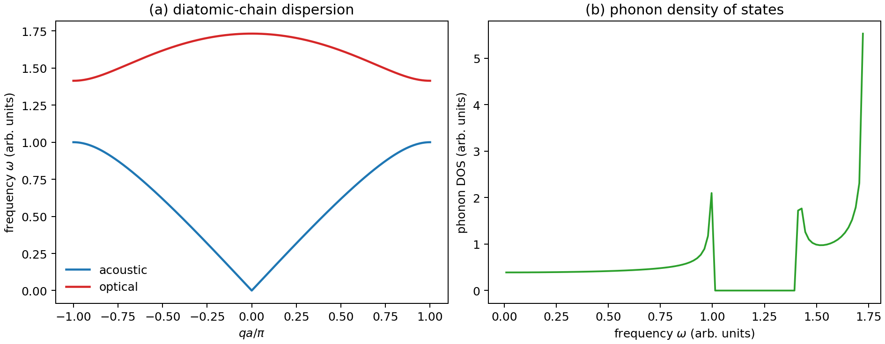

# 晶格振动与声子谱

**适用环境：通用（Python 3 + numpy + matplotlib）；DFT 声子部分按 VASP / phonopy 篇目准备。**

原子不是钉在平衡位置上的。温度升高、热膨胀、热导率和铁电软模都与晶格振动有关。把势能在平衡位置展开到二阶，得到简谐近似；解动力学矩阵的本征值，就得到声子频率随波矢的色散。

本文用一维双原子链说明声学支、光学支和带隙，并给出可运行的 Python 示例。示例是模型计算，不是真实材料的声子谱。

## 简谐近似与动力学矩阵

势能展开：

$$
V=V_0+\frac12\sum_{i\alpha,j\beta}\Phi_{i\alpha,j\beta}u_{i\alpha}u_{j\beta}+\cdots,
$$

$\Phi$ 是力常数矩阵。运动方程

$$
m_i\ddot u_{i\alpha}=-\sum_{j\beta}\Phi_{i\alpha,j\beta}u_{j\beta}.
$$

代入平面波解 $u_{i\alpha}=A_{i\alpha}e^{i(\mathbf q\cdot\mathbf R_i-\omega t)}$，得到

$$
\sum_{j\beta}\left[\Phi_{i\alpha,j\beta}(\mathbf q)-\omega^2m_i\delta_{ij}\delta_{\alpha\beta}\right]A_{j\beta}=0.
$$

括号内是广义本征方程的系数矩阵。用质量加权位移 $e_{i\alpha}=\sqrt{m_i}A_{i\alpha}$，得到动力学矩阵 $D_{i\alpha,j\beta}(\mathbf q)=\Phi_{i\alpha,j\beta}(\mathbf q)/\sqrt{m_i m_j}$。它的本征值为 $\omega^2$，本征矢给出质量加权的振动模式。三维体系每个 q 点有 $3N$ 个模式，$N$ 是原胞原子数。

## 一维双原子链

质量 $m_1$、$m_2$ 交替排列，最近邻弹簧常数 $K$，晶格常数 $a$。色散满足

$$
\omega^2=K\left(\frac1{m_1}+\frac1{m_2}\right)
\pm K\sqrt{\left(\frac1{m_1}+\frac1{m_2}\right)^2-\frac{4\sin^2(qa/2)}{m_1m_2}}.
$$

取“$+$”为光学支，“$-$”为声学支。关键极限：

- $q\to0$：声学支 $\omega\to0$（整体平移），光学支 $\omega^2\to2K(1/m_1+1/m_2)$（两个子晶格反向振动）。
- $q=\pi/a$：声学支 $\omega^2=2K/m_{\rm heavy}$，光学支 $\omega^2=2K/m_{\rm light}$；$m_1\ne m_2$ 时两支之间出现带隙。
- $m_1=m_2$：带隙关闭，两支在布里渊区边界简并，折叠成单原子链的色散。

[交互演示](https://wangchr1617.github.io/research-handbook/#phonon)。比较等质量和不等质量时的色散，再看弹簧常数怎样整体改变频率。

如果每个原胞只有一个原子，只有声学支；双原子基元把原来的声学支折叠成声学+光学两支。带隙来自质量差和力常数差，不是“光学支一定对应光吸收”——光学支在 q≈0 时可以与电磁波耦合，但是否吸收还取决于选择定则和声子极化。

## 声子态密度与热力学

声子态密度

$$
g(\omega)=\frac{1}{\Omega_{\rm BZ}}\sum_{\nu}\int_{\rm BZ}d^3q\,\delta(\omega-\omega_\nu(\mathbf q))
$$

按原胞归一化，$\Omega_{\rm BZ}$ 为布里渊区体积，$\int g(\omega)d\omega=3N$。简谐近似下，每原胞热容由

$$
C_V=k_B\int d\omega\,g(\omega)\left(\frac{\hbar\omega}{k_BT}\right)^2
\frac{e^{\hbar\omega/k_BT}}{(e^{\hbar\omega/k_BT}-1)^2}
$$

给出；高温趋近 $3Nk_B$（Dulong–Petit），三维绝缘晶体的低温声子热容按 $T^3$ 下降。声子平均自由程和 Umklapp 过程决定热导率，这些不在简谐近似内，需要声子玻尔兹曼方程或分子动力学。

## 示例：双原子链的色散与态密度

配套案例在 [phonon-chain](../../examples/solid-state/phonon-chain/README.md)。输入：

```json
{"m1": 1.0, "m2": 2.0, "K_eV_per_A2": 1.0, "a_A": 1.0, "n_k": 401}
```

运行：

```bash
cd examples/solid-state/phonon-chain
python3 -m pip install -r requirements.txt
python3 run.py
```

程序画出色散和声子态密度，并输出带隙下边 $\sqrt{2K/m_{\rm heavy}}=1.0$、上边 $\sqrt{2K/m_{\rm light}}\approx1.414$（模型频率单位）。图中的 DOS 直方图按概率密度归一化，积分为 1。带边的峰对应一维色散的范霍夫奇点。



把 $m_2$ 改成 1.0，带隙应关闭；把 $K$ 加倍，所有频率应乘 $\sqrt2$。这两个检查能发现公式或单位错误。

## 从模型到第一性原理声子

DFT 声子常用两种方法：

1. **有限位移法**：在超胞中逐个移动原子，算受力，构造力常数；phonopy 是常用工具。超胞要足够大，否则力常数被截断，色散出现虚假振荡。
2. **密度泛函微扰理论（DFPT）**：直接算二阶导数，不需要超胞，但实现复杂，对金属和磁性体系要小心。

注意：

- **LO–TO 劈裂**：极性材料中纵光学支与横光学支在 q→0 时不简并，需要非解析项修正；只做有限位移会漏掉。
- **虚频**：声子谱出现明显虚频，说明结构动力学不稳定；先检查结构优化、截断和 k 点，不要直接把虚频当“计算误差”。
- **热膨胀**：简谐声子谱不产生热膨胀；需要准谐近似（体积依赖的频率）或分子动力学。
- **单位**：phonopy 常输出 THz、cm⁻¹ 或 meV；比较前统一单位。

## 极性晶体的 LO–TO 劈裂

对三维极性绝缘体，长波纵向振动会产生宏观电场。计算 $\Gamma$ 点附近的光学支时，将 Born 有效电荷和高频介电张量（固定离子）交给 Phonopy 加入非解析项，并注明 $\mathbf q\to0$ 的方向。可先用 NaCl 对照开启与关闭修正的色散，再检查超胞尺寸与力常数收敛。对照室温散射谱时，还要区分简谐频率与有限温度非谐谱的峰位和线形。Phonopy/phono3py 教程用 NaCl 演示非解析修正，KCl/NaCl 的室温散射研究则展示了近 $\Gamma$ 的 LO 谱对非谐性的敏感性。

## 检查清单

- q 路径是否覆盖布里渊区边界？声学支在 Γ 点是否严格为零？
- 双原子/多原子原胞的模式数是否为 $3N$？有没有漏掉光学支？
- 超胞尺寸是否收敛？力常数截断是否造成色散振荡？
- 极性材料是否处理了 LO–TO 劈裂？
- 是否有虚频？虚频出现在哪个 q 点，对应什么畸变？
- DOS 按什么归一化？每原胞总 DOS 的积分为 $3N$，案例中的概率密度积分为 1。

## 参考

- C. Kittel. *Introduction to Solid State Physics*, 8th ed. Wiley, 2004.
- M. Born, K. Huang. *Dynamical Theory of Crystal Lattices*. Oxford University Press, 1954.
- A. Togo, I. Tanaka. First principles phonon calculations in materials science. *Scr. Mater.*, 2015, 108: 1. [doi:10.1016/j.scriptamat.2015.07.021](https://doi.org/10.1016/j.scriptamat.2015.07.021)
- A. Togo. First-principles phonon calculations with Phonopy and Phono3py. *J. Phys. Soc. Jpn.*, 2023, 92: 012001. [DOI](https://doi.org/10.7566/JPSJ.92.012001)
- A. Togo, H. Hayashi, T. Tadano, S. Tsutsui, and I. Tanaka. *LO-mode phonon of KCl and NaCl at 300 K by inelastic x-ray scattering measurements and first principles calculations*. *J. Phys.: Condens. Matter*, 2022, 34: 365401. [DOI](https://doi.org/10.1088/1361-648X/ac7b01)
- [Phonopy 文档](https://phonopy.github.io/phonopy/)
