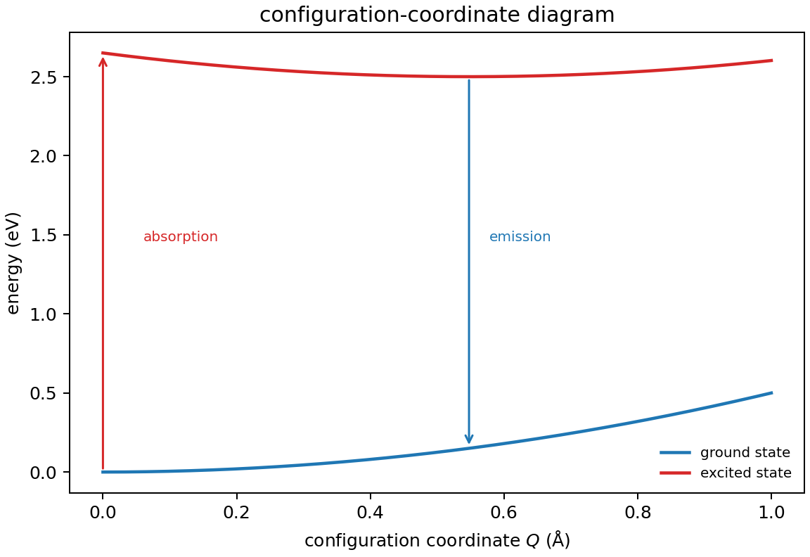

# 点缺陷与光学跃迁

**适用环境：通用（Python 3 + numpy + matplotlib）；DFT 缺陷计算按 VASP / CP2K 篇目准备。**

点缺陷不只是“少了一个原子”。它会引入局域电子态、改变晶格弛豫，并在光激发后把能量以光子或声子的形式释放。发光中心的颜色、荧光寿命和量子效率，都由这些过程竞争决定。

本文用位形坐标模型说明吸收、发射和 Stokes 位移，并给出可运行的 Python 示例。示例是模型计算，不是真实材料的发光参数；缺陷形成能和电荷跃迁能级的计算见[锂电池材料的缺陷化学](../材料应用/锂离子电池/锂电池材料的缺陷化学.md)。

## 缺陷态与电荷跃迁

点缺陷可以在带隙中引入局域态。对电荷态 $q$，形成能随费米能级变化：

$$
E_f(X^q)=E_{\rm tot}(X^q)-E_{\rm tot}({\rm bulk})
-\sum_i n_i\mu_i+q(E_F+E_{\rm VBM})+\Delta E_{\rm corr}.
$$

两个电荷态的交点给出跃迁能级

$$
\varepsilon(q_1/q_2)=\frac{E_f(q_1;E_F=0)-E_f(q_2;E_F=0)}{q_2-q_1}.
$$

若该交点位于形成能下包络且落在带隙内，缺陷可以俘获或释放载流子，成为复合中心、施主/受主或发光中心。缺陷的电子态还可能被晶格畸变稳定（极化子、自陷激子），这时必须同时优化电子占据和原子位置。

## 位形坐标模型

把缺陷周围的晶格畸变压缩成一个简正坐标 $Q$。基态和激发态各用一条抛物线近似：

$$
E_g(Q)=\frac12 kQ^2,
$$

$$
E_e(Q)=E_0+\frac12k(Q-Q_0)^2,
$$

$E_0$ 是两条势能曲线的极小值之差。等曲率近似下，两态零点能相消，此时 $E_0$ 对应零声子线能量。$Q_0$ 是激发态平衡位置相对基态的位移。两条抛物线的最小值错开，所以吸收和发射能量不同。

在 $Q=0$ 处垂直激发，吸收能量

$$
E_{\rm abs}=E_0+\frac12kQ_0^2.
$$

激发态弛豫到 $Q_0$ 后，再从 $Q_0$ 垂直回到基态，发射能量

$$
E_{\rm em}=E_0-\frac12kQ_0^2.
$$

Stokes 位移

$$
E_{\rm abs}-E_{\rm em}=kQ_0^2=2S\hbar\omega,
$$

其中 Huang–Rhys 因子

$$
S=\frac{kQ_0^2}{2\hbar\omega}
$$

衡量电子–声子耦合强度。$S$ 越大，Stokes 位移越大，发射越红移；$S\ll1$ 时吸收和发射接近窄线，$S\gg1$ 时形成宽带的“声子边带”。

## 吸收、发射与非辐射

位形坐标图把三个过程放在一起：

- **吸收**：从基态谷底垂直向上，能量 $E_{\rm abs}$。
- **发射**：从激发态谷底垂直向下，能量 $E_{\rm em}$。
- **非辐射**：激发态通过势能面交叉点回到基态，把能量交给声子；交叉点越低，非辐射越容易。

热激活的非辐射通道可在升温时降低发光效率，形成热猝灭。缺陷浓度高时还会发生浓度猝灭和能量转移。

## 常见缺陷发光中心

- **F 中心**：卤化物晶体中的阴离子空位俘获电子，吸收可见光，颜色随晶格常数变化。
- **空位/间隙缺陷**：氧化物中的氧空位、锌空位等，常在带隙中引入深能级，发光波长对局部配位敏感。
- **稀土/过渡金属掺杂**：$4f$/$3d$ 内壳层跃迁，谱线窄；晶体场决定能级分裂和发射颜色。
- **自陷激子**：激子被晶格畸变局域化，发射宽谱，常见于卤化物和低维材料。

判断一个发光中心，不能只看“带隙里有个态”；还要看跃迁矩阵元、宇称/自旋选择定则、缺陷浓度和竞争的非辐射通道。

## 示例：位形坐标与 Stokes 位移

配套案例在 [defect-optical](../../examples/solid-state/defect-optical/README.md)。输入：

```json
{"E0_eV": 2.5, "S": 3.0, "hbar_omega_eV": 0.05,
 "k_eV_per_A2": 1.0, "Q_max_A": 1.0}
```

运行：

```bash
cd examples/solid-state/defect-optical
python3 -m pip install -r requirements.txt
python3 run.py
```

程序画两条抛物线、吸收/发射箭头，并输出 $Q_0=0.548$ Å、$E_{\rm abs}=2.65$ eV、$E_{\rm em}=2.35$ eV、Stokes 位移 0.30 eV。数字是模型参数，只用于验证公式。



把 $S$ 改成 0，两条抛物线的最小值重合，吸收和发射能量都回到 $E_0$；把 $S$ 改成 10，Stokes 位移变成 1.0 eV，发射明显红移。这两个极限能检查公式和单位。

## 从模型到 DFT

计算缺陷光学通常分几步：

1. **结构优化**：基态和激发态分别优化，注意自旋态和电荷态。
2. **跃迁能**：用 $\Delta$SCF、约束占据或 GW/BSE；普通半局部泛函的带隙偏小，激发能不可靠。
3. **电声耦合**：算 $S$ 和 $Q_0$，可以由声子模式投影或势能面拟合。
4. **有限尺寸修正**：带电缺陷的镜像电荷修正同样适用；中性缺陷的激发态也要检查超胞尺寸。

注意：DFT 的 Kohn–Sham 带隙不是光学带隙；激发能需要准粒子修正或 TDDFT/BSE。不要直接把带隙里的缺陷态能量当作发射光子能量。

## 光谱计算的选择

如果问题是小信号下的吸收边、各向异性或偏振选择，先看频率依赖的介电张量和跃迁矩阵元。若问题是单个发光中心的 Stokes 位移或非辐射弛豫，则分别考虑激发态弛豫、基态与激发态的势能面。介电张量与光学吸收的读图方法见 [VASP 光学性质计算](../VASP/响应与输运/VASP光学性质计算.md)。

## 检查清单

- 缺陷的电荷态、自旋态和费米能级是否说明？
- 基态和激发态是否分别优化？有没有虚频？
- 跃迁能是 $\Delta$SCF、GW 还是实验值？
- Huang–Rhys 因子和 Stokes 位移是否与光谱线宽一致？
- 超胞尺寸和有限尺寸修正是否报告？
- 非辐射通道、浓度猝灭和热猝灭是否考虑？

## 参考

- A. M. Stoneham. *Theory of Defects in Solids*. Oxford University Press, 1975.
- C. Freysoldt, B. Grabowski, T. Hickel, et al. First-principles calculations for point defects in solids. *Rev. Mod. Phys.*, 2014, 86: 253. [doi:10.1103/RevModPhys.86.253](https://doi.org/10.1103/RevModPhys.86.253)
- A. Alkauskas, M. D. McCluskey, C. G. Van de Walle. Tutorial: Defects in semiconductors—combining experiment and theory. *J. Appl. Phys.*, 2016, 119: 181101. [doi:10.1063/1.4948245](https://doi.org/10.1063/1.4948245)
- K. Huang, A. Rhys. Theory of light absorption and non-radiative transitions in F-centres. *Proc. R. Soc. A*, 1950, 204: 406. [doi:10.1098/rspa.1950.0184](https://doi.org/10.1098/rspa.1950.0184)
