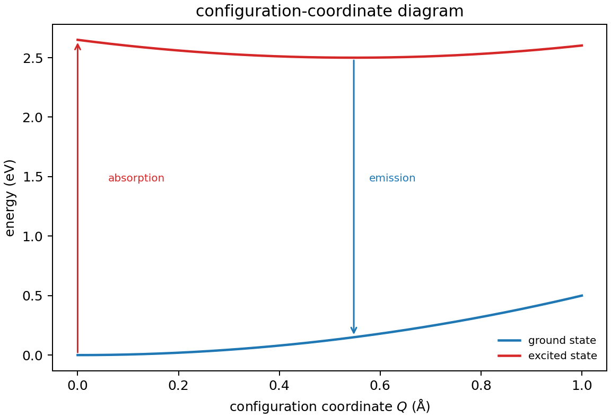

# 点缺陷与光学跃迁

**适用环境：通用（Python 3 + numpy + matplotlib）；DFT 缺陷计算按 VASP / CP2K 篇目准备。**

仓库的位形坐标算例里，两条势能曲线的谷底相差 2.50 eV，吸收和发射的竖直箭头却分别是 2.65 和 2.35 eV。要读懂这三个值，先分清跃迁前后是否改变电荷态，以及离子坐标有没有来得及弛豫。

## 一、先确定两个电子态怎样比较

点缺陷可以在带隙中引入局域态。对电荷态 $q$，形成能随费米能级变化：

$$
E_f(X^q)=E_{\rm tot}(X^q)-E_{\rm tot}({\rm bulk})
-\sum_i n_i\mu_i+q(E_F+E_{\rm VBM})+\Delta E_{\rm corr}.
$$

两个电荷态的交点给出跃迁能级

$$
\varepsilon(q_1/q_2)=\frac{E_f(q_1;E_F=0)-E_f(q_2;E_F=0)}{q_2-q_1}.
$$

若该交点位于形成能下包络且落在带隙内，缺陷可以俘获或释放载流子，成为复合中心、施主/受主或发光中心。这里的能级比较的是经过弛豫的不同电荷态。若研究同一电荷态内的发光，接下来要指定基态和激发态的电子占据，并分别求各自的平衡构型。若研究向能带电离，还需另定义载流子所处的能带参考。 [缺陷形成能算例与口径](../材料应用/锂离子电池/锂电池材料的缺陷化学.md)

## 二、在两条势能曲线上找到三个能量差

把缺陷周围的晶格畸变压缩成一个简正坐标 $Q$。基态和激发态各用一条抛物线近似：

$$
E_g(Q)=\frac12 kQ^2,
$$

$$
E_e(Q)=E_0+\frac12k(Q-Q_0)^2,
$$

$E_0$ 是两条势能曲线的极小值之差。等曲率近似下，两态零点能相消，此时 $E_0$ 对应零声子线能量。$Q_0$ 是激发态平衡位置相对基态的位移。两条抛物线的最小值错开，所以吸收和发射能量不同。

在 $Q=0$ 处垂直激发，吸收能量

$$
E_{\rm abs}=E_0+\frac12kQ_0^2.
$$

激发态弛豫到 $Q_0$ 后，再从 $Q_0$ 垂直回到基态，发射能量

$$
E_{\rm em}=E_0-\frac12kQ_0^2.
$$

Stokes 位移

$$
E_{\rm abs}-E_{\rm em}=kQ_0^2=2S\hbar\omega,
$$

其中 Huang–Rhys 因子

$$
S=\frac{kQ_0^2}{2\hbar\omega}
$$

衡量电子–声子耦合强度。$S$ 越大，Stokes 位移越大，发射越红移；$S\ll1$ 时吸收和发射接近窄线，$S\gg1$ 时形成宽带的“声子边带”。

[交互演示](https://wangchr1617.github.io/research-handbook/#defect-optical)。改变 Huang–Rhys 因子，比较两条竖直跃迁和 Stokes 位移。

### 按四个能量点复算仓库案例

配套案例在 [defect-optical](../../examples/solid-state/defect-optical/README.md)。输入：

```json
{"E0_eV": 2.5, "S": 3.0, "hbar_omega_eV": 0.05,
 "k_eV_per_A2": 1.0, "Q_max_A": 1.0}
```

运行：

```bash
cd examples/solid-state/defect-optical
python3 -m pip install -r requirements.txt
python3 run.py
```

默认参数给出 $Q_0=0.548$ Å。以基态谷底为能量零点，图上的四个能量点如下。吸收沿 $Q=0$ 向上读，发射沿 $Q=Q_0$ 向下读，零声子线在等曲率近似下取两个谷底的差。

| 构型 | 基态能量（eV） | 激发态能量（eV） | 同构型的能量差（eV） |
| --- | ---: | ---: | ---: |
| 基态平衡构型 $Q=0$ | 0.00 | 2.65 | 2.65 |
| 激发态平衡构型 $Q=Q_0$ | 0.15 | 2.50 | 2.35 |

两次竖直跃迁相差 0.30 eV，等于两条曲线各 0.15 eV 的弛豫能之和。以上数值出自教学模型。若两态曲率不同，应分别计算弛豫能，并在估计零声子线时检查零点能之差。



把 $S$ 改成 0，两条抛物线的最小值重合，吸收和发射能量都回到 $E_0$；把 $S$ 改成 10，Stokes 位移变成 1.0 eV，发射明显红移。这两个极限能检查公式和单位。

## 三、从要解释的观测量选择计算方法

若目标是缺陷发光，可用约束占据的 $\Delta$SCF 沿用上表的四点思路：在两个平衡构型上分别计算基态和激发态总能，并核对电子占据、自旋以及弛豫后的局域性。如果自洽过程中激发态回落到基态，应先检查占据约束是否锁住了目标电子态。做带电超胞时要检查电势对齐和有限尺寸修正，中性激发同样需要测试超胞尺寸。若关心晶体的线性吸收边或偏振选择，则应计算频率依赖的介电张量与跃迁矩阵元，必要时用 BSE 等方法处理电子–空穴相互作用。 [VASP 光学性质计算](../VASP/响应与输运/VASP光学性质计算.md)

如果要解释热猝灭，可沿位形坐标估算激发态到达两势能面交叉区域的能垒。不过交叉位置只给出一条可能的弛豫路径；要得到非辐射俘获速率，还需计算电子–声子耦合，并处理振动态重叠与有限温度下的占据分布。因此，发光能量、寿命与量子效率需要各自的定量证据。 [Alkauskas 等，非辐射俘获方法](https://arxiv.org/abs/1407.4197)

## 四、参考文献

- A. M. Stoneham. *Theory of Defects in Solids*. Oxford University Press, 1975.
- C. Freysoldt, B. Grabowski, T. Hickel, et al. First-principles calculations for point defects in solids. *Rev. Mod. Phys.*, 2014, 86: 253. [doi:10.1103/RevModPhys.86.253](https://doi.org/10.1103/RevModPhys.86.253)
- A. Alkauskas, M. D. McCluskey, C. G. Van de Walle. Tutorial: Defects in semiconductors—combining experiment and theory. *J. Appl. Phys.*, 2016, 119: 181101. [doi:10.1063/1.4948245](https://doi.org/10.1063/1.4948245)
- K. Huang, A. Rhys. Theory of light absorption and non-radiative transitions in F-centres. *Proc. R. Soc. A*, 1950, 204: 406. [doi:10.1098/rspa.1950.0184](https://doi.org/10.1098/rspa.1950.0184)
