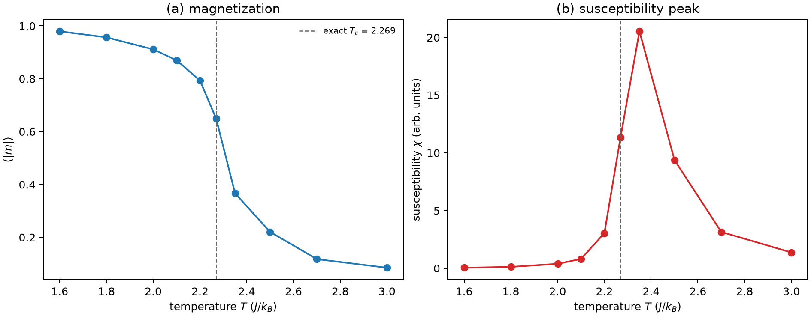

# 磁性与自旋模型

**适用环境：通用（Python 3 + numpy + matplotlib）；DFT 磁性计算按 VASP / OpenMX 篇目准备。**

磁性材料的第一性原理计算常常先问三个问题：磁矩多大、磁序是什么、交换作用有多强。前两个可以从自洽计算直接读出，第三个需要把总能量映射到自旋模型。理解 Ising、Heisenberg 和平均场，才能判断算出的 $T_c$ 是否可信。

本文用二维 Ising 模型的蒙特卡罗说明磁序和相变，并给出可运行的 Python 示例。示例是模型计算，不是真实材料的临界温度。

## 磁矩与交换作用

原子的磁矩来自未配对电子的自旋和轨道。晶体中，局域磁矩之间的交换作用可以写成

$$
\mathcal H=-\sum_{i<j}J_{ij}\,\mathbf S_i\cdot\mathbf S_j
-\sum_i D_i(S_i^z)^2-\mu_B\mathbf B\cdot\sum_i\mathbf g_i\mathbf S_i,
$$

$J_{ij}>0$ 倾向平行（铁磁），$J_{ij}<0$ 倾向反平行（反铁磁）；$D_i$ 是单离子各向异性，每对交换键计一次。交换作用的来源包括：

- **直接交换**：相邻磁性轨道重叠，通常较强，但作用距离短。
- **超交换**：通过非磁性配体（如 O²⁻）间接耦合，常见于氧化物；Goodenough–Kanamori 规则给出轨道占据与符号的关系。
- **RKKY 交换**：通过导电电子极化，作用距离长且符号振荡，常见于稀土金属和稀释磁体。
- **双交换**：混合价态中电子跳跃与自旋排列耦合，常见于锰氧化物。

## Ising 模型与平均场

把自旋限制在 $z$ 方向，$\mathbf S_i\to S_i^z=\pm1$，得到 Ising 模型：

$$
\mathcal H=-J\sum_{\langle ij\rangle}S_iS_j-\mu B\sum_iS_i.
$$

平均场近似把每个自旋感受到的邻居替换成平均值 $m=\langle S\rangle$：

$$
m=\tanh\left(\frac{zJm+\mu B}{k_BT}\right),
$$

$z$ 是配位数。$B=0$ 时，临界温度

$$
T_c^{\rm MF}=\frac{zJ}{k_B}.
$$

平均场给出非零的 $T_c$，但忽略了涨落；在低维体系中涨落会显著降低 $T_c$，二维正方晶格、最近邻铁磁 Ising 模型在零场下的精确结果为

$$
T_c=\frac{2J}{k_B\ln(1+\sqrt2)}\approx2.269\,\frac{J}{k_B}.
$$

三维 Ising 没有精确解，数值结果约为 $4.51J/k_B$（简单立方）。平均场在三维大致可用，在二维明显高估。

## 蒙特卡罗与有限尺寸

Metropolis 算法：随机选一个自旋，计算翻转前后的能量差 $\Delta E$，以概率 $\min(1,e^{-\Delta E/k_BT})$ 接受。经过足够长的平衡步后，测量磁化强度

$$
m=\frac1N\left|\sum_iS_i\right|,
$$

磁化率

$$
\chi=\frac{N}{k_BT}\left(\langle m^2\rangle-\langle m\rangle^2\right),
$$

和比热。这里的 $\chi$ 使用 $|m|$ 的涨落，作为有限尺寸的峰位指标。零场线性响应的涨落公式应使用带符号的磁化 $m_{\rm s}=\sum_i S_i/N$。估计热力学极限的 $T_c$ 时，需要比较多个 $L$。

## 示例：二维 Ising 的磁化与磁化率

配套案例在 [ising-magnetization](../../examples/solid-state/ising-magnetization/README.md)。输入：

```json
{"L": 32, "J": 1.0, "temperatures": [1.6, 1.8, 2.0, 2.1, 2.2, 2.269, 2.35, 2.5, 2.7, 3.0],
 "n_burn": 500, "n_sweeps": 2000, "seed": 7}
```

运行：

```bash
cd examples/solid-state/ising-magnetization
python3 -m pip install -r requirements.txt
python3 run.py
```

程序用棋盘格更新（每次翻转一个子晶格的所有自旋），画出 $\langle|m|\rangle$ 和 $\chi$ 随温度的变化，并用虚线标出精确 $T_c=2.269$。本次采样中 $\chi$ 的峰在 2.35，比热力学极限值高约 3.6%。峰位受尺寸、温度网格与采样长度影响，可用多种尺寸和独立采样估计偏差。



## 从模型到 DFT

用 DFT 提取交换常数，常见做法是：

1. 在同一超胞和晶格几何上构造铁磁、反铁磁等候选自旋排列。使用相同计算设置，核对收敛后的局域磁矩仍对应设定磁序。
2. 按每对键计一次的约定，用海森堡模型拟合 $J_{ij}$。例如单位自旋、单一最近邻交换且所有 $N_b$ 条键在反铁磁态均反平行时，$E_{\rm AFM}-E_{\rm FM}=2N_bJ$。多个交换参数需要多个独立磁构型。
3. 将 $J$、晶格和必要的磁各向异性代入自旋模型。二维体系的有限温磁序对自旋对称性敏感，二维 Ising 的临界温度对应离散自旋模型。

注意：

- **DFT+U**：强关联 $d$/$f$ 体系需要加 $U$；$U$ 的取值影响磁矩和交换常数，必须报告。
- **金属**：巡游磁性不能用局域自旋模型简单描述；需要自旋极化计算、态密度和 Stoner 判据。
- **各向异性**：单离子各向异性决定易磁化轴，需要非共线计算或磁各向异性能。
- **有限尺寸**：蒙特卡罗的 $T_c$ 依赖 $L$，不能拿一个尺寸的结果直接和实验比。

## 检查清单

- 磁矩是否收敛？每个磁性原子的局域磁矩是否合理？
- 拟合交换时是否统一晶格几何？磁构型总能量差是否大于数值误差？
- $J$ 的符号和配位数是否与磁序一致？
- 蒙特卡罗是否平衡？$\chi$ 峰是否随 $L$ 移动？
- DFT+U 的 $U$、泛函、k 点是否报告？
- 是否考虑了各向异性和自旋轨道耦合？

软件操作见 [OpenMX 磁序与局域磁矩](../OpenMX/电子结构与磁性/OpenMX磁序与局域磁矩.md)与 [VASP 磁各向异性能](../VASP/泛函与磁性/VASP磁各向异性能.md)。

进一步阅读可按磁性的来源分流。Yosida 的《Theory of Magnetism》第一部分讨论晶体中的磁离子与交换，第二部分讨论局域自旋的铁磁与反铁磁，第三部分讨论金属中的巡游电子，第四部分讨论稀磁杂质与 Kondo 效应。用总能量差拟合局域自旋模型前，先检查不同磁构型的局域磁矩大小是否近似保持。金属中磁矩振幅随构型明显变化时，需要把巡游电子和纵向涨落纳入分析。[Yosida，1996](https://link.springer.com/book/9783540606512)

## 参考

- C. Kittel. *Introduction to Solid State Physics*, 8th ed. Wiley, 2004.
- S. Blundell. *Magnetism in Condensed Matter*. Oxford University Press, 2001.
- L. Onsager. Crystal statistics. I. A two-dimensional model with an order-disorder transition. *Phys. Rev.*, 1944, 65: 117. [doi:10.1103/PhysRev.65.117](https://doi.org/10.1103/PhysRev.65.117)
- J. Goodenough. *Magnetism and the Chemical Bond*. Interscience, 1963.
