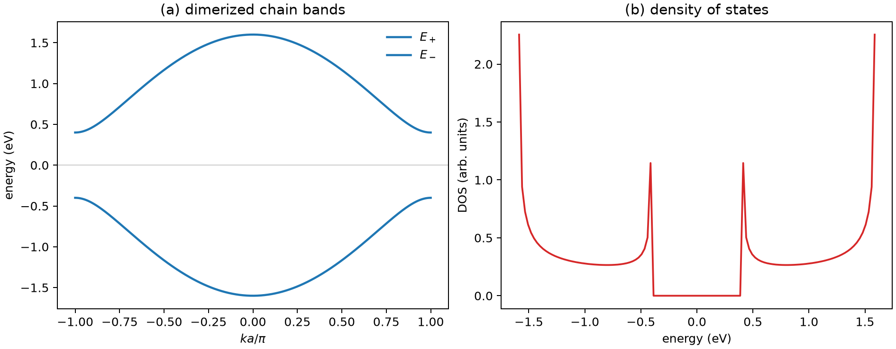

# 能带结构与紧束缚模型

**适用环境：通用（Python 3 + numpy + matplotlib）；DFT 能带部分按 VASP / CP2K 篇目准备。**

把一维链的晶胞加倍，画出的能带会从一条变成两条。若两种键的跃迁相同，两支只是在新区边界相接。若跃迁交替，交点才会分裂。下面用仓库的二聚化链案例重现这两种情形，再把读图方法接到 DFT 超胞能带。

## 一、从单原子链看带宽和曲率

周期势中电子本征态的能量随波矢的变化。理解这一点，才能判断计算出的带隙、有效质量和费米面是否合理，而不是只看软件画出的曲线好不好看。

本文用一维二聚化链的紧束缚模型说明能带、带隙和态密度从哪里来，并给出可运行的 Python 示例。示例是模型计算，不是任何真实材料的 DFT 结果。

### Bloch 定理与倒空间

周期势 $V(\mathbf r+\mathbf R)=V(\mathbf r)$ 下，电子本征态可以写成

$$
\psi_{n\mathbf k}(\mathbf r)=e^{i\mathbf k\cdot\mathbf r}u_{n\mathbf k}(\mathbf r),
$$

$u_{n\mathbf k}$ 具有与晶格相同的周期性，$n$ 是能带指标，$\mathbf k$ 限制在第一布里渊区。能带 $E_n(\mathbf k)$ 是倒空间中的周期函数，因此只需要画一个布里渊区。

实空间晶格常数为 $a$ 时，倒空间周期为 $2\pi/a$。第一布里渊区边界在 $k=\pm\pi/a$。区边界是比较折叠能带的位置，是否开隙还取决于周期势或跃迁项能否耦合相遇的两支。

### 最近邻跃迁怎样改变色散

把晶体轨道写成原子轨道的线性组合：

$$
\psi_{\mathbf k}(\mathbf r)=\frac{1}{\sqrt N}\sum_{\mathbf R}e^{i\mathbf k\cdot\mathbf R}\phi(\mathbf r-\mathbf R).
$$

只保留最近邻跃迁 $t$，一维单原子链的色散为

$$
E(k)=-2t\cos(ka).
$$

带宽 $4|t|$，有效质量

$$
m^*=\hbar^2\left(\frac{d^2E}{dk^2}\right)^{-1}
$$

在带底为 $\hbar^2/(2|t|a^2)$。$t$ 越大，带宽越宽、电子越容易离域；$t\to0$ 时能带变平，对应局域态。

## 二、在相同的双格点晶胞里打开带隙

取含两个格点的晶胞，$a$ 此时是双格点晶胞的重复长度。令两个格点现场能相同并取为零，最近邻跃迁分为同号的胞内 $t_1$ 和胞间 $t_2$，色散为

$$
E_\pm(k)=\pm\sqrt{t_1^2+t_2^2+2t_1t_2\cos(ka)}.
$$

在布里渊区边界 $k=\pi/a$，根号内为 $(t_1-t_2)^2$，能隙为

$$
E_g=2|t_1-t_2|.
$$

$t_1=t_2$ 时能隙关闭，得到均匀单原子链在双格点晶胞中的折叠色散；在半填充的一维链中，二聚化可以打开费米能级处的带隙，降低占据态的电子能量。实际是否发生 Peierls 畸变，还要计入晶格畸变的能量代价。

[交互演示](https://wangchr1617.github.io/research-handbook/#tight-binding)。调节胞内和胞间跃迁，观察区边界带隙闭合及孤立二聚体的平带。

### 先定义 DOS 的计数口径

态密度

$$
g(E)=\sum_{n}\int_{\rm BZ}\frac{d^d k}{(2\pi)^d}\delta(E-E_n(\mathbf k))
$$

描述单位实空间体积（或低维体系的面积、长度）、单位能量的态数。一维最近邻链在带边 $E_{\rm edge}=\pm2|t|$ 附近有 $g(E)\propto1/\sqrt{|E-E_{\rm edge}|}$，出现范霍夫奇点；二维和三维的奇点形状不同。输运、光吸收和超导转变都和费米面附近的态密度有关。

### 用脚本复现开隙和闭隙

配套案例在 [tight-binding-band](../../examples/solid-state/tight-binding-band/README.md)。输入只有 $t_1$、$t_2$ 和晶格常数：

```json
{"t1_eV": 1.0, "t2_eV": 0.6, "a_A": 1.0, "n_k": 401}
```

运行：

```bash
cd examples/solid-state/tight-binding-band
python3 -m pip install -r requirements.txt
python3 run.py
```

程序画出上下两个能带和态密度，并输出带隙 $2|t_1-t_2|=0.8$ eV。输出中的 `bandwidth_eV` 为两条带合起来的全谱跨度 $2(t_1+t_2)=3.2$ eV，每条带自身宽度为 1.2 eV。解析态密度在带边有奇点，图中则用有限分箱显示，直方图积分为 1。靠近带隙边缘的箱子若横跨带边，要回到色散极值读隙宽。



把 $t_2$ 改成与 $t_1$ 相等，带隙应关闭；把 $t_2$ 改成 0，上下带变成两条平带。先做这两个极限，能快速检查代码和公式是否对得上。

## 三、用同样的思路读 DFT 超胞能带

如果原胞和超胞的图上支数不同，先问晶格周期是否真的改变。仅改用更大的重复单元会折叠能带，比较时可按[反折叠笔记](../VASP/电子结构与成键/VASP能带反折叠.md)追踪原胞波矢的谱权重。若要判断实际材料的带隙，区分路径图上的表观带隙与完整布里渊区的带边。比较泛函或 SOC 的影响时保持结构及采样口径一致。有效质量应在同一带边附近拟合曲率，DOS 核对电子数则应按占据加权，并保留自旋权重。

## 四、参考文献

- C. Kittel. *Introduction to Solid State Physics*, 8th ed. Wiley, 2004.
- N. W. Ashcroft, N. D. Mermin. *Solid State Physics*. Holt, Rinehart and Winston, 1976.
- R. M. Martin. *Electronic Structure: Basic Theory and Practical Methods*. Cambridge University Press, 2004.
- R. Peierls. *Quantum Theory of Solids*. Oxford University Press, 1955.
