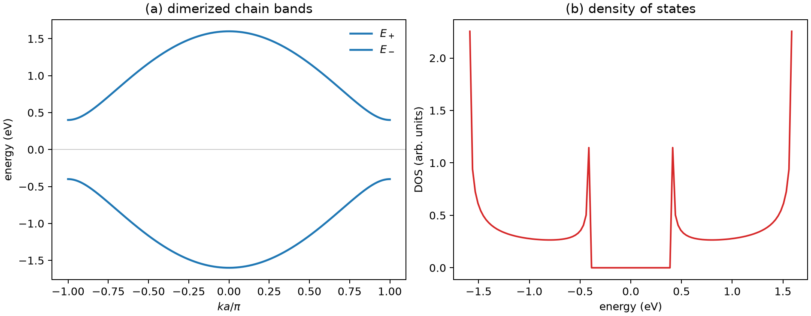

# 能带结构与紧束缚模型

**适用环境：通用（Python 3 + numpy + matplotlib）；DFT 能带部分按 VASP / CP2K 篇目准备。**

能带图上的每条线都不是“一个电子的轨道”，而是周期势中电子本征态的能量随波矢的变化。理解这一点，才能判断计算出的带隙、有效质量和费米面是否合理，而不是只看软件画出的曲线好不好看。

本文用一维二聚化链的紧束缚模型说明能带、带隙和态密度从哪里来，并给出可运行的 Python 示例。示例是模型计算，不是任何真实材料的 DFT 结果。

## Bloch 定理与倒空间

周期势 $V(\mathbf r+\mathbf R)=V(\mathbf r)$ 下，电子本征态可以写成

$$
\psi_{n\mathbf k}(\mathbf r)=e^{i\mathbf k\cdot\mathbf r}u_{n\mathbf k}(\mathbf r),
$$

$u_{n\mathbf k}$ 具有与晶格相同的周期性，$n$ 是能带指标，$\mathbf k$ 限制在第一布里渊区。能带 $E_n(\mathbf k)$ 是倒空间中的周期函数，因此只需要画一个布里渊区。

实空间晶格常数为 $a$ 时，倒空间周期为 $2\pi/a$。第一布里渊区边界在 $k=\pm\pi/a$；边界处的能隙来自晶格周期性对波的布拉格反射。

## 紧束缚：从原子轨道到能带

把晶体轨道写成原子轨道的线性组合：

$$
\psi_{\mathbf k}(\mathbf r)=\frac{1}{\sqrt N}\sum_{\mathbf R}e^{i\mathbf k\cdot\mathbf R}\phi(\mathbf r-\mathbf R).
$$

只保留最近邻跃迁 $t$，一维单原子链的色散为

$$
E(k)=-2t\cos(ka).
$$

带宽 $4|t|$，有效质量

$$
m^*=\hbar^2\left(\frac{d^2E}{dk^2}\right)^{-1}
$$

在带底为 $\hbar^2/(2|t|a^2)$。$t$ 越大，带宽越宽、电子越容易离域；$t\to0$ 时能带变平，对应局域态。

## 二聚化与带隙

如果每个晶胞有两个不等价的原子（或键长交替），最近邻跃迁分成胞内 $t_1$ 和胞间 $t_2$，色散变为

$$
E_\pm(k)=\pm\sqrt{t_1^2+t_2^2+2t_1t_2\cos(ka)}.
$$

在布里渊区边界 $k=\pi/a$，根号内为 $(t_1-t_2)^2$，能隙为

$$
E_g=2|t_1-t_2|.
$$

$t_1=t_2$ 时能隙关闭，回到单原子链；在半填充的一维链中，二聚化可以打开费米能级处的带隙，降低占据态的电子能量。实际是否发生 Peierls 畸变，还要计入晶格畸变的能量代价。

真实材料中，带隙还来自离子势、轨道重叠和电子相互作用；紧束缚模型只保留跳跃项，不能直接给出正确的带隙绝对值，但能说明带隙“从哪里来”。

## 态密度与范霍夫奇点

态密度

$$
g(E)=\sum_{n}\int_{\rm BZ}\frac{d^d k}{(2\pi)^d}\delta(E-E_n(\mathbf k))
$$

描述单位实空间体积（或低维体系的面积、长度）、单位能量的态数。一维最近邻链在带边 $E_{\rm edge}=\pm2|t|$ 附近有 $g(E)\propto1/\sqrt{|E-E_{\rm edge}|}$，出现范霍夫奇点；二维和三维的奇点形状不同。输运、光吸收和超导转变都和费米面附近的态密度有关。

## 示例：二聚化链的能带与态密度

配套案例在 [tight-binding-band](../../examples/solid-state/tight-binding-band/README.md)。输入只有 $t_1$、$t_2$ 和晶格常数：

```json
{"t1_eV": 1.0, "t2_eV": 0.6, "a_A": 1.0, "n_k": 401}
```

运行：

```bash
cd examples/solid-state/tight-binding-band
python3 -m pip install -r requirements.txt
python3 run.py
```

程序画出上下两个能带和态密度，并输出带隙 $2|t_1-t_2|=0.8$ eV、带宽 $2(t_1+t_2)=3.2$ eV。态密度在带边发散，带隙内为零；这是解析式直接给出的，不是数值拟合。



把 $t_2$ 改成与 $t_1$ 相等，带隙应关闭；把 $t_2$ 改成 0，上下带变成两条平带。先做这两个极限，能快速检查代码和公式是否对得上。

## 从模型到 DFT 能带

DFT 能带计算要额外注意：

- **k 路径**：高对称路径要覆盖布里渊区的关键点；只画一条线可能漏掉能带交叉或节点。
- **泛函**：PBE 通常低估带隙，HSE 或 GW 更接近实验，但成本高；不要拿不同泛函的带隙直接比较。
- **自旋轨道耦合**：重元素、拓扑材料和磁性材料需要 SOC；没有 SOC 的能带可能给出错误的简并。
- **占据与 smearing**：金属要用合适的 smearing，绝缘体用四面体方法；smearing 太大会抹掉小带隙。
- **能带反折叠**：超胞计算出的能带要反折叠到原胞，才能和模型或 ARPES 比较。

## 检查清单

- 能带是否在布里渊区边界打开带隙？带隙位置和大小是否与结构畸变一致？
- 费米能级穿过的能带数目是否与电子计数一致？
- 有效质量是否在带边用二阶差分计算？单位是否换算正确？
- DOS 的归一化与自旋权重是否一致？核对电子数时要将 DOS 按占据数加权后积分。
- DFT 的泛函、k 点、截断和 SOC 是否在图中注明？
- 是否把超胞能带误当成原胞能带，导致带折叠？

## 参考

- C. Kittel. *Introduction to Solid State Physics*, 8th ed. Wiley, 2004.
- N. W. Ashcroft, N. D. Mermin. *Solid State Physics*. Holt, Rinehart and Winston, 1976.
- R. M. Martin. *Electronic Structure: Basic Theory and Practical Methods*. Cambridge University Press, 2004.
- R. Peierls. *Quantum Theory of Solids*. Oxford University Press, 1955.
