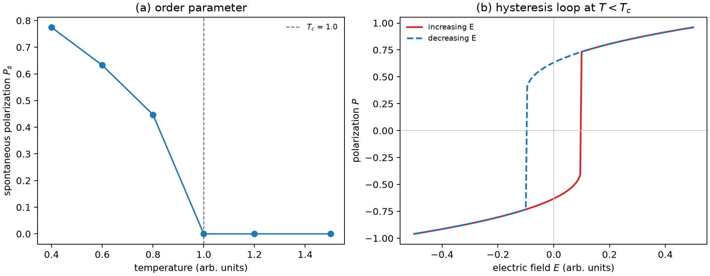

# 铁电性与软模

**适用环境：通用（Python 3 + numpy + matplotlib）；DFT 铁电计算按 VASP / CP2K 篇目准备。**

铁电材料在没有外场时也有自发极化，且极化可以被外场翻转。它的两个核心图像是：自由能面上的双势阱，以及声子谱中随温度软化的横光学支。前者解释“为什么有极化”，后者解释“为什么偏偏在这个温度失稳”。

本文用 Landau–Devonshire 模型说明自发极化、介电响应发散和电滞回线，并给出可运行的 Python 示例。示例是模型计算，不是真实铁电体的参数。

## 自发极化与双势阱

把自由能按极化强度 $P$ 展开，保留到四阶：

$$
F(P)=\frac{\alpha}{2}P^2+\frac{\beta}{4}P^4-EP,
$$

$\alpha=a(T-T_c)$，$\beta>0$，$E$ 是外电场。没有外场时，极值满足

$$
\frac{\partial F}{\partial P}=\alpha P+\beta P^3=0.
$$

- $T>T_c$：$\alpha>0$，唯一极小在 $P=0$，顺电相。
- $T<T_c$：$\alpha<0$，$P=0$ 变成极大，两个极小在

$$
P_s=\pm\sqrt{-\frac{\alpha}{\beta}},
$$

即自发极化。自由能曲线是双势阱，两个谷对应两个极化方向。

这是**二级相变**的 Landau 图像：$P_s$ 在 $T_c$ 连续降到零。若展开式含六阶项且 $\beta<0$，相变可以是一级，$P_s$ 在 $T_c$ 不连续。

## 介电响应与矫顽场

把 $F$ 视为自由能密度。极化对外场的微分响应为 $\chi_P=\partial P/\partial E$，其倒数等于平衡点的自由能曲率。

$$
\chi_P^{-1}=\left.\frac{\partial^2F}{\partial P^2}\right|_{P=P_s}
=\alpha+3\beta P_s^2.
$$

代入 $P_s^2=-\alpha/\beta$，得 $\chi_P^{-1}=-2\alpha=2a(T_c-T)$，所以 $T\to T_c^-$ 时介电常数发散。这一发散对应四阶模型的连续相变。实际介电峰还受相变级数、畴、缺陷和测量频率影响。

矫顽场由 $E(P)=\alpha P+\beta P^3$ 的极值给出：

$$
E_c=\frac{2}{3\sqrt3}\frac{(-\alpha)^{3/2}}{\sqrt{\beta}}.
$$

$T$ 越接近 $T_c$，$|\alpha|$ 越小，矫顽场越低。电滞回线是 $P$–$E$ 平面上的双稳态：外场扫过时，极化在矫顽场附近跳变。

## 软模

对连续位移型铁电相变，从顺电相降温时，极性的横光学（TO）模逐渐软化。

$$
\omega_{\rm TO}^2\propto(T-T_c),
$$

在 $T_c$ 处趋近零，晶格对极化方向的恢复力消失，静态极化出现。Cochran 和 Anderson 在 1950 年代提出这个软模图像；它把宏观的 Landau 系数和微观的声子频率联系起来。

软模不是所有铁电体都成立。order-disorder 型铁电体（如某些氢键晶体）的相变更像有序–无序转变，而不是单个声子频率降到零；区分两者需要看声子谱、熵和结构涨落。

## 退极化场与畴

真实样品不是一块无限大的均匀极化体：

- **退极化场**：极化在表面产生束缚电荷，形成与极化反向的电场；样品越薄，退极化场越强，可能把单畴拆成多畴。
- **畴壁**：不同极化方向的区域之间的边界；畴壁能、缺陷钉扎和电场共同决定畴结构。
- **尺寸效应**：纳米薄膜的 $T_c$ 和矫顽场随厚度变化；界面、应变和电极屏蔽都会改变边界条件。

因此，DFT 算出的“理想单畴极化”不能直接和薄膜实验比较；要先说明电学边界条件。

## 示例：Landau 双势阱与电滞回线

配套案例在 [ferroelectric-double-well](../../examples/solid-state/ferroelectric-double-well/README.md)。输入：

```json
{"Tc": 1.0, "a0": 1.0, "beta": 1.0,
 "T_points": [0.4, 0.6, 0.8, 1.0, 1.2, 1.5],
 "E_max": 0.5, "n_E": 201}
```

运行：

```bash
cd examples/solid-state/ferroelectric-double-well
python3 -m pip install -r requirements.txt
python3 run.py
```

程序画出 $P_s(T)$ 和 $T<T_c$ 的 $P$–$E$ 回线。本次参数下 $P_s(0.4)=0.775$，矫顽场估计 $0.097$；回线在 $\pm0.1$ 附近跳变，和估计一致。数值是任意单位，只用于验证公式。



当前脚本用四阶模型，扫场温度固定为 0.6。理论上，$T>T_c$ 时 $E(P)$ 单调，升场和降场沿同一分支，小场极限为 $P\approx E/\alpha$。

## 从模型到 DFT

DFT 计算铁电性常用：

- **Berry phase 极化**：计算极化量子，注意分支和参考结构；极化差才是物理量。
- **Born 有效电荷**：描述电场对原子的力，判断软模和 LO–TO 劈裂。
- **声子谱**：找 TO 软模；虚频说明结构不稳定，需要畸变到低对称结构。
- **应变/外场**：用固定应变或有限电场计算，得到压电和介电响应。

周期晶体的总极化包含离子和电子贡献。Berry 相位给出的极化值相差整数倍极化量子 $e\mathbf R/\Omega$ 时物理等价，$\mathbf R$ 为晶格矢量，$\Omega$ 为晶胞体积。计算自发极化时，从绝缘参考结构出发，沿连续且保持绝缘的畸变路径追踪同一分支，再取极化差。若相邻点的跃变接近极化量子，先加密路径确认分支。实操见 [VASP Berry 相位极化](../VASP/响应与输运/VASPBerry相极化与Born有效电荷.md)。

## 检查清单

- 高对称结构是否优化到力收敛？有没有虚频？
- 极化是否用 Berry phase 计算？参考结构和分支是否说明？
- $T_c$ 是实验值、Landau 拟合值，还是声子软模外推值？
- 是否考虑了退极化场、畴和电极屏蔽？
- 薄膜的应变、厚度和边界条件是否报告？
- 一级/二级相变是否用六阶项或潜热区分？

## 参考

- M. E. Lines, A. M. Glass. *Principles and Applications of Ferroelectrics and Related Materials*. Oxford University Press, 1977.
- K. M. Rabe, C. H. Ahn, J.-M. Triscone (eds.). *Physics of Ferroelectrics: A Modern Perspective*. Springer, 2007.
- W. Cochran. Crystal stability and the theory of ferroelectricity. *Adv. Phys.*, 1960, 9: 387. [doi:10.1080/00018736000101229](https://doi.org/10.1080/00018736000101229)
- N. A. Spaldin. A beginner's guide to the modern theory of polarization. *J. Solid State Chem.*, 2012, 195: 2–10. [DOI](https://doi.org/10.1016/j.jssc.2012.05.010)
- R. Resta. Macroscopic polarization in crystalline dielectrics: the geometric phase approach. *Rev. Mod. Phys.*, 1994, 66: 899. [doi:10.1103/RevModPhys.66.899](https://doi.org/10.1103/RevModPhys.66.899)
