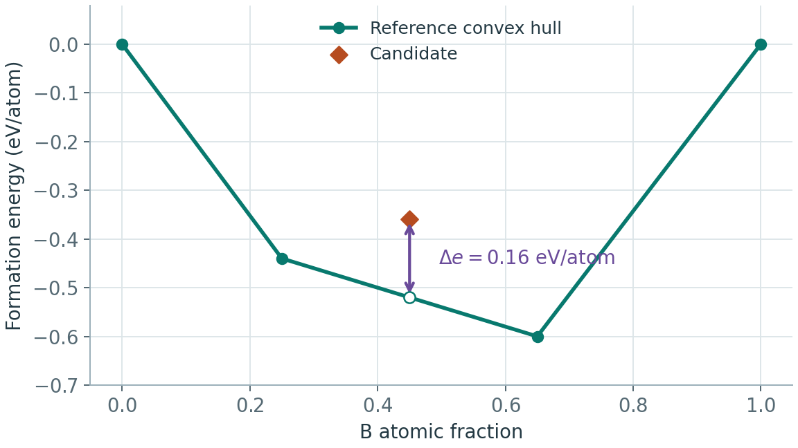

# 晶体结构评价：从匹配率到 SUN 与 mSUN

适用环境：通用。指标实现与来源核对截至 2026-11-07。

## 结构恢复与材料发现回答不同问题

组成条件 CSP 通常问“是否找回参考结构”，无条件生成问“产生了多少值得研究的新候选”。预测出参考结构之外的低能多晶型可能有价值，却不计为参考匹配；不断复现已知稳定结构可能提高稳定率，却降低发现任务的新颖性。

| 指标 | 含义与单位 | 必须同时说明 |
| --- | --- | --- |
| Match rate / success rate | 与参考结构匹配的测试目标比例 | 匹配容差、是否允许超胞或晶胞变换、弛豫前后状态 |
| Best-of-k / top-k | 每个目标的 k 个候选中至少一个成功；或排序前 k 个中成功 | 是否先看参考答案挑选；k、排序模型和额外计算预算 |
| RMSD / RMSE | 经周期对齐、晶胞等价与原子映射后的位移误差 | Å 或无量纲归一化、是否只在匹配成功子集平均 |
| Validity | 格式、周期几何、距离及化学启发式通过率 | 哪些检查；形式价态不适合的体系怎样处理 |
| Uniqueness | 批内去重后不同结构的比例 | 采样量、结构匹配算法与代表选择顺序 |
| Novelty | 与指定参考库不匹配的比例 | 参考库、版本；按组成还是结构判新 |
| Target success / MAE | 目标性质命中率或误差，按目标物理量给单位 | 预测器、DFT 或实验；容差窗口与有效样本分母 |
| Diversity / coverage | 组成、空间群、结构特征分布及对参考空间的覆盖 | 特征、距离、阈值；随机无效结构也可非常“多样” |
| 成本 | 墙钟时间、CPU/GPU 小时、DFT 调用量、网络求值次数 NFE | 硬件、批量、训练及弛豫是否计入 |

同一空间群可以对应不同结构；同一晶体在不同容差下也可能被识别为不同空间群。因此空间群命中只能补充结构匹配。具体实现可从 [DiffCSP 评估代码](https://github.com/jiaor17/DiffCSP) 和 [pymatgen StructureMatcher](https://pymatgen.org/pymatgen.analysis.html) 学习。

## 形成能、凸包与能量高出凸包

形成能比较化合物与元素参考；负形成能仍可能高于若干竞争化合物的混合物。对固定组成 $\mathbf{x}$，参考相图的最低分解能可写成

$$
e_{\mathrm{hull}}(\mathbf{x})=
\min_{\lambda_j\geq0}\sum_j\lambda_j e_j,
\quad \sum_j\lambda_j=1,\quad
\sum_j\lambda_j\mathbf{x}_j=\mathbf{x}.
$$

候选与该基线之差为 $\Delta e=e_{\mathrm{candidate}}-e_{\mathrm{hull}}(\mathbf{x})$，通常以 eV/atom 或 meV/atom 报告，1 eV/atom = 1000 meV/atom。

在示意二元相图中，候选的形成能为 −0.36 eV/atom，同组成处的参考凸包为 −0.52 eV/atom，两者相差 0.16 eV/atom。

若候选尚未加入参考凸包，$\Delta e$ 可为负，表示它将降低旧凸包；重新把候选纳入完整相图后，严格意义的 energy above hull 非负，稳定相取零。论文把两种量都简称 $E_{\mathrm{hull}}$ 时，要回到实现核对。

构造相图要求统一参考理论与兼容能量校正。缺少竞争相会使稳定性判断过于乐观；使用不同势模型估计候选与参考相，也会引入能量零点及组成相关偏差。背景见 [Materials Project 相图文档](https://docs.materialsproject.org/methodology/materials-methodology/thermodynamic-stability/phase-diagrams-pds)与[能量比较笔记](../计算化学/计算层级切换与能量比较.md)。

## SUN 究竟怎样计算

SUN 是 stable、unique、novel，即稳定、批内独特、相对参考库新颖。设原始生成尝试数为 $N_0$，对稳定候选去重、再排除已知结构后剩下 $N_{\mathrm{SUN}}$ 个代表，一种常用的端到端产率定义为

$$
\mathrm{SUN}=\frac{N_{\mathrm{SUN}}}{N_0}\times100\%.
$$

三个独立报告的边际百分数不能直接相乘，因为稳定、新颖和去重通常相互关联。若采用逐步条件筛选，可以将每步的条件通过率相乘，结果才等于最终产率；还应说明去重和稳定性筛选的顺序。

“Stable”阈值及零点附近的数值容差依评估协议而定。[MatterGen（2025）](https://www.nature.com/articles/s41586-025-08628-5)推动了这一组合指标的使用，但跨论文比较仍须对齐阈值、参考相图、匹配方法与弛豫设置，不能只看相同缩写。

## mSUN / MSUN 的两个口径

小写 m 通常指 metastable，部分项目写 MSUN 或 MetaSUN。它不是统一标准，也不是 mean SUN。以下两种用法都能在当前材料生成评估中见到：

| 口径 | 能量条件示例 | 与 SUN 的关系 |
| --- | --- | --- |
| 狭义亚稳区间 | $0<\Delta e\leq0.1$ eV/atom，另加独特和新颖 | 与 $\Delta e\leq0$ 的 SUN 分开；二者可求和得到宽阈值产率 |
| 宽阈值低能集合 | $\Delta e\leq0.1$ eV/atom，另加独特和新颖 | 包括稳定结构，SUN 是其子集；不能再次相加 |

[LeMat-GenBench README](https://github.com/LeMaterial/lemat-genbench)将 SUN、MetaSUN 和 Combined 分开描述；[Orbitol，2026-10，附录 C](https://arxiv.org/html/2610.30086v1)的 MSUN 明确包括 SUN，并区分其与 GEODE 表格口径。这个例子说明：应引用公式与实现，而不能凭字母大小写判断是否包括稳定相。0.1 eV/atom 是这些协议中的筛选阈值，不能当作所有体系的可合成界线。

教学算例：生成 1000 次，最终得到 20 个稳定、独特、新颖结构，另有 80 个位于上述狭义亚稳区间。SUN 为 2%，狭义 mSUN 为 8%，宽阈值 MSUN 为 10%。这里是解释定义的假设数字。

若只在 500 个成功弛豫结构中统计，百分数将翻倍，应同时给出原始分母和失败数。

截至核对日，LeMat-GenBench 官方仓库公告：早期未锁定 MACE checkpoint 的配置可能混用了候选能量与参考凸包的能量尺度，受影响历史结果正在重算。复现应锁定提交、势权重与凸包文件，并记录重算状态，不能直接复用旧榜单数字。

## 稳定性与对称性术语

| 术语 | 科学含义 | 结果检查 |
| --- | --- | --- |
| 局部极小点 / basin | 小扰动附近能量不下降的构型及其吸引域 | 力和应力收敛；必要时检查曲率与声子 |
| 热力学稳定 / metastability | 给定条件下相对竞争相的自由能最低 / 可局部存在的非最低相 | 静态相图只是特定近似；寿命还由势垒决定 |
| 动力学稳定 | 在所研究结构与条件下对微小扰动稳定 | 全布里渊区声子；Γ 点没有虚频不足以排除有限波矢软模 |
| polymorph / prototype | 同组成的不同晶型 / 可跨元素复用的结构原型 | 组成与结构身份分别判断 |
| space group / Wyckoff orbit | 晶体对称操作集合 / 对称等价位置的轨道 | 多重度、位点对称性、自由坐标及组成相容性 |
| Z / Z′ | 晶胞内化学式单元数 / 分子晶体不对称单元中的独立化学式单元数 | 常规胞、原胞与分子计数约定 |
| synthesizability | 在具体反应物、条件与工艺下制备目标材料的能力 | 合成路径、相纯度与结构表征；SUN 本身不提供这些信息 |

对称性条件生成还应报告弛豫后是否保留目标空间群，以及同时满足低能、新颖和目标对称性的联合产率。原始 CIF 写入的空间群标签与重新识别出的结构对称性应分别检查。
