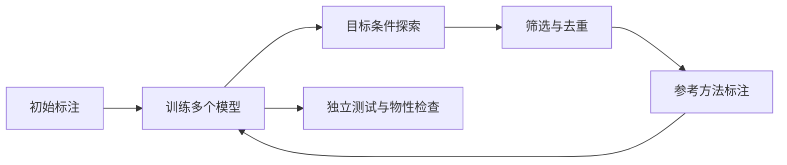

# 势函数的数据、主动学习与结果检查

**适用环境：通用（方法）；DFT 标注与 MD 按各软件环境执行。**

势函数能学到的范围由参考方法和采样共同决定。先描述打算研究的元素、相态、温压、缺陷和反应，再选择训练数据。相同网络架构在不同数据集上可以成为完全不同的模型。

## 一、建立可追溯的数据表

每个结构至少保留晶胞、周期性、元素、坐标、总能、力和来源标识。若使用应力，记录单位与正负号；若来源包含不同泛函、赝势、自旋或 Hubbard $U$，先解释如何处理其不一致性。

| 数据范围 | 用途 | 容易漏掉的内容 |
| --- | --- | --- |
| 弛豫附近的小扰动 | 平衡结构、弹性与声子 | 不稳定模、不同应变方向 |
| 不同温度的独立轨迹 | 热振动、扩散、液体 | 同一轨迹的时间相关性 |
| 体积与应变扫描 | 压力、机械响应 | 拉伸、压缩及剪切 |
| 缺陷、表面与界面 | 迁移、成核、界面反应 | 低配位和不同终止面 |
| 短距离排斥构型 | 避免非物理原子重叠 | 高能构型的 DFT 收敛质量 |

力中突然出现极端值时，先核对几何、单位和电子收敛，不能一律当作脏数据删除。若确实排除错误标签，写明规则并保留来源。

## 实践：先检查一帧 extxyz，再检查整个数据集

下面生成一个带标签的教学数据文件，标签来自 ASE 的 EMT 势，适用于 Cu 等该模型支持的元素。EMT 是参考势计算，不是 DFT；此例用于验证格式和读取逻辑：

```python
from ase.build import bulk
from ase.calculators.emt import EMT
from ase.io import write, read
atoms = bulk("Cu", "fcc", a=3.60, cubic=True)
atoms.calc = EMT()
print(atoms.get_potential_energy(), atoms.get_forces().shape)
write("cu_emt.extxyz", atoms, format="extxyz")
restored = read("cu_emt.extxyz")
assert len(restored) == 4
assert restored.get_forces().shape == (4, 3)
```

文件第二行的 `Lattice` 有九个分量，`Properties` 说明每个原子行的列布局，能量是结构总能；不能把每原子能写进总能字段后仍按总能训练。ASE 可把读取的标签放进 `SinglePointCalculator`，因此应通过 `get_potential_energy()` / `get_forces()` 核对，不能只检查 `atoms.info` 中有没有某个键。

## 二、先划分，再训练

按独立轨迹、材料身份、相态或母结构分组。训练集用于拟合，验证集用于选超参数，测试集用于最终评估。把同条 MD 的相邻帧随机分到两边，往往只测试了插值能力。代码示例见[数据划分与模型评估](../../机器学习/基础与评估/数据划分与模型评估.md)。

主动学习产生的新标注可以加入训练池，但应预留不会反复参与决策的独立测试集。不能为了降低测试误差而把难例移回训练集，随后继续使用原来的“测试集”名称。

## 三、主动学习在做什么

DP-GEN 把探索、标注和训练组成循环；MTP 的主动学习常基于 D-optimality 与外推等级。它们选择的是有助于补足模型的信息，不是为每个预测提供严格的误差上界。[^dpgen][^mtp]



例如有 $K$ 个独立初始化的模型，对同一个原子的力预测为 $\mathbf F_i^{(k)}$。先求均值，再求分歧：

$$
\overline{\mathbf F}_i=\frac1K\sum_k\mathbf F_i^{(k)},\qquad
d_i=\sqrt{\frac1K\sum_k\|\mathbf F_i^{(k)}-\overline{\mathbf F}_i\|^2}.
$$

可以用 $\max_i d_i$ 做构型级指标。其单位与力相同，但分歧不是参考误差：多个模型可能共同犯错。阈值应结合参考计算抽查、体系尺度和采样阶段校准，不能从另一种材料直接照搬。

## 把主动学习的选择规则写具体

假定训练了四个相同架构、不同初始化的模型。对一个构型，将力整理为 `[4,N_atoms,3]`：

```python
import numpy as np
forces = np.array([[[0.10, 0., 0.]], [[0.14, 0., 0.]],
                   [[0.12, 0., 0.]], [[0.08, 0., 0.]]])
mean = forces.mean(axis=0)
per_atom = np.sqrt(((forces-mean)**2).sum(axis=2).mean(axis=0))
print("max force disagreement:", per_atom.max(), "eV/angstrom")
```

这个结果对每个原子先合并三个分量，再对四个模型平均；若改成全部分量 RMSE，数值会相差因子，阈值不能沿用。设置候选区间后，还需按几何和来源去重、限制每轮标注数、抽查低分歧构型，避免只对一个“难”的局部区域反复标注。

## 四、横向比较需要控制哪些条件

比较 DP、MTP、NEP、MACE 等模型时，至少固定相同数据划分、参考精度和目标物理量。速度测试说明硬件、精度、原子数、邻居数、是否计入求力与应力，以及单步时延或吞吐量。模型文件小、参数少和实际 MD 快，不是同一个指标。

| 检查层次 | 建议报告 | 不能替代的检查 |
| --- | --- | --- |
| 静态误差 | 每原子能、力分量、应力误差与尾部 | 域外构型 |
| 不变性与导数 | 旋转、置换、复制、有限差分 | 标签质量 |
| 局部物理 | 优化结构、曲率、弹性、声子 | 高温与反应采样 |
| 动力学 | RDF、扩散、NVE 漂移与参考抽查 | 稀有事件或自由能收敛 |
| 研究结论 | 相对稳定性、势垒、相变或输运 | 其他条件下的通用性 |

## 五、如何使用已有训练教程

具体输入文件见 [DeePMD](../../DeePMD/README.md)、[DPGEN](../../DeePMD/DPGEN入门.md)和 [NEP 训练](../../GPUMD/NEP训练.md)。输入参数应随所用版本核对；固定训练步数只规定计算量，是否收敛仍要看验证曲线和物性。

使用通用预训练势时，先核对元素、计算口径与数据域，做少量独立参考检查，再决定是否微调。预训练与任务数据比较见[通用势的预训练与选型](../通用基础势/通用势的预训练与选型.md)。

## 参考资料

[^dpgen]: Y. Zhang et al. DP-GEN: A concurrent learning platform for the generation of reliable deep learning based potential energy models. *Computer Physics Communications* **253**, 107206 (2020). [论文与作者](https://arxiv.org/abs/1910.12690)。
[^mtp]: E. V. Podryabinkin, A. V. Shapeev. Active learning of linearly parametrized interatomic potentials. *Computational Materials Science* **140**, 171–180 (2017). [原始论文](https://arxiv.org/abs/1611.09346)。

返回[分类导航](README.md)或[专题首页](../README.md)。
