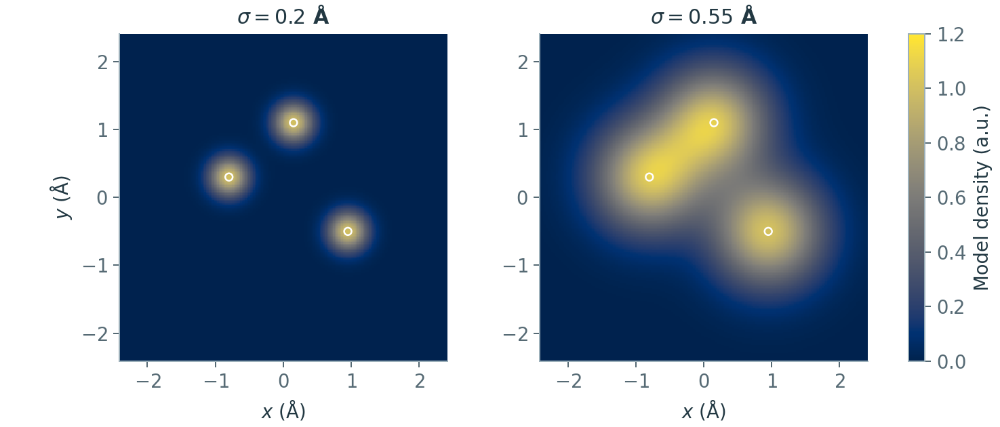

# GAP 与 SOAP

**适用环境：通用（原理）；实践可结合 QUIP、GAP 与描述符工具。**

GAP 是一种回归势能的方法，SOAP 是描述局域环境或定义环境相似度的方法。二者经常搭配，但 SOAP 并不专属于 GAP，早期 GAP 也不只使用 SOAP。

沿用 ACSF 篇的两组 OHH 邻域。SOAP 也要能区分夹角变化，并在整体旋转或同元素邻居交换后给出相同结果。建立相似度矩阵之后，还要用带标签的结构检验这个相似度能否支持能量和力的预测。 [ACSF 对照](BP与原子中心对称函数.md)

## 一、从邻域相似度到回归

Albert P. Bartók、Mike C. Payne、Risi Kondor 和 Gábor Csányi 在 2010 年发表 GAP，源于 Cambridge 相关合作。Bartók、Kondor 和 Csányi 在 2013 年发表 SOAP。GAP/QUIP 后续由社区持续开发。两项工作的顺序解释了为什么不能把“GAP”和“SOAP”当成同一个模型名。[^gap][^soap]

## 二、从点状邻居到平滑密度

先把每个邻居换成一个平滑的小云团：

$$
\rho_i(\mathbf r)=\sum_j f_c(r_{ij})
\exp\!\left[-\frac{|\mathbf r-\mathbf r_{ij}|^2}{2\sigma^2}\right].
$$



两幅图取相同的三个邻居位置、相同色标和单位截断权重。增大 $\sigma$ 后，邻居之间的云团重叠增多。这里画的是输入密度切片，后续才对密度展开并构造功率谱。

$\sigma$ 是云团宽度。小幅移动原子只会平滑改变密度，避免硬直方图跨格时的跳变。再用径向函数和球谐函数展开密度，得到系数 $c_{nlm}$；把角分量成对相乘并求和，得到功率谱：

$$
p_{nn'l}=\sum_{m=-l}^{l}c_{nlm}^*c_{n'lm}.
$$

同一旋转会同时转动两个系数组，求和后的内积不变。多元素体系通常使用分元素密度及其组合。不过，有限的径向和角向展开仍会丢失一部分分辨率，因此不能把描述符简单当成环境的“唯一指纹”。

## 三、相似环境怎样给出能量

一种常见归一化 SOAP 核写作

$$
k(i,j)=\left(\frac{\mathbf p_i\cdot\mathbf p_j}
{\|\mathbf p_i\|\|\mathbf p_j\|}\right)^\zeta,
\qquad
\varepsilon_i=\sum_{s\in\mathcal S}\alpha_s k(i,s).
$$

$\mathcal S$ 是选出的代表环境，$\alpha_s$ 是训练系数。新环境越像某些代表环境，它们对预测的影响越大。真实训练要把局域贡献组合成总能，并把核对坐标的导数用于力标签；不是要求 DFT 提供原子能。[^tutorial]

## 四、特点与横向比较

SOAP-GAP 的优势在于相似度清楚、核方法基础成熟，可作为中小规模数据上的高质量基线。代表环境数量、描述符维度和多元素组合会影响训练与推理成本。核模型的方差或距离指标也需要校准，不能直接当作可靠误差条。

与 [MTP](MTP与主动学习.md)、[ACE](ACE与多体展开.md)相比，SOAP-GAP 通过核组合表达非线性；与 BP 相比，差异主要在表示和回归器，不能简单归纳为“传统”对“深度”。

## 五、用相同邻域检查 SOAP 和核

检查描述符的旋转和置换不变性，扫描截断、平滑宽度和展开阶数，观察精度与成本。再按独立轨迹验证，避免只在高度相似的环境上得到乐观结果。仓库中已有 [SOAP 相似性核 Notebook](../../GPUMD/SOAP相似性核.ipynb)，其依赖与代码按 Notebook 准备。

### 从 SOAP 向量算出核矩阵

[描述符案例](../../../examples/machine-learning/atomistic-models/descriptor_demo.py)用 DScribe 直接计算 SOAP。在归档设置下，O 中心的 SOAP 向量有 63 维，改变夹角后差的范数约为 0.17392，旋转误差约为 1.11 × 10⁻¹⁶，同种邻居交换误差为零。对照 ACSF 时，向量维数和尺度都不同，两种范数的大小不宜拿来给模型精度排序。 [归档结果](../../../examples/machine-learning/atomistic-models/reference/cpu-results.json)

对多元素、不压缩的功率谱，特征维数受元素通道、`n_max` 和 `l_max` 共同决定；`n_max` 是径向展开数量，`l_max` 是最高角阶，均不是网络深度。

```python
import numpy as np
from ase.build import molecule
from dscribe.descriptors import SOAP

water = molecule("H2O")
soap = SOAP(species=["H", "O"], periodic=False, r_cut=4.0,
            n_max=3, l_max=2, sigma=0.3, sparse=False)
x = soap.create(water)
x /= np.linalg.norm(x, axis=1, keepdims=True)
kernel = (x @ x.T) ** 4
assert np.allclose(np.diag(kernel), 1.0)
print(kernel.shape)
```

这里有三个原子中心，核矩阵为 `3×3`，元素 $K_{ij}$ 是两个原子环境的相似度，不是三个分子的能量。中心元素处理、核归一化和多元素通道需要与训练方案一致。对归一化前零向量的处理也要明确。

## 六、从核矩阵走到带标签的 GAP 拟合

已有 Si 的带能量、力标签的 `train.xyz`，且 `energy` / `force` 字段名与 GAP 读取设置一致时，可以从如下小型 SOAP 模型开始：

```bash
gap_fit at_file=train.xyz \
  'gap={soap cutoff=5.0 cutoff_transition_width=1.0 atom_sigma=0.5 n_max=6 l_max=4 n_sparse=200 delta=1.0 covariance_type=dot_product zeta=4 sparse_method=cur_points}' \
  'default_sigma={0.002 0.1 0.1 0.0}' \
  e0_method=average gp_file=gap.xml
```

命令应在已安装 QUIP/GAP 的环境中运行。`n_sparse=200` 只是一个小规模起点，且前提是数据中有足够的代表环境。`default_sigma` 依次控制能量、力、virial 和 Hessian 的正则或噪声尺度，并不是四项随意相加的损失权重；绝对量、每原子量以及配置级覆盖值的具体含义需按所用 GAP 版本核对。拟合输出不仅有 XML 文件，还可能附带存放稀疏点的外部文件，部署模型时必须一并保留。

此命令遵循[官方 gap_fit 输入语法](https://libatoms.github.io/GAP/gap_fit.html)。拟合完成后，应在独立结构上检查能量差与力，再看核设置是否需要调整。上面的 DScribe 代码可以先单独用来核对表示与核矩阵。

### 参考资料

[^gap]: A. P. Bartók et al. Gaussian Approximation Potentials: The Accuracy of Quantum Mechanics, without the Electrons. *Physical Review Letters* **104**, 136403 (2010). [论文](https://arxiv.org/abs/0910.1019)。
[^soap]: A. P. Bartók, R. Kondor, G. Csányi. On representing chemical environments. *Physical Review B* **87**, 184115 (2013). [论文](https://arxiv.org/abs/1209.3140)。
[^tutorial]: A. P. Bartók, G. Csányi. Gaussian approximation potentials: A brief tutorial introduction (2015). [作者教程](https://arxiv.org/abs/1502.01366)。

返回[分类导航](README.md)或[专题首页](../README.md)。
