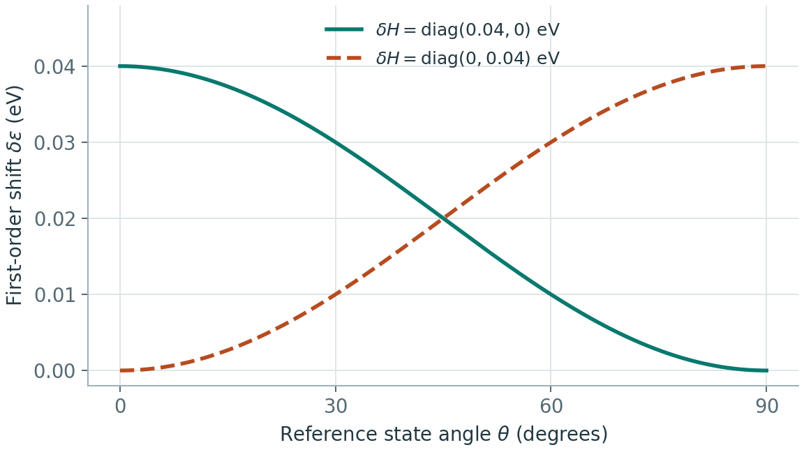

# 哈密顿量模型的训练数据与评估

**适用环境：通用（方法）。**

哈密顿量矩阵的每个数都依赖基与计算约定。开始训练前，先证明同一套解析器可以从参考输出重建矩阵、能带和电子数，再讨论网络架构。

## 一、标签需要哪些元信息

| 层次 | 必须明确的内容 |
| --- | --- |
| 参考理论 | 泛函、赝势、基组、电子温度、电荷、自旋、SOC 与收敛设置 |
| 原子结构 | 元素、坐标、晶胞、周期性、原子顺序与单位 |
| 轨道 | 每元素轨道数、径向副本、$l,m$ 顺序、实/复球谐、相位 |
| 矩阵块 | 原胞原子对、晶格位移、行列方向、复数存储与能量单位 |
| 辅助量 | 重叠矩阵、费米能、电子数、标签能量零点 |

非正交基中，把所有本征值平移 $\Delta$ 对应 $H'=H+\Delta S$；只有 $S=I$ 时才简化为 $H+\Delta I$。因此不能在对齐参考零点时无条件只给对角加同一个数。

## 二、训练目标怎样设置

矩阵监督常使用逐块或逐元素误差，能谱监督使用本征值或能带误差。二者约束不同：矩阵监督需要一致基规范；能谱监督不唯一确定矩阵与波函数。SchNOrb、DeepH 与 DeePTB 的路线正好说明这些差别。[^schnorb][^deeph][^deeptb]

示意损失可写为

$$
L=w_H\langle\|H^\theta-H^{\rm ref}\|_F^2\rangle
+w_\epsilon\langle(\epsilon^\theta-\epsilon^{\rm ref})^2\rangle.
$$

实际要写清矩阵是否按块大小归一、不同轨道/近远邻是否等权、能窗和 $k$ 点权重，以及是否对齐零点。很小的远距离矩阵元数量可能很多，若简单平均，它们会掩盖少数关键耦合的误差。

## 三、为什么矩阵 MAE 小不一定能带正确

在正交基、非简并且误差较小时，一阶近似为

$$
\delta\epsilon_n\approx c_n^\dagger\delta Hc_n.
$$



取示意态 $c=(\cos\theta,\sin\theta)$。两种误差矩阵都只有一个 0.04 eV 的非零元，放在不同轨道上。当态几乎只在第一个轨道上时，第一个轨道的在位误差几乎完整地传入能级偏移。

把 $H+\delta H$ 与 $c+\delta c$ 代入本征方程，忽略两个小量相乘的项，左乘 $c^\dagger$，利用 $c^\dagger H=\epsilon c^\dagger$ 消掉含 $\delta c$ 的部分，即得到此式。非正交且 $c^\dagger Sc=1$ 时则是

$$
\delta\epsilon_n\approx c_n^\dagger(\delta H-\epsilon_n\delta S)c_n.
$$

这表明影响谱的是误差在具体态上的投影，重叠误差也会进入。近简并时还需处理简并子空间，不能逐条应用非简并结论；波函数也可能对很小的能隙更敏感。

## 四、从格式检查到物理检查

1. 检查原子、轨道和周期位移索引，重建参考 $H(\mathbf k),S(\mathbf k)$。
2. 检查厄米性、$S$ 正定性、电子占据和能量零点。
3. 旋转结构并同步旋转轨道，检查矩阵的等变关系。
4. 报告分轨道、分距离矩阵误差和目标能窗的能带误差。
5. 检查带隙、带边、DOS、有效质量等目标量，再进入更敏感的拓扑或输运。

带交叉附近不能总按排序后的第 $n$ 条能带强行匹配；可按子空间、投影或任务所需的连续性评估。拓扑、光学和输运通常还涉及波函数、位置或速度算符、边界条件及占据，不能只凭能带形状判断正确。

## 五、数据划分与规模扩展

按独立轨迹、结构家族、缺陷类型或成分划分，防止近重复几何泄漏。小胞训练到大胞预测，检验的是相似局部环境的组合；若大胞出现新的长程电荷重排或磁序，局域迁移可能失效。

速度分开报告特征构造、矩阵预测、稀疏装配、谱求解和目标物性后处理。构建矩阵更快，不等于整个电子结构任务都获得相同加速倍数。

## 配置级切分与误差表怎样保存

每条数据保留 `structure_id`、`trajectory_id`、元素、轨道数、能量单位和基规范。将所有由同一母胞微扰得到的结构随机打散，可能高估向新缺陷或新相迁移的效果。标签矩阵较大时，建议分别报告在位块、近邻块、远邻块及目标元素对误差。

例如同一模型的整体 MAE 为 1 meV，不能据此推断一个 2 meV 的带分裂已经可信。应围绕相关能窗重新检查本征值、简并子空间和波函数投影，并把 $k$ 点及电子占据作为评估输入保存。

## 实践：对真实矩阵注入一个可控误差

先运行[水分子矩阵案例](../../../examples/machine-learning/atomistic-models/molecular_matrix.py)，再对输出矩阵做检查：

```python
import numpy as np
from scipy.linalg import eigh
sample = np.load("results/water_rhf.npz")
h, s = sample["hamiltonian"], sample["overlap"]
eps = eigh(h, s)[0]
shift = 0.01  # Hartree
shifted = eigh(h + shift*s, s)[0]
assert np.allclose(shifted-eps, shift)
```

这验证了非正交基下正确的能量零点平移是加 $\Delta S$。若换成 $\Delta I$，不同轨道一般不会刚好等量平移。

对未知模型的预测矩阵，至少打印 `max(abs(H-H.conj().T))`、`eigvalsh(S).min()`、广义本征残差和电子数。厄米误差不是用 `H-H.T` 检查复矩阵；`S` 的最小本征值接近零时，不能只把负值截成一个小正数后当作物理已修复。

## 参考资料

[^schnorb]: K. T. Schütt et al. SchNOrb (2019). [原始论文](https://doi.org/10.1038/s41467-019-12875-2)。
[^deeph]: H. Li et al. DeepH (2022). [原始论文](https://doi.org/10.1038/s43588-022-00265-6)。
[^deeptb]: Q. Gu et al. DeePTB (2024). [原始论文](https://doi.org/10.1038/s41467-024-51006-4)。

返回[分类导航](README.md)或[专题首页](../README.md)。
