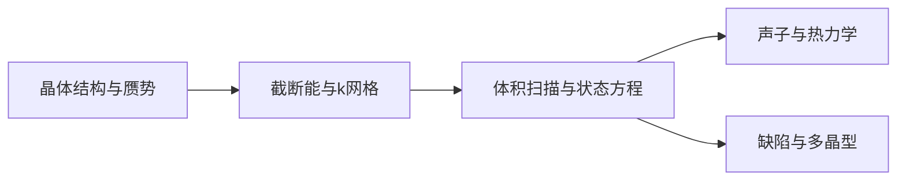

# 无机非金属：从 MgO 状态方程到晶体与玻璃

**适用环境：macOS / Linux，CPU 计算。**

## 一、先分清比较对象

无机非金属入口覆盖离子、共价及混合成键体系。晶体通常从晶胞、电子收敛与声子出发；玻璃要先建立具有统计意义的结构集合。这里用岩盐型 MgO 演示静态状态方程，再说明如何扩展到多晶型、缺陷和非晶体系。状态方程拟合的实现见 ASE 文档[^1]。

MgO 原胞有两个原子。`inorganic.json` 给出起始常规晶格常数 4.22 Å、500 eV 截断能和 `7×7×7` k 网格；这组输入是一个可复现的扫描起点，需用更高精度检验目标性质是否稳定。

## 二、从结构到状态方程



对参考晶胞乘体积因子 $f$ 时，晶格矢量应乘 $f^{1/3}$。本例取 $f=0.91,0.94,\ldots,1.09$；原子分数坐标不变。岩盐 MgO 的理想高对称内部坐标由对称性固定，一般低对称材料则应在每个固定体积下放松内部坐标。

```text
ENCUT = 500
PREC = Accurate
EDIFF = 1E-7
ISMEAR = 0
SIGMA = 0.05
IBRION = -1
NSW = 0
```

运行器将实际总能量与体积都除以原子数，拟合三阶 Birch–Murnaghan 状态方程，输出平衡体积和体积模量。若 $E$ 用 eV/atom、$V$ 用 ų/atom，$B$ 的单位为 eV/ų，乘 160.21766208 转成 GPa。只将能量归一化、却保留整胞体积，会使模量出错。

## 三、从七个体积点读出平衡晶格

`curve.csv` 应包含七个不同体积与有限能量；能量曲线应平滑，拟合的最低点应位于扫描区间内。若最低点落在区间外，应扩展区间重新计算，避免依赖外推极小值。

归档的[七点曲线](../../../examples/materials/inorganic/data/curve.csv)中，最低采样点在 9.67575 ų/atom，其两侧相邻点能量都更高。[状态方程拟合](../../../examples/materials/inorganic/data/results.json)进一步给出 $V_0=9.58672$ ų/atom 和 $B=151.73$ GPa。岩盐型常规胞含 8 个原子，因而拟合晶格常数为 $(8V_0)^{1/3}=4.249$ Å。这样能独立检查体积归一化，也能区分扫描起点 4.22 Å、最低采样点与拟合平衡点。若目标是精确的模量，先加密最低点附近的体积，再分别提高截断能和 k 网格，比较 $V_0$ 与 $B$。本例是 0 K 静态晶格曲线，未加入零点振动和热膨胀，不应直接与任意温度下的实验弹性量等同。

## 四、多晶型与稳定性

比较同化学计量的多晶型时，应对各相的晶格与原子坐标分别充分优化，再按每化学式单元的能量进行比较。在外压 $p$ 下应比较焓 $H=E+pV$，有限温度下则需进一步计入自由能。需要注意的是，单次结构优化得到的只是局部极小值，并不能直接证明该相在所有竞争相中最稳定。

对于不同组成的体系，应使用一致的元素参考态计算形成能，并据此建立竞争相关系。氧化物中的氧化学势容易受环境条件和参考分子计算误差的影响，因此不能混用不同泛函或不同氧参考下的结果。含过渡金属的体系还需明确自旋设置、DFT+U 的施加对象和参数依据，可参见 [VASP 的 DFT+U](../../VASP/泛函与磁性/VASP的DFT加U计算.md)。

## 五、声子、介电与缺陷

[声子谱](../../VASP/振动与热力学/VASP声子谱计算.md)使用充分优化结构，再检查超胞、位移幅度和受力精度；极性材料的长程电场效应需要 Born 电荷和介电张量。声学支在 Γ 点的小数值偏差与遍布布里渊区的软模，应分开判断。继续查[铁电与介电](../铁电与介电/README.md)。

缺陷形成能涉及缺陷与完整晶体能量、原子化学势及电荷态。带电缺陷还需有限尺寸和电势对齐处理，具体公式与路线见[半导体教程](../半导体/半导体：从Si能带到缺陷与界面.md)。

## 六、玻璃与非晶分支

构建玻璃模型时，需先选定组成、密度与超胞尺寸，再依次完成充分熔融、液体平衡、淬火与低温弛豫，并通过 RDF、配位数、键角以及不同初态的统计平均来检验结构合理性；仅优化单个随机结构不足以代表真实的玻璃态。VASP 和 CP2K 可用于 AIMD 模拟，若存在可靠的经典势函数，也可用 LAMMPS 扩大体系尺度。完整的温度历程与结构判据可参见[相变存储](../相变存储/相变存储：从GeTe熔融淬火到晶化判据.md)。

本例的 MgO 赝势与数值设置不能直接移植到所有陶瓷或玻璃；赝势、价电子、截断能与参考态必须随体系重新核对。

[^1]: ASE. Equation of state. https://wiki.fysik.dtu.dk/ase/ase/eos.html

## 七、配套案例

[MgO 的 PBE 状态方程](../../../examples/materials/inorganic/README.md)提供参数、运行命令与数据说明。先检查[本机运行与结果检查](../本机运行与结果检查.md)，再运行案例；更换参数后使用新输出目录。

返回[无机非金属](README.md)或[材料应用](../README.md)。
