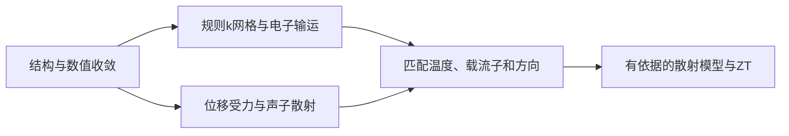

# 热电：从 Si 输运系数到晶格热导与 ZT

**适用环境：macOS / Linux，CPU 计算。**

## 先拆开电子与晶格输运

热电性能常用 $ZT=S^2\sigma T/(\kappa_e+\kappa_l)$。电子与晶格部分来自不同计算，必须匹配温度、方向、载流子条件与结构。BoltzTraP2 通过能带插值计算半经典输运，常数弛豫时间近似下需要区分 $\sigma/\tau$、$\kappa_e/\tau$ 与实际输运量[^1]。

本例用 Si 演示电子输运流程，不把 Si 指定为高性能热电材料，也不从未确定的散射时间推断绝对 ZT。

## 计算路线



## 规则网格与 BoltzTraP2

采用两原子 Si 原胞、5.47 Å 常规晶格常数、450 eV、`9×9×9` Γ 网格。读取 `vasprun.xml`，先插值再在 300、600 K 积分：

```bash
btp2 -n 1 interpolate -m 3 .
btp2 -n 1 integrate -b 1000 interpolation.bt2 300,600
```

`-m 3` 为插值增密设置，不能补回原始 DFT 网格缺失的信息。高对称路径能带适合展示色散，不能替代布里渊区积分网格。先分别收敛原始 k 网格、插值及积分网格，并检查带边附近的空带覆盖。

程序用 `.btj` 读取电中性参考，再将 `.trace` 的 Ry 转为 eV；输出的是相对参考的化学势。不得把第一列直接标为电子伏特或载流子浓度。

## 读取输运结果

`curve.csv` 列出化学势、温度、Seebeck 系数（µV/K）、$\sigma/\tau$、$\kappa_e/\tau$ 和 $S^2\sigma/\tau$。后面三者分别使用 S/(m·s)、W/(m·K·s)、W/(m·K²·s)。输出表头中 `tau` 是以秒计的弛豫时间。

本例读取标量 trace，它涉及张量分量的平均。各向异性研究应读取并逐方向处理张量，不能把不同方向的 $S$、$\sigma$ 和热导随意组合。窄带隙、高温条件还要评估带隙误差与双极输运。

化学势扫描与固定载流子浓度的温度扫描不同。后者应在每个温度下求满足目标浓度的化学势，并明确浓度单位、电子/空穴符号和每胞体积。软件的积分与掺杂工作流见原论文与项目说明[^1]。

## 晶格热导率路线

使用 phono3py 可继续运行[硅的 RTA 晶格热导率案例](../../../examples/vasp/minimal/lattice-thermal-conductivity/README.md)，原理与输入见[晶格热导率笔记](../../VASP/振动与热力学/VASP晶格热导率计算.md)。顺序为：优化结构 → 生成二/三阶位移 → VASP 受力 → 力常数 → 检查声子 → 声子 Boltzmann 方程。phono3py 支持 RTA 与直接求解，其近似和参数应与所用版本一致[^2]。

该现有案例使用小超胞和粗 q 网格，主要演示计算链。正式结果需检查位移幅度、超胞、三阶作用范围、电子受力精度、q 网格及展宽。虚频未处理前不应直接接受热导数值。

也可在 LAMMPS 和适用势下选择 MD 输运，但应另外收敛尺寸与相关时间。

## 汇总性能与报告条件

若有独立来源且适用于该温度/载流子的 $\tau$，可将电子输运量恢复为实际值；若只是探索参数，必须标为假设情景，不能作为材料的预测值。电子与晶格热导要统一结构、温度、方向及单位。

至少报告泛函、晶格、k 网格、插值、温度、载流子/化学势定义、散射模型、声子超胞和 q 网格，并分别说明电子与声子散射机制。详细电子输运输入见[现有笔记](../../VASP/响应与输运/VASP电子输运与电子热导率.md)。

[^1]: Madsen, Carrete, Verstraete. BoltzTraP2. Computer Physics Communications 231 (2018). https://doi.org/10.1016/j.cpc.2018.05.010
[^2]: Phono3py. Documentation. https://phonopy.github.io/phono3py/

## 配套案例

[Si 的 BoltzTraP2 输运](../../../examples/materials/thermoelectric/README.md)提供参数、运行命令与数据说明。先检查[本机运行与结果检查](../本机运行与结果检查.md)，再运行案例；更换参数后使用新输出目录。

返回[热电](README.md)或[材料应用](../README.md)。
