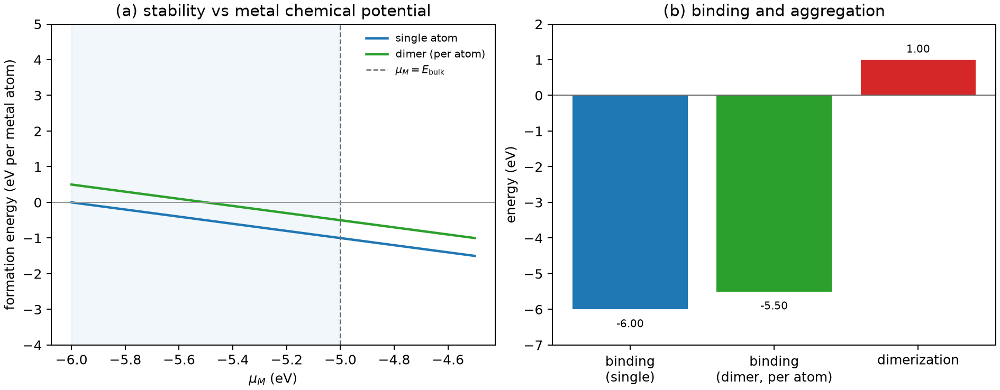

# 单原子与双原子催化剂建模

**适用环境：Linux / macOS / Windows（Python 3 + numpy + matplotlib）；形成能与结合能来自 DFT，示例只演示稳定性判据。**

同一组载体与金属总能，可以回答两个问题。金属从储库来到空位点是否有利？已经锚定的两个金属原子是否倾向靠到一起？下面用仓库的教学能量把两个反应分别配平，再说明双位点活性要怎样做对照。

## 一、先定载体和锚定位点

单原子不是悬空的原子。它通过配位键锚定在载体表面或缺陷位：

- 氧化物表面的氧空位、羟基、台阶位；
- 氮掺杂碳的吡啶氮/吡咯氮；
- 金属表面的台阶、角位；
- 二维材料的空位或掺杂位。

同一种金属在不同位点可能有不同配位、电荷和自旋态。先比较几个候选锚定位点，再用各自弛豫后的配位与磁矩确认算到了哪个结构。载体超胞要足够大，避免相邻镜像原子通过周期边界相互作用；覆盖度要写清（例如 1/4 ML、1/9 ML）。

## 二、稳定性：形成能与化学势

把单个金属原子 M 放在载体上，形成能写成

$$
E_f({\rm M@support})
=E({\rm M@support})-E({\rm support})-\mu_{\rm M}.
$$

$\mu_{\rm M}$ 是金属的化学势，受本体金属约束：

$$
\mu_{\rm M}\le E_{\rm bulk}({\rm M}).
$$

在金属富集极限 $\mu_{\rm M}=E_{\rm bulk}$，$E_f<0$ 表示锚定态低于“金属本体加干净载体”的参考组合。若 $E_f>0$，该组合的能量更低。实际聚集或溶出还取决于可达路径与工作环境。$\mu_{\rm M}$ 越低（贫金属条件），$E_f$ 越大，单原子越难稳定。因此只报一个形成能而不报化学势，信息是不完整的。

## 三、抗团聚：二聚化能

即使单原子相对金属本体稳定，两个相邻单原子仍可能愿意合并。对反应

$$
2\,{\rm M@support}\rightarrow {\rm M_2@support}+{\rm support},
$$

二聚化能为

$$
\Delta E_{\rm dimer}
=E({\rm M_2@support})+E({\rm support})-2E({\rm M@support}).
$$

$\Delta E_{\rm dimer}<0$ 表示二聚放热，单原子有热力学团聚倾向；$>0$ 表示单原子在热力学上更稳定。这个量只比较单原子与二聚体，不含三聚体、颗粒和载体重构；真正的烧结判据还要比较更大团簇和体相。

注意 $E({\rm support})$ 的参考：如果两个单原子分别在两个独立的 slab 上，而二聚体在一个 slab 上，产物侧要多加一个干净 slab 的能量。漏掉这一项会让二聚化能出现几百 eV 的荒谬值。示例程序就是按这个配平写的。

## 四、双原子：协同还是叠加

双原子催化剂多一个自由度：两个金属的间距、顺序和桥联方式。要判断“协同”，至少比较：

- 相同载体、组成、覆盖度和吸附物数量下，孤立位点的吸附自由能；
- 双原子位点上桥联/端基吸附的能量；
- 中间体在两个金属之间的迁移路径；
- 两个金属是否分工（一个供电子、一个供空轨道）。

若双位点改变了吸附方式或打开新的反应路径，用相同的参考态比较自由能和势垒，明确变化来自哪个结构或反应步骤。若在一个足够大的超胞上可以同时容纳两个彼此分离的金属，也可直接比较同一覆盖度下的远隔与相邻构型，再沿[反应自由能台阶](电催化多步反应自由能台阶图.md)比较相应中间体。双原子也可能比单原子更容易团聚，因为两个原子已经相邻；稳定性计算同样要做二聚化/三聚化比较。

## 五、建模流程

1. **载体**：优化干净 slab，确定表面终止、层数、真空层和偶极修正。
2. **位点**：枚举候选锚定位点，做初步筛选；不要只取一个。
3. **单原子**：优化 M@support，检查自旋、电荷、局域磁矩和载体重构。
4. **覆盖度**：改变超胞或原子数，检查相邻镜像的相互作用。
5. **稳定性**：算 $E_f(\mu_{\rm M})$ 与二聚化能；必要时算溶出电位。
6. **吸附**：在稳定位点上算反应中间体，进入自由能台阶或微动力学。

## 六、示例：单原子与二聚体的稳定性

配套案例在 [single-atom-catalyst](../../../examples/materials/single-atom-catalyst/README.md)。输入是干净载体、单原子、二聚体和金属本体的总能量：

```json
{"E_support_eV": -500.0, "E_single_atom_eV": -506.0,
 "E_dimer_eV": -511.0, "E_bulk_per_atom_eV": -5.0}
```

运行：

```bash
cd examples/materials/single-atom-catalyst
python3 -m pip install -r requirements.txt
python3 run.py
```

先把示意输入代到两个反应里：

| 要比较的反应 | 直接代入 | 教学结果 |
| --- | --- | --- |
| 储库中的一个 M 进入载体，$\mu_{\rm M}=-5$ eV | $-506-(-500)-(-5)$ | $-1$ eV，每个锚定原子 |
| 两个锚定原子组成二聚体 | $-511+(-500)-2(-506)$ | $+1$ eV，每次二聚反应 |

把储库化学势降到 −6 eV，单原子形成能变成零。二聚化能保持 +1 eV，因为两侧都有两个金属原子，储库项相消。输出的 `stable_mu_range_eV` 只按 $\mu_{\rm M}\le E_{\rm bulk}$ 筛选绘图网格，给出 −6.000 至 −5.005 eV。−5.005 是离散网格内的最后一点，物理允许的上界仍为 −5.000 eV。读取形成能曲线的零点时，应使用实际能量判据。 [算例输出](../../../examples/materials/single-atom-catalyst/results.json)



换成自己的数据时，先确认所有总能量用的是同一 slab、同一截断和同一 k 点；再检查二聚化能的配平是否包含干净载体。若 $E_f$ 或 $\Delta E_{\rm dimer}$ 对超胞尺寸敏感，说明覆盖度或镜像相互作用没有处理好。

## 七、参考

- B. Qiao, A. Wang, X. Yang, et al. Single-atom catalysis of CO oxidation using Pt1/FeOx. *Nat. Chem.*, 2011, 3: 634. [doi:10.1038/nchem.1095](https://doi.org/10.1038/nchem.1095)
- X.-F. Yang, A. Wang, B. Qiao, et al. Single-atom catalysts: a new frontier in heterogeneous catalysis. *Acc. Chem. Res.*, 2013, 46: 1740. [doi:10.1021/ar300361m](https://doi.org/10.1021/ar300361m)
- J. Liu. Catalysis by supported single metal atoms. *ACS Catal.*, 2017, 7: 34. [doi:10.1021/acscatal.6b01534](https://doi.org/10.1021/acscatal.6b01534)
