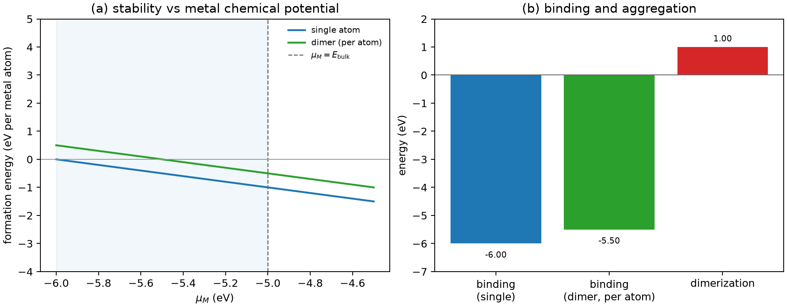

# 单原子与双原子催化剂建模

**适用环境：Linux / macOS / Windows（Python 3 + numpy + matplotlib）；形成能与结合能来自 DFT，示例只演示稳定性判据。**

单原子催化剂（single-atom catalyst，SAC）把金属分散到载体上的孤立位点，金属利用率接近 100%，但代价是每个原子都暴露在环境中，容易团聚、溶出或被反应物迁移。双原子催化剂（dual-atom catalyst，DAC）让两个金属原子相邻，可能产生协同吸附，也可能只是两个单原子的简单叠加。建模要回答的核心问题不是“这个结构好不好看”，而是“在这个化学势和电位下，它是否比团聚相更稳定，以及吸附中间体时是否还稳定”。

本文用形成能和二聚化能说明单原子/双原子的热力学稳定性，并给出一个可运行的 Python 示例。示例中的总能量是**为检查代码而构造的示意数值，不是任何真实催化剂的数据**。

## 先定载体和锚定位点

单原子不是悬空的原子。它通过配位键锚定在载体表面或缺陷位：

- 氧化物表面的氧空位、羟基、台阶位；
- 氮掺杂碳的吡啶氮/吡咯氮；
- 金属表面的台阶、角位；
- 二维材料的空位或掺杂位。

同一个金属在不同位点的配位数、电荷转移和自旋态不同，吸附能可以差 1 eV 以上。建模时至少比较几个候选位点，而不是只取一个“看起来顺眼”的桥位。载体超胞要足够大，避免相邻镜像原子通过周期边界相互作用；覆盖度要写清（例如 1/4 ML、1/9 ML）。

## 稳定性：形成能与化学势

把单个金属原子 M 放在载体上，形成能写成

$$
E_f({\rm M@support})
=E({\rm M@support})-E({\rm support})-\mu_{\rm M}.
$$

$\mu_{\rm M}$ 是金属的化学势，受本体金属约束：

$$
\mu_{\rm M}\le E_{\rm bulk}({\rm M}).
$$

在金属富集极限 $\mu_{\rm M}=E_{\rm bulk}$，若 $E_f<0$，单原子相对“金属本体 + 干净载体”是稳定的；若 $E_f>0$，金属倾向于析出成颗粒。$\mu_{\rm M}$ 越低（贫金属条件），$E_f$ 越大，单原子越难稳定。因此只报一个形成能而不报化学势，信息是不完整的。

## 抗团聚：二聚化能

即使单原子相对金属本体稳定，两个相邻单原子仍可能愿意合并。对反应

$$
2\,{\rm M@support}\rightarrow {\rm M_2@support}+{\rm support},
$$

二聚化能为

$$
\Delta E_{\rm dimer}
=E({\rm M_2@support})+E({\rm support})-2E({\rm M@support}).
$$

$\Delta E_{\rm dimer}<0$ 表示二聚放热，单原子有热力学团聚倾向；$>0$ 表示单原子在热力学上更稳定。这个量只比较单原子与二聚体，不含三聚体、颗粒和载体重构；真正的烧结判据还要比较更大团簇和体相。

注意 $E({\rm support})$ 的参考：如果两个单原子分别在两个独立的 slab 上，而二聚体在一个 slab 上，产物侧要多加一个干净 slab 的能量。漏掉这一项会让二聚化能出现几百 eV 的荒谬值。示例程序就是按这个配平写的。

## 双原子：协同还是叠加

双原子催化剂多一个自由度：两个金属的间距、顺序和桥联方式。要判断“协同”，至少比较：

- 相同载体、组成、覆盖度和吸附物数量下，孤立位点的吸附自由能；
- 双原子位点上桥联/端基吸附的能量；
- 中间体在两个金属之间的迁移路径；
- 两个金属是否分工（一个供电子、一个供空轨道）。

若双位点改变了吸附方式或打开新的反应路径，用相同的参考态比较自由能和势垒，明确变化来自哪个结构或反应步骤。双原子也可能比单原子更容易团聚，因为两个原子已经相邻；稳定性计算同样要做二聚化/三聚化比较。

## 建模流程

1. **载体**：优化干净 slab，确定表面终止、层数、真空层和偶极修正。
2. **位点**：枚举候选锚定位点，做初步筛选；不要只取一个。
3. **单原子**：优化 M@support，检查自旋、电荷、局域磁矩和载体重构。
4. **覆盖度**：改变超胞或原子数，检查相邻镜像的相互作用。
5. **稳定性**：算 $E_f(\mu_{\rm M})$ 与二聚化能；必要时算溶出电位。
6. **吸附**：在稳定位点上算反应中间体，进入自由能台阶或微动力学。

## 示例：单原子与二聚体的稳定性

配套案例在 [single-atom-catalyst](../../../examples/materials/single-atom-catalyst/README.md)。输入是干净载体、单原子、二聚体和金属本体的总能量：

```json
{"E_support_eV": -500.0, "E_single_atom_eV": -506.0,
 "E_dimer_eV": -511.0, "E_bulk_per_atom_eV": -5.0}
```

运行：

```bash
cd examples/materials/single-atom-catalyst
python3 -m pip install -r requirements.txt
python3 run.py
```

程序画形成能随 $\mu_{\rm M}$ 的变化，并给出单原子结合能、二聚体每原子结合能和二聚化能。示意输入在 $\mu_{\rm M}=E_{\rm bulk}=-5$ eV 时单原子形成能为 $-1$ eV，二聚化能为 $+1$ eV，即单原子在热力学上比二聚体稳定；这些数字只用于说明判据，不能当作真实催化剂结论。



换成自己的数据时，先确认所有总能量用的是同一 slab、同一截断和同一 k 点；再检查二聚化能的配平是否包含干净载体。若 $E_f$ 或 $\Delta E_{\rm dimer}$ 对超胞尺寸敏感，说明覆盖度或镜像相互作用没有处理好。

## 检查清单

- 载体终止、层数、真空层、偶极修正是否一致？超胞是否足够大？
- 金属位点的配位数、自旋态和电荷是否合理？有没有多个候选位点？
- 形成能报的是哪个 $\mu_{\rm M}$？是否满足 $\mu_{\rm M}\le E_{\rm bulk}$？
- 二聚化能的配平是否包含干净载体？有没有比较高阶团簇？
- 吸附中间体后，单原子/双原子是否还稳定？会不会迁移或溶出？
- 双原子的“协同”是否有新吸附构型或新路径支持，而不只是两个单原子的平均？

## 参考

- B. Qiao, A. Wang, X. Yang, et al. Single-atom catalysis of CO oxidation using Pt1/FeOx. *Nat. Chem.*, 2011, 3: 634. [doi:10.1038/nchem.1095](https://doi.org/10.1038/nchem.1095)
- X.-F. Yang, A. Wang, B. Qiao, et al. Single-atom catalysts: a new frontier in heterogeneous catalysis. *Acc. Chem. Res.*, 2013, 46: 1740. [doi:10.1021/ar300361m](https://doi.org/10.1021/ar300361m)
- J. Liu. Catalysis by supported single metal atoms. *ACS Catal.*, 2017, 7: 34. [doi:10.1021/acscatal.6b01534](https://doi.org/10.1021/acscatal.6b01534)
