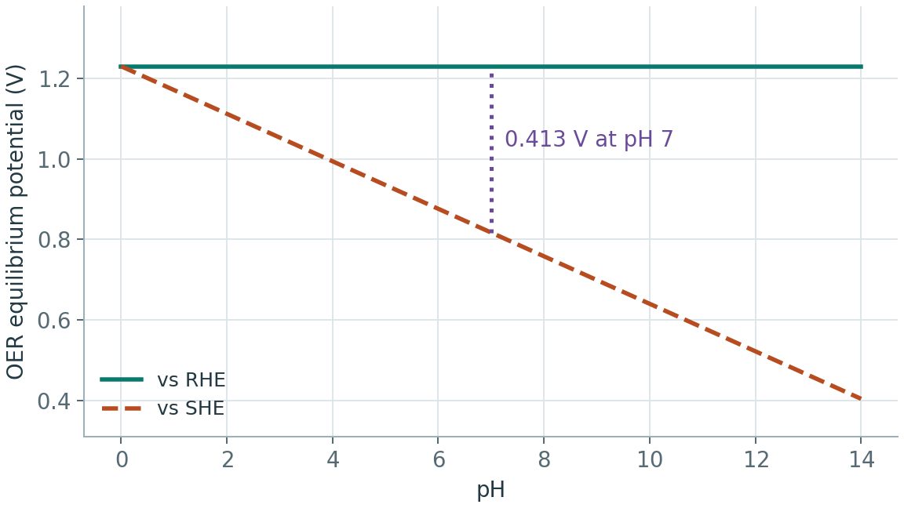
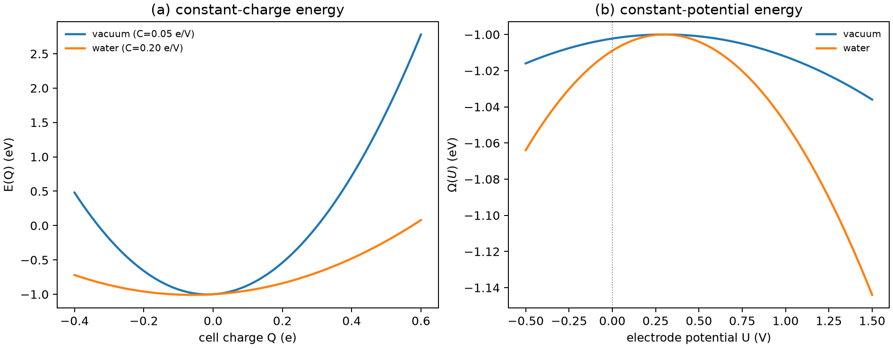

# 电催化中的溶剂化与电位修正

**适用环境：通用（阅读与建模）；示例用 Python 3 + numpy + matplotlib，真实计算需 VASP/CP2K 等电子结构程序与隐式溶剂支持。**

真空中的吸附能回答的是“分子在干净表面上结合多强”，电催化关心的是“在电解液里、给定电极电位下，这一步还愿不愿意发生”。两者之间至少差三件事：溶剂化、电极电位和双电层。把它们分开处理，才能判断一个吸附能差异是真实趋势，还是参考态没对齐。

本文说明恒电荷与恒电位能量的关系、隐式/显式溶剂各自能补什么、pH 与参比电极怎样换算，并给出一个可运行的恒电荷—恒电位后处理示例。示例是二次型能量模型，不是 DFT 数据。

## 恒电荷与恒电位

DFT 超胞通常固定电子数，得到 $E(Q)$：体系带电荷 $Q$ 时的总能量。取 $Q>0$ 表示体系缺电子。电极电位 $U$ 对应电子费米能级，实验上电极会从外电路吸放电子，所以更合适的量是**巨势**：

$$
\Omega(U)=\min_Q\left[E(Q)-QU\right].
$$

对 $Q$ 求极小，得到平衡电荷 $Q^*(U)$。若 $E(Q)$ 近似为二次型

$$
E(Q)=E_0+aQ+\frac{Q^2}{2C},
$$

则

$$
Q^*(U)=C(U-a),\qquad
\Omega(U)=E_0-\frac{C}{2}(U-a)^2.
$$

$C$ 是界面电容，单位是 $e$/V。$C$ 越大，$Q^*$ 随电位变化越快，$\Omega(U)$ 的曲率绝对值越大；这正是溶剂和电解液的作用之一：它们提高界面电容，使同一电位变化对应更多电子转移。

CHE 中的 $eU$ 项来自反应式里的电子库化学势。它可以与界面充电模型配合使用。只用中性表面与 CHE 时，界面随电位的充电和重排需要另行评估。

## 溶剂化模型

常见三层选择：

1. **真空**：只适合与方法基准比较，不适合直接报电催化趋势。
2. **隐式溶剂**：把电解液当成连续介质，用介电常数和空腔描述。SCCS、VASPsol 一类方法计算便宜，能抓住极性中间体的稳定化；但对具体氢键、水层结构和特定离子效应不敏感。
3. **显式溶剂**：放几十到几百个水分子做 AIMD 或经典 MD，能描述氢键网络和双电层结构；代价高，采样和统计误差大。

隐式溶剂的关键参数是介电常数、空腔形状和半径。不同实现给出的绝对溶剂化能可能差 0.1–0.3 eV，比较不同论文时，先确认它们用的是同一套溶剂模型和空腔定义。对带电吸附物，还要检查补偿电荷放在哪里；把背景电荷放在真空中和放在电解质里，能量不一样。

## 双电层与电容

电极表面的电荷由电子和吸附离子共同屏蔽。最简单的 Helmholtz 模型把双电层看成平行板电容：

$$
C=\frac{\varepsilon_0\varepsilon_r A}{d}.
$$

更真实的是 Gouy–Chapman–Stern 模型：扩散层用 Poisson–Boltzmann 描述，Stern 层给出紧束缚离子。电容可以随电位和浓度变化。若拟合得到负的微分电容，先检查拟合范围、分支稳定性和电荷符号。

对 DFT 后处理，常用做法是：

- 用恒电荷计算若干 $Q$，拟合 $E(Q)$；
- 由 $C=\mathrm{d}Q/\mathrm{d}U$ 或二次拟合得到电容；
- 用 $\Omega(U)$ 比较不同吸附物或反应步；
- 用实验或 MD 的双电层电容检查数量级。

如果 $E(Q)$ 明显偏离二次型，说明体系在充放电过程中发生了电子转移、结构重排或溶剂重组，不能用一个常数 $C$ 概括。

## pH 与参比电极

CHE 常在 RHE（可逆氢电极）标尺下写：

$$
\Delta G_i(U)=\Delta G_i(0)-n_i eU_{\rm RHE}.
$$

RHE 已经把 pH 吸收进参考态，所以对质子与电子等数转移的 CHE 步骤，在 RHE 下无需再加 $0.059\,\mathrm{pH}$。若用 SHE 标尺，换算关系是

$$
U_{\rm RHE}=U_{\rm SHE}+0.059\,\mathrm{pH}\ \mathrm{(V,\ 25^\circ C)}.
$$



示意取 25 °C 和 RHE 标尺上的 1.23 V。pH 7 时，同一平衡电位在 SHE 标尺上约为 0.817 V，两条线的高度差来自参比换算。

把 RHE 的结果再按 pH 平移一次，是常见错误；它会让过电位随 pH 漂移，而实验上 RHE 标尺的 OER/HER 电位通常不随 pH 变。

对 CO₂RR、NRR 等多质子多电子反应，pH 还影响碳酸根/碳酸氢根平衡和可用质子活度；CHE 只给热力学下限，选择性和动力学要另外算。

## 示例：恒电荷抛物线到恒电位曲线

配套案例在 [electrocatalysis-potential](../../../examples/materials/electrocatalysis-potential/README.md)。输入是二次型参数：

```json
{"E0_eV": -1.0, "a_eV_per_e": 0.3,
 "capacitance_e_per_V": {"vacuum": 0.05, "water": 0.20}}
```

运行：

```bash
cd examples/materials/electrocatalysis-potential
python3 -m pip install -r requirements.txt
python3 run.py
```

程序对每个电容画 $E(Q)$，再用 $Q^*=C(U-a)$ 和 $\Omega(U)=E_0-\frac{C}{2}(U-a)^2$ 画恒电位曲线。示意结果：$U=1$ V 时，真空 $\Omega=-1.0123$ eV、$Q=0.035$ e；水（更大电容）$\Omega=-1.049$ eV、$Q=0.14$ e。水环境让同一电位下转移更多电子，能量随电位弯曲更缓；数字只用于说明模型，不能当作真实吸附能。



把示例换成真实数据时，$E(Q)$ 应来自多个电荷态的 DFT 总能量，并做背景电荷修正；$C$ 可由拟合或双电层模型给出。不要把一个中性点的能量直接代入二次式外推到高电位。

## 检查清单

- 吸附能是真空、隐式溶剂还是显式溶剂？不同溶剂模型的绝对值不能直接混用。
- 带电中间体的补偿电荷在哪里？有没有做有限尺寸/势对齐修正？
- 用的是恒电荷还是恒电位？如果只算了一个电荷态，是否说明忽略电荷弛豫？
- $E(Q)$ 是否接近二次型？偏离时，$C$ 是否还能当常数？
- 电位标尺是 RHE 还是 SHE？有没有重复加 pH 修正？
- 双电层电容的数量级是否合理？与实验或 MD 比过吗？
- 有没有把热力学过电位当成动力学过电位？CHE 不包含能垒。

## 参考

- K. Mathew, R. Sundararaman, K. Letchworth-Weaver, et al. Implicit solvation model for density-functional study of nanocrystal surfaces and reaction pathways. *J. Chem. Phys.*, 2014, 140: 084106. [doi:10.1063/1.4865107](https://doi.org/10.1063/1.4865107)
- O. Andreussi, I. Dabo, N. Marzari. Revised self-consistent continuum solvation in electronic-structure calculations. *J. Chem. Phys.*, 2012, 136: 064102. [doi:10.1063/1.3676407](https://doi.org/10.1063/1.3676407)
- J. K. Nørskov, J. Rossmeisl, A. Logadottir, et al. Origin of the overpotential for oxygen reduction at a fuel-cell cathode. *J. Phys. Chem. B*, 2004, 108: 17886. [doi:10.1021/jp047349j](https://doi.org/10.1021/jp047349j)
- M. T. M. Koper. Theory of multiple proton–electron transfer reactions and its implications for electrocatalysis. *Chem. Sci.*, 2013, 4: 2710. [doi:10.1039/C3SC50205H](https://doi.org/10.1039/C3SC50205H)
