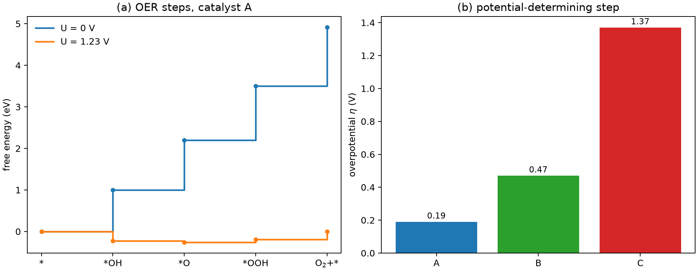

# 电催化多步反应自由能台阶图

**适用环境：Linux / macOS / Windows（Python 3 + numpy + matplotlib）；吸附自由能来自 DFT + ZPE − TS，示例只演示 CHE 后处理。**

析氧反应（OER）、氧还原反应（ORR）、CO₂ 还原和氮还原都不是一步完成的。把总反应拆成若干基元步骤，逐步算自由能，再按电极电位连成台阶图，才能看出哪一步是“卡住”的、过电位有多大。这套做法叫计算氢电极（computational hydrogen electrode，CHE），最早由 Nørskov 等人系统使用。

本文以四电子 OER 为例，说明反应配平、参考态、电位修正和过电位的定义，并给出一个可运行的 Python 示例。示例中的吸附自由能是**为检查代码而构造的示意数值，不是任何真实催化剂的 DFT 结果**。

## 先配平，再谈自由能

OER 在酸性条件下的总反应是

$$
2\mathrm{H_2O}\rightarrow \mathrm{O_2}+4\mathrm{H^+}+4\mathrm{e^-}.
$$

四步基元反应通常写成：

1. 第一步：$\ast+\mathrm{H_2O}\rightarrow \ast\mathrm{OH}+\mathrm{H^+}+\mathrm{e^-}$
2. 第二步：$\ast\mathrm{OH}\rightarrow \ast\mathrm{O}+\mathrm{H^+}+\mathrm{e^-}$
3. 第三步：$\ast\mathrm{O}+\mathrm{H_2O}\rightarrow \ast\mathrm{OOH}+\mathrm{H^+}+\mathrm{e^-}$
4. 第四步：$\ast\mathrm{OOH}\rightarrow \ast+\mathrm{O_2}+\mathrm{H^+}+\mathrm{e^-}$

每一步都转移一个质子和一个电子。先把每一步的原子、电荷和电子数配平，再决定用什么参考态算自由能；顺序反了，后面的电位修正一定错。

## CHE 参考态

CHE 把质子—电子对的化学势与氢气联系起来：

$$
\mu_{\mathrm{H^+}}+\mu_{\mathrm{e^-}}
=\frac12\mu_{\mathrm{H_2}}-eU_{\rm RHE}.
$$

在 $U=0$ V（vs RHE）时，$\mathrm{H^+}+\mathrm{e^-}$ 等价于半个 $\mathrm{H_2}$。于是可以用 DFT 算吸附物和 H₂，用实验或热化学数据算 H₂O，避免直接处理溶剂化质子。

在这一参考下，定义三个吸附自由能：

$$
\begin{aligned}
\Delta G_{\rm OH}
&=G(\ast\mathrm{OH})+\tfrac12 G(\mathrm{H_2})-G(\ast)-G(\mathrm{H_2O}),\\
\Delta G_{\rm O}
&=G(\ast\mathrm{O})+G(\mathrm{H_2})-G(\ast)-G(\mathrm{H_2O}),\\
\Delta G_{\rm OOH}
&=G(\ast\mathrm{OOH})+\tfrac32 G(\mathrm{H_2})
-G(\ast)-2G(\mathrm{H_2O}).
\end{aligned}
$$

它们分别对应“从洁净表面和水的参考态出发，生成 *OH、*O、*OOH”的自由能变化。四步台阶就可以写成

$$
\begin{aligned}
\Delta G_1&=\Delta G_{\rm OH},\\
\Delta G_2&=\Delta G_{\rm O}-\Delta G_{\rm OH},\\
\Delta G_3&=\Delta G_{\rm OOH}-\Delta G_{\rm O},\\
\Delta G_4&=4.92-\Delta G_{\rm OOH}.
\end{aligned}
$$

$4.92$ eV 是 OER 在 0 V 的总自由能变化（$4\times1.23$ eV）。四步相加必须回到 $4.92$ eV；如果对不上，先查参考态和化学计量，不要急着解释催化活性。

## 电位修正与过电位

在 RHE 标尺下，每一步都转移一个电子，电位 $U$ 使该步自由能降低 $eU$：

$$
\Delta G_i(U)=\Delta G_i(0)-eU.
$$

四步的总和变成 $4.92-4eU$，在 $U=1.23$ V 时为零，这就是热力学平衡电位。实际催化剂需要额外电位才能让每一步都放热，过电位定义为

$$
\eta=\frac{1}{e}\max_i \Delta G_i(0)-1.23\ {\rm V}.
$$

使 $\Delta G_i(0)$ 最大的那一步叫电位决定步（potential-determining step，PDS）。它不一定是“最慢”的基元步骤：CHE 只给热力学台阶，动力学势垒要看 NEB 或实验 Tafel 斜率。

## ZPE 与熵：别把电子能当自由能

吸附自由能不是 DFT 电子能。常用近似是

$$
\Delta G=\Delta E_{\rm DFT}+\Delta ZPE-T\Delta S.
$$

- 吸附物的 $\Delta ZPE$ 由振动频率算，通常 0.05–0.2 eV；虚频、固定层和部分 Hessian 都会影响结果。
- 吸附物的振动熵较小；气相 H₂O、H₂、O₂ 的熵必须用实验或统计热力学值。
- O₂ 的 DFT 能量误差较大，常用总反应能 4.92 eV 反推，或对 O₂ 做专门修正。用不同修正时，四步台阶会整体平移，过电位不一定不变。

报告时要写清：泛函、色散修正、ZPE 来源、温度、熵的处理、O₂ 参考。只给一张台阶图而不给这些条件，别人无法复现。

## pH 与电位标尺

RHE 标尺已经把 pH 吸收进参考态：$U_{\rm RHE}=U_{\rm SHE}+0.059\,{\rm pH}$。如果数据来自 SHE，转换一次就够，不要再在每一步里重复加 $0.059\,{\rm pH}$。在 CO₂RR 中，pH 还会改变碳酸根/碳酸氢根平衡和局部 CO₂ 浓度，CHE 的简单形式只能给热力学趋势。

## ORR、CO₂RR 与 NRR 的差异

四电子 ORR 的总反应方向与 OER 相反。对消耗一个电子的 ORR 步骤，$\Delta G_i(U)=\Delta G_i(0)+eU$。沿选定的 ORR 路径，令各步均不吸能的最高电位为 $U_L=\min_i[-\Delta G_i(0)/e]$，过电位为 $1.23\,\mathrm V-U_L$。

CO₂RR 和 NRR 的难点不在 CHE 公式，而在：

- 产物多，竞争路径多，选择性需要比较各分支的全程自由能；
- 各反应步的质子、电子计量依机制而定，需要逐步配平；
- 溶剂化、pH、局部浓度和电极电位耦合；
- HER 是强竞争反应，必须同时算。

对这些体系，CHE 给的是热力学下界；要预测法拉第效率，还需要微观动力学、传输和实验验证。

## 示例：四步 OER 台阶与过电位

配套案例在 [electrocatalysis-oer](../../../examples/materials/electrocatalysis-oer/README.md)。输入是三个吸附自由能：

```json
{"name": "A", "dG_OH_eV": 1.0, "dG_O_eV": 2.2, "dG_OOH_eV": 3.5}
```

运行：

```bash
cd examples/materials/electrocatalysis-oer
python3 -m pip install -r requirements.txt
python3 run.py
```

程序按上式算四步、电位决定步和过电位，画 $U=0$ 与 $U=1.23$ V 的台阶图以及三个催化剂的 $\eta$。示意结果：

| 催化剂 | 四步 $\Delta G_i(0)$ / eV | $\eta$ / V |
| --- | --- | --- |
| A | 1.0, 1.2, 1.3, 1.42 | 0.19 |
| B | 1.5, 1.7, 1.0, 0.72 | 0.47 |
| C | 0.6, 0.6, 2.6, 1.12 | 1.37 |



这些数字只用于说明读图：A 的四步较均衡，PDS 是最后一步；C 的第三步太高，过电位大。换成自己的 DFT 数据时，先确认三个吸附自由能用的是同一参考态，再把 $4.92$ eV 的总能量对上。

## 检查清单

- 总反应、基元步骤、质子和电子数是否配平？四步之和是否等于 4.92 eV？
- 吸附自由能是否包含 ZPE 和熵？O₂ 参考怎么处理？
- 电位标尺是 RHE 还是 SHE？pH 是否只加了一次？
- 过电位是否用 $\max_i\Delta G_i(0)-1.23$ 算？有没有把“最慢步骤”与“电位决定步”混为一谈？
- 覆盖度、溶剂、电场和表面重构是否影响台阶？CHE 是否足以回答当前问题？
- 是否把热力学台阶当成动力学势垒？需要速率时是否另做 NEB/微动力学？

## 参考

- J. K. Nørskov, T. Bligaard, A. Logadottir, et al. Trends in the exchange current for hydrogen evolution. *J. Electrochem. Soc.*, 2005, 152: J23. [doi:10.1149/1.1856988](https://doi.org/10.1149/1.1856988)
- I. C. Man, H.-Y. Su, F. Calle-Vallejo, et al. Universality in oxygen evolution electrocatalysis on oxide surfaces. *ChemCatChem*, 2011, 3: 1159. [doi:10.1002/cctc.201000397](https://doi.org/10.1002/cctc.201000397)
- M. T. M. Koper. Theory of multiple proton–electron transfer reactions and its implications for electrocatalysis. *Chem. Sci.*, 2013, 4: 2710. [doi:10.1039/C3SC50205H](https://doi.org/10.1039/C3SC50205H)
