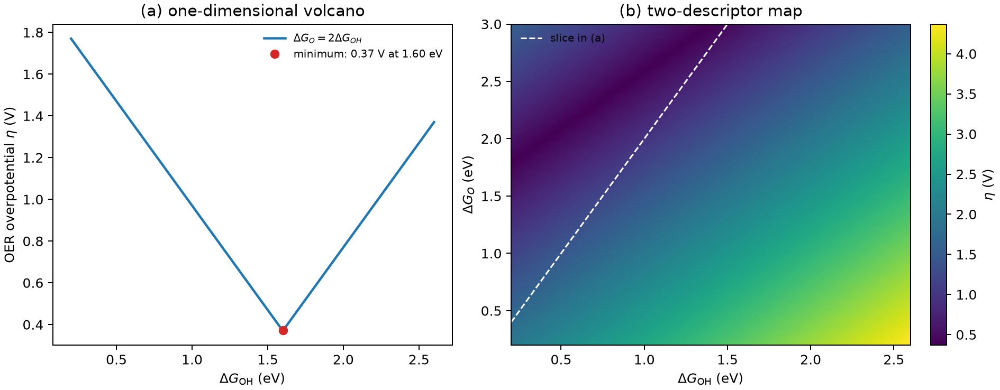

# 电催化描述符与火山图

**适用环境：通用（阅读与绘图）；示例用 Python 3 + numpy + matplotlib，真实描述符来自 DFT 吸附能或电子结构量。**

催化剂筛选不能对每个表面都把全部中间体算一遍。更常见的做法是找一个**描述符**：一个容易算、又能预测活性的量。把活性对描述符作图，常常得到一座火山——吸附太弱，中间体接不上；吸附太强，产物下不来。火山顶就是 Sabatier 最优。

本文说明描述符、标度关系和火山图之间的关系，并给出一个可运行的一维火山与二维过电位图示例。示例中的标度关系是为画图而设的示意式，不是通用规律。

## 描述符：把多维问题压成一维

对 HER，最常用的描述符是氢吸附自由能 $\Delta G_{\rm H}$。理想情况下 $\Delta G_{\rm H}\approx0$：吸附太弱，Volmer 步难以进行；吸附太强，H* 占满表面、难以复合脱附。

对 OER/ORR，常用 $\Delta G_{\rm OH}$、$\Delta G_{\rm O}$ 或它们的线性组合。电子结构层面，d 带中心、d 带填充、Bader 电荷、配位数也常被当作描述符；它们与吸附能的关联见[d 带中心的能窗、参考与比较](../../计算化学/d带中心的能窗、参考与比较.md)。注意：d 带中心是**相关性描述符**，不是因果量；两个表面 d 带中心相同，吸附能仍可能因配位和自旋不同而差很多。

## 标度关系：火山图的来源

同一类表面上，不同中间体的吸附能往往线性相关。例如 OER 中常见的近似

$$
\Delta G_{\rm OOH}\approx \Delta G_{\rm OH}+3.2\ {\rm eV},
$$

以及 $\Delta G_{\rm O}$ 与 $\Delta G_{\rm OH}$ 的线性关系。这样，原本两个独立变量就压成一个，四步自由能台阶可以只用一个描述符画出来。

标度关系的代价是**限制了最优过电位**。如果 $\Delta G_{\rm OOH}$ 总比 $\Delta G_{\rm OH}$ 高 3.2 eV，那么无论怎么调 $\Delta G_{\rm OH}$，总有一两步无法同时接近 1.23 eV；火山顶的过电位就有一个由标度关系约束的下限。打破标度关系（双功能位点、双原子协同、限域环境）是降低过电位的常见思路。

## 从四步台阶到火山

以 OER 为例，四步为

$$
\Delta G_1=\Delta G_{\rm OH},\quad
\Delta G_2=\Delta G_{\rm O}-\Delta G_{\rm OH},\quad
\Delta G_3=\Delta G_{\rm OOH}-\Delta G_{\rm O},\quad
\Delta G_4=4.92-\Delta G_{\rm OOH}.
$$

给定一条标度关系，把 $\Delta G_{\rm O}$、$\Delta G_{\rm OOH}$ 都用 $\Delta G_{\rm OH}$ 表示，就能对每个 $\Delta G_{\rm OH}$ 算

$$
\eta=\frac{\max_i \Delta G_i}{e}-1.23\,\mathrm V.
$$

$\eta$ 在下文的标度模型中，低 $\Delta G_{\rm OH}$ 端由 `OOH*` 形成步限制，高值端由 `OH*` 形成或脱氢步限制。过电位呈谷形。若用 $-\eta$ 作为活性指标，极小值对应火山顶。

如果两个描述符独立，火山就不是一条线，而是二维平面上的**过电位谷**。固定其中一个描述符做切片，曲线可能单调，也可能在边界取极小；只看一条切片就断言“没有火山”会误判。

## 示例：一维火山与二维过电位图

配套案例在 [electrocatalysis-volcano](../../../examples/materials/electrocatalysis-volcano/README.md)。输入是描述符范围、标度关系斜率和截距：

```json
{"dG_OH_range_eV": [0.2, 2.6], "dG_O_ratio": 2.0, "dG_OOH_offset_eV": 3.2}
```

运行：

```bash
cd examples/materials/electrocatalysis-volcano
python3 -m pip install -r requirements.txt
python3 run.py
```

左图取 $\Delta G_{\rm O}=2\Delta G_{\rm OH}$、$\Delta G_{\rm OOH}=\Delta G_{\rm OH}+3.2$，得到 $\eta$ 在 $\Delta G_{\rm OH}=1.60$ eV 处最小，$\eta=0.37$ V。右图把 $\Delta G_{\rm OH}$ 和 $\Delta G_{\rm O}$ 都当独立变量，画出二维过电位分布；白色虚线是左图用的切片。$\eta$ 的低谷沿一条斜带分布，而不是一个点。



$2\Delta G_{\rm OH}$ 这个关系只是为了在示例里画出一维火山，不是 OER 的通用标度关系。真实体系要用文献或自己算出的标度关系，并检查斜率、截距和适用表面。

## 火山图不能回答什么

- **动力学**：火山图只比较热力学台阶，不含活化能。两个催化剂热力学过电位相同，Tafel 斜率可能差很多。
- **选择性与副反应**：HER 的火山不告诉你 CO₂RR 的 Faradaic 效率；要同时比较竞争反应。
- **表面重构与覆盖度**：描述符通常对应理想表面、低覆盖度；实际条件下重构、氧化和吸附物覆盖会改变活性位。
- **溶剂与电位**：真空吸附能算出的火山，和电解液中的火山可能整体平移；见[溶剂化与电位修正](电催化中的溶剂化与电位修正.md)。
- **稳定性**：火山顶的催化剂可能在工作电位下溶解或团聚；活性与稳定性要分开评估。

## 检查清单

- 描述符的定义是否一致？$\Delta G_{\rm H}$ 是 1/2 H₂ 参考还是 H⁺/e⁻ 参考？
- 标度关系来自哪里？斜率、截距、误差范围是否报告？
- 火山是 1D 切片还是 2D 面？切片是否真的沿标度关系取？
- 过电位用的是热力学台阶还是包含活化能？
- 有没有考虑溶剂、电位、覆盖度和表面重构？
- 火山顶的候选是否做过稳定性检查（溶出、团聚、相变）？

## 参考

- J. K. Nørskov, J. Rossmeisl, A. Logadottir, et al. Origin of the overpotential for oxygen reduction at a fuel-cell cathode. *J. Phys. Chem. B*, 2004, 108: 17886. [doi:10.1021/jp047349j](https://doi.org/10.1021/jp047349j)
- J. K. Nørskov, T. Bligaard, J. Rossmeisl, C. H. Christensen. Towards the computational design of solid catalysts. *Nat. Chem.*, 2009, 1: 37. [doi:10.1038/nchem.121](https://doi.org/10.1038/nchem.121)
- M. T. M. Koper. Theory of multiple proton–electron transfer reactions and its implications for electrocatalysis. *Chem. Sci.*, 2013, 4: 2710. [doi:10.1039/C3SC50205H](https://doi.org/10.1039/C3SC50205H)
- 本仓库：[d 带中心的能窗、参考与比较](../../计算化学/d带中心的能窗、参考与比较.md)
