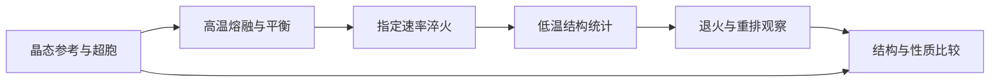

# 相变存储：从 GeTe 熔融淬火到晶化判据

**适用环境：macOS / Linux，CPU 计算。**

## 区分建模、结构转变与器件性能

相变存储关注晶态与非晶态及其结构和性质差异。原子模拟先回答如何获得可信的两态结构，再研究成核、晶化或电子/光学变化。一个短轨迹没有出现晶化，不能据此认定材料不能晶化；一张无序快照也不能独立证明得到代表性的非晶结构。

本例用 GeTe 演示 AIMD 多阶段流程：熔融、淬火、退火，保留阶段间速度及重启结构。VASP 的温控和熔融计算方法见官方说明[^1]。

## 建立结构与温度历程



`phase-change.json` 从岩盐型 GeTe 的两原子原胞出发，`2×2×4` 扩胞，共 32 个原子，常规晶格参数 6.0 Å。初始坐标加入固定种子的 0.08 Å 扰动，避免在完美对称结构上观察不足的运动。使用 Ge、Te 的 PBE PAW 势、300 eV、Γ 点和固定晶胞。

| 阶段 | 步数 | 时间 | 热浴目标 |
| --- | ---: | ---: | --- |
| 熔融段 | 300 | 0.6 ps | 2000 K |
| 淬火段 | 400 | 0.8 ps | 2000 → 300 K |
| 退火段 | 300 | 0.6 ps | 600 K |

时间步长 2 fs，总时间 2 ps。淬火设定速率为 $(2000-300)/0.8=2125$ K/ps，即 $2.125\times10^{15}$ K/s。这里是短时、小体系的学习案例；研究非晶统计和晶化动力学应显著扩展体系、熔融平衡与采样时长，并比较多个随机初态及不同淬火速率。

## 动力学设置与阶段衔接

```text
IBRION = 0
MDALGO = 3
ISIF = 2
POTIM = 2.0
LANGEVIN_GAMMA = 10 10
TEBEG = 2000
TEEND = 300
NSW = 400
```

Langevin 摩擦系数单位为 ps⁻¹，温控目标不等于每一帧的实际温度。改变温度不能替代判断液体是否已平衡。时间步长还需通过短程 NVE 能量漂移等方法检查，含高频轻元素的体系尤其应重新选择。

运行器直接把上一阶段 `CONTCAR` 作为下一阶段 `POSCAR`，保留速度与适用的重启信息；不要只复制坐标再随机抽速度，却把过程称作连续淬火。`--resume` 核对并复用已登记输出；对于正常停止的 MD 短段，需加 `--continue-md` 才会原样衔接速度与随机数状态，补足原阶段步数，详见[案例说明](../../../examples/materials/phase-change/README.md)。

## 如何判断发生了什么

先检查每个离子步的电子收敛、温度、势能、最小原子间距和盒子密度。高温运动应有持续的邻近环境重排；若始终只在格点附近振动，应加长熔融段、调整温度并检查结构与密度，确认熔融后再进入淬火。

结构指标可组合使用：

- 原子对 RDF：在适合周期边界的半径范围内，区分 Ge–Ge、Ge–Te、Te–Te。第一峰位置与峰积分分别提供键长和配位信息。
- 配位数：写明元素对及 cutoff，扫描 cutoff 检验结论稳定性。统一阈值不能忽视不同原子对的差异。
- 键角、局域序、结构因子：判断短程和较长程有序，单个指标不足以覆盖多种局域环境。
- MSD：展开周期轨迹并处理整体漂移；只在已平衡的稳态区间拟合扩散，不能把升降温混合轨迹的斜率当作扩散系数。

完整流程结束后，`results.json` 提供初末平均配位与最小间距，`curve.csv` 提供逐步实际温度与势能。进一步分析可用[OVITO 的 RDF 与配位](../../OVITO/配位数与径向分布函数.md)、[批量轨迹分析](../../OVITO/OVITOPython批量分析.md)及[现有 RDF 脚本](../../../scripts/analysis/calculate_rdf.py)。小盒子的 RDF 可用半径有限，不应据此宣称长程无序已经充分收敛。

配套[结构分析脚本](../../../scripts/materials/analyze_phase.py)使用 ASE 与 NumPy，生成部分 RDF、分元素配位分布和去除整体质心漂移的 MSD。RDF 的一般含义与可视化操作可参照 OVITO 手册[^2]；本例的归一化明确采用有序原子对计数：

$$g_{ab}(r)=\frac{\langle n_{ab}([r_-,r_+))\rangle V}{N_a(N_b-\delta_{ab})\,\tfrac{4\pi}{3}(r_+^3-r_-^3)}.$$

同元素对排除原子与自身的配对，并使用有限粒子数修正。与采用 $N_b/V$ 归一化的软件比较时，先统一这一约定，尤其是只有几十个原子的小体系。脚本按各阶段末尾最多 50 帧取算术平均，并单独保留理想晶体参考。

对于本例固定晶胞，周期展开后减去质量加权整体质心位移，再按 Ge、Te 分组平均平方位移。这样整体平移不会被误判为内部扩散；跨越熔融、淬火和退火的非稳态曲线只作为运动及结构变化的辅助指标，不进行扩散系数拟合。

## 退火与晶化分支

退火温度应结合目标材料的可达重排时间与稳定性确定。600 K 在此仅是输入设定，不是预测的晶化温度。多初态、多个退火温度和更长轨迹中，应同时观察局域序、结构因子与能量变化，必要时区分均匀成核、界面诱导和已有晶核生长。

静态 NEB 适用于已定义初末态之间的特定局部过程；它不替代完整液体到晶体的采样。长时大体系可在 LAMMPS 上使用经过验证的势；若没有适用于 Ge–Te 液体、非晶、晶态和转变环境的势，不借用仅适用单元素 Ge 的势。VASP 自带机器学习力场可作为后续路线，但需要足够多相关状态的训练与独立误差检查，见[现有机器学习力场笔记](../../VASP/动力学与机器学习/VASP机器学习力场.md)。

## 两态性质比较与 CP2K 路线

从不同低温初态抽取多个结构，在一致精度下计算 DOS、带隙或光学响应，并报告结构间分散度；熔融/淬火时的高温展宽和 Γ 点参数不应未经检查直接用于最终光学或带隙分析。晶态参考还需区分岩盐型高温结构与其他低温畸变结构。

CP2K 也可运行同类分阶段 AIMD，见[CP2K 分子动力学](../../CP2K/动力学与反应/CP2K分子动力学.md)。改用 CP2K 时需独立收敛基组、平面波辅助截断、赝势和时间步长，保留 `.restart` 等信息。不同程序的绝对总能量不能直接混合计算两态能差。

[^1]: VASP. Molecular-dynamics calculations and melting tutorial. https://vasp.at/wiki/MD_runs ; https://vasp.at/tutorials/latest/md/part1/
[^2]: OVITO. Radial distribution function. https://www.ovito.org/docs/current/reference/pipelines/modifiers/radial_distribution_function.html

## 配套案例

[GeTe 的熔融—淬火—退火轨迹](../../../examples/materials/phase-change/README.md)提供参数、运行命令与后处理说明。先检查[本机运行与结果检查](../本机运行与结果检查.md)，再运行案例；更换参数后使用新输出目录。

返回[相变存储](README.md)或[材料应用](../README.md)。
