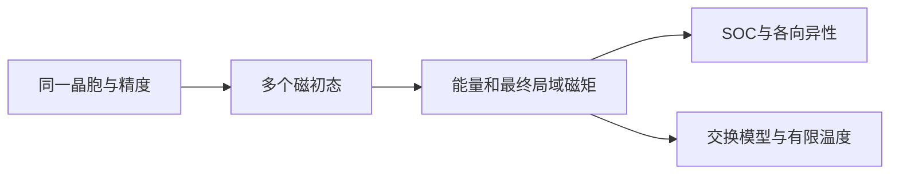

# 磁性与自旋：从 Fe 磁序到 SOC 与有限温度

**适用环境：macOS / Linux，CPU 计算。**

## 从磁序开始

磁性研究先比较不同自旋构型，再决定是否需要 SOC、非共线磁性或统计自旋模型。本例比较同一 bcc Fe 晶胞的非自旋极化态 NM、铁磁态 FM，以及两个子晶格相反的共线 AFM 初态。`MAGMOM` 是电子迭代初始磁矩，不是固定最终磁矩；相关行为见 VASP 官方说明[^1]。

## 固定条件比较



使用常规 bcc 胞的两个 Fe，晶格常数 2.86 Å、450 eV、`9×9×9` k 网格。先固定晶胞和位置比较电子能，避免结构差异掩盖磁序作用。FM 与 AFM 分别取 `MAGMOM=2.5 2.5`、`2.5 -2.5`；NM 用 `ISPIN=1`。三态使用相同展宽与能量定义。

```text
ISPIN = 2
MAGMOM = 2.5 -2.5
LORBIT = 11
ISMEAR = 1
SIGMA = 0.1
ISYM = 0
```

结果同时读取总磁矩与两个原子的局域磁矩。AFM 总磁矩接近零，并不说明局域磁矩也为零；若 AFM 初态最终变为其他态，应按最终状态解释，而不是按目录名归类。

## 能量差与检查

`curve.csv` 以每原子能量比较三种输入，最低样本为零。`results.json` 保留各态绝对能量与局域投影磁矩。对金属应收敛 k 网格与展宽，必要时比较多种初始幅度，避免把不充分收敛的解当作亚稳磁态。

局域磁矩依赖投影范围与定义，跨软件比较先核对投影方式。允许结构弛豫后还应区分“同一结构的磁序能差”和“各态分别弛豫后的能差”，二者对应不同问题。

## SOC 与磁各向异性

确定参考磁态后，用`vasp_ncl` 进入 [SOC](../../VASP/泛函与磁性/VASP自旋轨道耦合.md)和[磁各向异性](../../VASP/泛函与磁性/VASP磁各向异性能.md)。不同磁化方向间的能量差往往远小于总能，因此需要比一般结构优化更严格的电子、k 点及对称性处理；比较时保持相同电子数、结构和数值设置。

磁各向异性能需注明总能法或力定理、单位是每原子还是每胞、方向与晶体坐标关系。非共线体系还需正确设置三分量初始磁矩；不能把共线输入中的两个标量直接当成非共线向量。

## 从交换参数到有限温度

交换模型必须先声明约定，例如 $H=-\sum_{i<j}J_{ij}\mathbf e_i\cdot\mathbf e_j$，其中 $\mathbf e_i$ 是单位自旋。若另一实现对所有有序原子对求和或使用带长度的自旋，参数会相差因子，不能直接混用。

拟合需要足够多独立磁构型、相互作用距离与残差检查，还需检验模型能否复现未参与拟合的 DFT 能量。两个磁态的能差通常不足以确定多个交换参数；它更不能单独给出可靠居里温度。有限温度自旋模拟属于不同于原子位置动力学的模型，需要另行选择与交换模型定义一致的求解方法。

## 可选软件与交叉方向

[OpenMX 磁序](../../OpenMX/电子结构与磁性/OpenMX磁序与局域磁矩.md)及[非共线与 SOC](../../OpenMX/电子结构与磁性/OpenMX非共线磁性与自旋轨道耦合.md)提供局域基组路线。需要对齐赝势、基组、泛函、投影与能量零点后再做跨软件比较。

合金磁性进入[金属与合金](../金属与合金/README.md)，磁电耦合进入[铁电与介电](../铁电与介电/README.md)，磁性半导体进入[半导体](../半导体/README.md)。

[^1]: VASP. MAGMOM. https://vasp.at/wiki/MAGMOM

## 配套案例

[bcc Fe 的 NM、FM、AFM 比较](../../../examples/materials/magnetism/README.md)提供参数、运行命令与数据说明。先检查[本机运行与结果检查](../本机运行与结果检查.md)，再运行案例；更换参数后使用新输出目录。

返回[磁性与自旋](README.md)或[材料应用](../README.md)。
