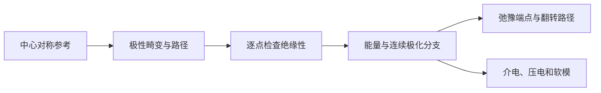

# 铁电与介电：从 BaTiO3 极性路径到响应与翻转

**适用环境：macOS / Linux，CPU 计算。**

## 极化、压电与铁电分别回答什么

介电响应描述电场与极化变化，压电响应描述应变或应力与极化的耦合，铁电问题还涉及可切换的极化状态。非零极化、非中心对称结构或压电系数本身不能代替铁电翻转分析。本例以 BaTiO₃ 为载体，学习沿一条指定极性畸变路径比较能量与极化，不把路径端点预先认定为稳定态。

周期绝缘体的极化需要处理 Berry 相及极化量子；方法和电场响应见 VASP 官方说明[^1]。

## 建立参考与极性路径



`ferroelectric.json` 使用固定四方晶胞 $a=4.00$ Å、$c=4.08$ Å。中心对称参考的分数坐标为 Ba `(0,0,0)`，Ti `(1/2,1/2,1/2)`，O 位于三个面心。极性模沿 z 的位移分别为 `(0,0.12,-0.04,-0.06,-0.06) Å`，乘无量纲幅度 $q$。扫描 $q=-1,-0.66,-0.33,0,0.33,0.66,1$。

这是指定路径的静态计算，不做内部坐标优化，因此可比较同一模式的能量曲线。PAW 顺序为 `Ba_sv Ti_sv O`，截断能 520 eV、`5×5×5` k 网格；所有路径点使用相同晶胞、势与精度。

```text
LCALCPOL = .TRUE.
ISYM = 0
IBRION = -1
NSW = 0
```

## 处理极化分支

OUTCAR 给出离子与电子偶极，先相加再转成极化。沿 z 的极化量子为 $P_q=e c/\Omega$；若偶极用 eÅ、胞体积用 ų，转换到 C/m² 的因子为 16.02176634。绝对输出只在模极化量子的意义下确定，不能直接把任意两个端点的原始数值相减。

运行器沿相邻路径点展开连续分支，以 $q=0$ 为参考输出 $\Delta P_z$。这需要路径保持绝缘、步长足够小；应加密路径确认相邻变化及分支选择稳定。出现闭合带隙或部分占据时，先检查结构与方法，不能继续套用本例。

结果应先检验反演关系：在相同精度下，$E(q)\approx E(-q)$，$\Delta P(q)\approx-\Delta P(-q)$。明显不对称时检查坐标、磁性/电子初态、收敛与分支；微小误差需结合实际数值精度解释。`results.json` 同时记录这两项误差。

## 从扫描到翻转势垒

若某路径两侧出现低于中心参考的能量，只能说明该指定模上的能量变化。要得到稳定极化态，应分别弛豫端点，并检验声子与其他结构自由度；再在适当的晶胞和约束条件下搜索路径，必要时使用 [NEB](../../VASP/表面与反应/NEB过渡态搜索.md)。

需要区分固定晶胞与允许应变弛豫的路径、均匀翻转与畴成核/畴壁运动。五原子均匀路径上的能量差不等于器件的矫顽场，也不能直接生成实验电滞回线。

## 介电、压电与软模

- [静态介电响应](../../VASP/响应与输运/VASP静态介电响应.md)：区分固定离子电子贡献与包含离子响应的总量。
- [Born 有效电荷](../../VASP/响应与输运/VASPBerry相极化与Born有效电荷.md)：是极化对原子位移的导数，和静态分区电荷不同。
- [压电张量](../../VASP/响应与输运/VASP压电张量.md)：注明坐标、Voigt 顺序、电子及离子贡献。$e$ 与 $d$ 还需要通过弹性柔量联系，不能直接改单位。
- [声子](../../VASP/振动与热力学/VASP声子谱计算.md)：识别极性软模及其他竞争不稳定性；高对称参考有软模不等于所有低对称结构都有该不稳定性。

## 有限温度、畴壁与其他体系

有限温度需要足够大的模型、足够长的采样或适当的有效模型，单个 0 K 路径不能给出居里温度。畴壁模型需构造相容的极化取向与周期边界，检查带电/非带电畴壁、电场与尺寸效应。若采用经典或机器学习势，应验证它是否正确描述电荷、极化和长程相互作用；缺少相应模型时，不把普通势函数当作通用铁电模拟器。

有机铁电进入[有机与高分子](../有机与高分子/README.md)，磁电耦合进入[磁性与自旋](../磁性与自旋/README.md)。

[^1]: VASP. Berry phases and finite electric fields. https://vasp.at/wiki/Berry_phases_and_finite_electric_fields

## 配套案例

[BaTiO3 的能量与 Berry 相极化扫描](../../../examples/materials/ferroelectric/README.md)提供参数、运行命令与数据说明。先检查[本机运行与结果检查](../本机运行与结果检查.md)，再运行案例；更换参数后使用新输出目录。

返回[铁电与介电](README.md)或[材料应用](../README.md)。
