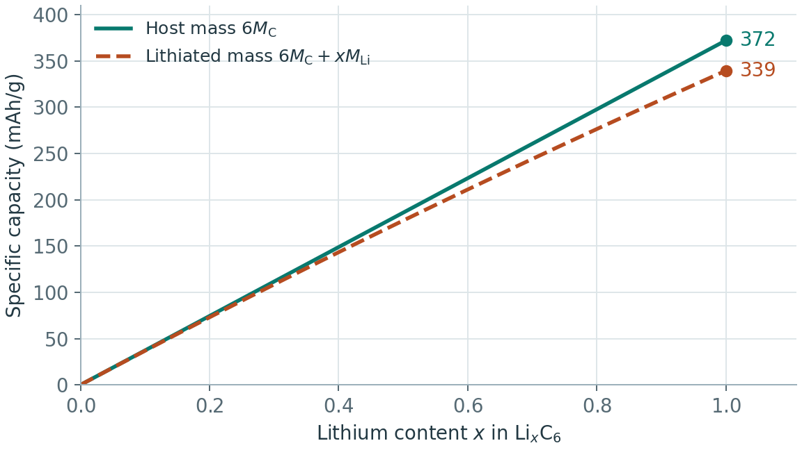

# 电池容量与能量密度的质量口径

理论容量先由配平反应给出电子数，再选择分母。若每摩尔宿主可交换 $n$ 摩尔电子，质量为 $M$（单位 $\mathrm{g\,mol^{-1}}$），则比容量为

$$
C_{\mathrm{sp}}=\frac{n F}{3.6 M}\quad(\mathrm{mAh\,g^{-1}}).
$$

其中 $F$ 是 Faraday 常数。这里的 $M$ 可以是未嵌锂宿主、初始正极活性物质或两极总活性质量。比较时先把数字换算到相同定义。

| 口径 | 质量包括什么 | 能回答的问题 |
| --- | --- | --- |
| 材料理论值 | 指定初始状态的活性物质 | 一个化学反应在给定电子数下的质量容量 |
| 电极涂层 | 活性物质、导电剂与黏结剂，必要时计集流体并注明 | 实验电极的面容量与质量容量 |
| 全电芯 | 两极、隔膜、电解液、集流体、极耳及封装等 | 在设计、温度、倍率和电压窗口下的实际能量密度 |

全电池平衡电压为正负极电位差。比能量按放电曲线对容量积分，再除以同一口径的质量。$C_{\mathrm{sp}}\bar V$ 可用于按容量加权的平均电压估算。若 $C_{\mathrm{sp}}$ 用 $\mathrm{mAh\,g^{-1}}$、$\bar V$ 用 V，所得数值单位为 $\mathrm{Wh\,kg^{-1}}$。体积能量密度还需明确所取的是材料体积、电极体积还是电芯外形体积。

## 从 DFT 构型得到电压与容量

1. 列出锂含量与各组成最低能候选。对固定宿主单位计算相邻稳定构型的能量差，以同一设置的 Li 金属为参考。多相平台和连续固溶体的解释见[相图与相变](锂电池相图与相变.md)。
2. 用电压窗口与可逆的嵌脱锂量确定 $n$。NEB 势垒用于比较迁移路径，实际倍率还受缺陷浓度、电解液与电极结构影响。
3. 全电池比较需分别计算两极质量配比和可用容量，统一首圈损失与电压区间。Li–O₂ 若只按金属锂质量计，需注明氧源来自外部。Li–S 若按 S 质量计，碳载体、电解液和过量锂需在电芯口径中另计。

例如石墨完全嵌锂为 $\mathrm{LiC_6}$ 时，以 $6M_\mathrm C$ 为分母、每个宿主交换 1 个电子，理论容量约 372 $\mathrm{mAh\,g^{-1}}$。若分母包括已嵌入的 Li，同样的电子计量给出约 339 $\mathrm{mAh\,g^{-1}}$。完整示例见[石墨电压与容量](锂离子电池：从LiC6电压到扩散与界面.md)。

示意图按 $\mathrm{Li}_x\mathrm C_6$ 中每嵌入一个 Li 对应一个电子计算。两条曲线的电荷量相同，质量分母分别取未嵌锂宿主和含 Li 的当前组成。

参考彭佳悦等的[理论能量密度估算](https://doi.org/10.3969/j.issn.2095-4239.2013.01.005)与[锂空气和锂硫电池](https://doi.org/10.3969/j.issn.2095-4239.2014.05.012)。
