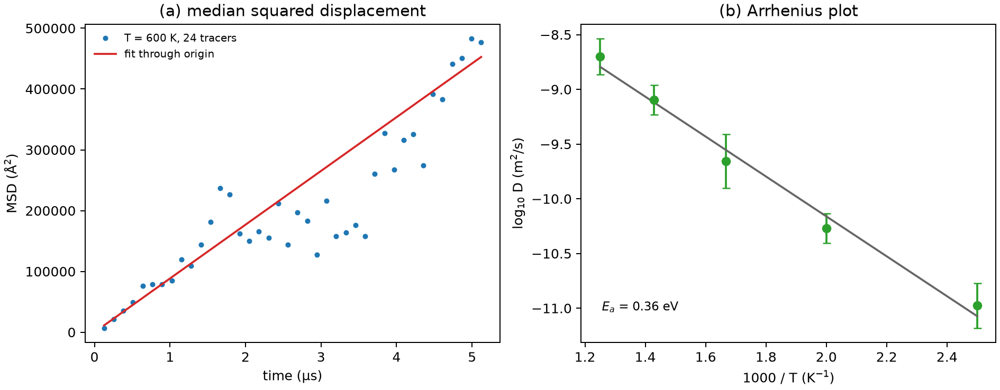

# 锂电池多尺度计算方法

**适用环境：Linux / macOS / Windows（Python 3 + numpy + matplotlib）；示例是二维 kMC，不依赖外部模拟软件。**

电池的容量、倍率、循环和安全性跨越十几个数量级：电子转移在飞秒到皮秒，界面反应在纳秒，锂在颗粒内扩散在秒到小时，电池包的热分布在分钟到小时。没有任何一种方法能同时覆盖这些尺度。多尺度计算的任务，是把不同方法在重叠的时间/空间窗口里接起来，并让交接的物理量保持一致。

本文按“DFT → MD → kMC → 连续模型”的顺序说明各尺度能算什么、交接什么、误差怎样传下去，并给出一个从跃迁势垒到扩散系数的二维 kMC 示例。示例只演示流程，不包含真实材料的参数。

## 四个尺度与交接量

| 尺度 | 方法 | 典型输出 | 交给下一尺度 |
| --- | --- | --- | --- |
| 电子/原子 | DFT | 总能量、缺陷形成能、迁移势垒、能带 | 能量参数、势垒、电荷 |
| 原子/纳米 | MD | 扩散系数、界面结构、热导、应力 | 输运系数、结构模板 |
| 微米/介观 | kMC、相场 | 浓度分布、相变动力学、SEI 生长 | 有效参数、源项 |
| 器件/系统 | 连续方程、FEM | 电压、电流、温度场 | 边界条件、寿命预测 |

交接不是“把数字复制过去”。每个尺度都有自己的近似：DFT 的 0 K、完美晶体、固定电荷态；MD 的力场或机器学习势误差；kMC 的格点与跃迁假设；连续模型的均匀化。上一级的误差会被下一级放大或掩盖，所以要做敏感性和收敛检查，而不是只跑通一条链。

## DFT：给 MD 和 kMC 提供能量参数

DFT 最常交付三类量：

1. **热力学量**：形成能、相图、电压。用于判断哪个相稳定、界面是否分解。
2. **动力学量**：迁移势垒、反应势垒。用 NEB、dimer 或约束 MD 算，交给 kMC 的跃迁速率。
3. **电子结构**：带边、功函数、缺陷能级。用于界面能带对齐和电子隧穿。

迁移势垒要报告路径、超胞、k 点、电荷态和是否包含零点能。同一迁移在体相、界面和缺陷附近可能差很多；把体相势垒直接用于界面，是常见的过度简化。

## MD：从势垒到扩散与结构

MD 可以直接算扩散系数（MSD 或速度自相关）、热导、界面结构和力学响应。关键是势函数：经典力场快但可迁移性有限，机器学习势精度接近 DFT 但需要训练数据覆盖目标构型。

MD 与 kMC 的交接通常有两种：

- 用 MD 算跳跃频率或扩散系数，反推有效势垒，再输入 kMC；
- 用 MD 采样局部环境，构造 kMC 的跃迁表（不同配位、不同邻近原子对应不同势垒）。

如果 MD 的势函数没覆盖缺陷/界面构型，得到的势垒不能直接当 kMC 输入。

## kMC：把跃迁速率变成宏观动力学

在格点 kMC 中，每个事件 $i$ 的速率用过渡态理论写成

$$
k_i=\nu_i\exp\left(-\frac{E_{a,i}}{k_BT}\right),
$$

$\nu_i$ 是尝试频率，$E_{a,i}$ 是势垒。每一步按速率加权选择事件，并把时间推进

$$
\Delta t=-\frac{\ln u}{\sum_i k_i},\qquad u\in(0,1].
$$

这样模拟的是“事件序列”，而不是固定时间步的 MD。kMC 能覆盖秒到小时，但前提是事件表和格点模型正确；漏掉一个低势垒事件，长时行为就会错。

示例是一个二维示踪粒子：x 方向势垒 0.35 eV，y 方向 0.55 eV，尝试频率 $10^{13}$ s$^{-1}$。每个温度跑 24 条独立轨迹。程序先用每条轨迹末段的位移估算

$$
D=\frac{\mathrm{MSD}}{4t}
$$

（二维），再取各轨迹估计值的中位数用于 Arrhenius 拟合。左图展示各采样步位移平方的中位数，用于查看轨迹涨落。

$$
D=D_0\exp\left(-\frac{E_a}{k_BT}\right).
$$

本示例拟合得到 $E_a\approx0.36$ eV，接近 x 方向的 0.35 eV，而不是两个势垒的平均。原因是快方向主导长时扩散；各向异性体系的 Arrhenius 斜率不对应单一微观势垒。这是一个有用的提醒：拟合出一个“活化能”并不等于识别出了唯一的跃迁机制。

## 连续模型：把微米尺度接到器件

kMC 或相场给出浓度场、相分布和界面位置后，连续模型用扩散方程、Poisson 方程、热传导和力学平衡算电极/电池的行为。交接量是有效扩散系数、有效电导率、反应速率和界面能；这些量必须与上游的尺度、温度、浓度范围匹配。

连续模型里的“有效参数”常常是拟合出来的，不是第一性原理直接给的。报告时要说明拟合区间和外推风险。把 0 K DFT 的界面能直接用于室温、高电流的器件模型，误差可能比数值误差大得多。

## 示例：二维 kMC 的扩散系数

配套案例在 [battery-multiscale](../../../examples/materials/battery-multiscale/README.md)。输入是势垒、尝试频率、温度和轨迹数：

```json
{"barrier_x_eV": 0.35, "barrier_y_eV": 0.55,
 "attempt_frequency_s": 1e13, "temperatures_K": [400, 500, 600, 700, 800]}
```

运行：

```bash
cd examples/materials/battery-multiscale
python3 -m pip install -r requirements.txt
python3 run.py
```

左图是 600 K 下 24 条轨迹的中位 MSD 与线性拟合，右图是 Arrhenius 图。程序用速率加权选择跃迁、用指数分布推进时间，没有用固定步长；这两点是 kMC 和 MD 的根本区别。



示例的误差棒是 24 条轨迹的标准误。单条轨迹的 MSD 涨落很大，必须用集合平均或长时间平均；只跑一条轨迹就拟合 $D$，很容易得到负斜率或错误的活化能。

## 检查清单

- DFT 势垒的路径、超胞、电荷态和零点能是否报告？体相势垒能否用于界面？
- MD 势函数是否覆盖目标温度、缺陷和界面构型？有没有用 DFT 做抽检？
- kMC 的事件表是否完整？有没有漏掉低势垒路径、协同跳跃或多体事件？
- 格点模型是否忽略了实际的短程有序、相互作用和浓度依赖？
- 连续模型的有效参数在什么区间拟合？外推到器件条件是否合理？
- 误差有没有逐级传递？哪一级的假设最可能主导最终结论？

对辐照后空位、间隙和团簇的迁移与反应，可对照[MMonCa 点缺陷退火与扩散](../../MMonCa/MMonCa点缺陷退火与扩散.md)了解对象 kMC 的输入和统计量。

## 参考

- 郑浩，李泓．锂电池基础科学问题（Ⅵ）——离子在固体中的输运．*储能科学与技术*，2013，2(6)．[doi:10.3969/j.issn.2095-4239.2013.06.010](https://doi.org/10.3969/j.issn.2095-4239.2013.06.010)
- 黄杰，李泓．锂电池基础科学问题（ⅩⅣ）——计算方法．*储能科学与技术*，2015，4(2)．[doi:10.3969/j.issn.2095-4239.2015.02.014](https://doi.org/10.3969/j.issn.2095-4239.2015.02.014)
- A. Van der Ven, J. Thomas, Q. Xu, et al. Linking the electronic structure of solids to their thermodynamic and kinetic properties. *Math. Comput. Simul.*, 2010, 80: 1393. [doi:10.1016/j.matcom.2009.08.007](https://doi.org/10.1016/j.matcom.2009.08.007)
- A. F. Voter. Introduction to the kinetic Monte Carlo method. In *Radiation Effects in Solids*, Springer, 2007: 1–23. [doi:10.1007/978-1-4020-5295-8_1](https://doi.org/10.1007/978-1-4020-5295-8_1)
