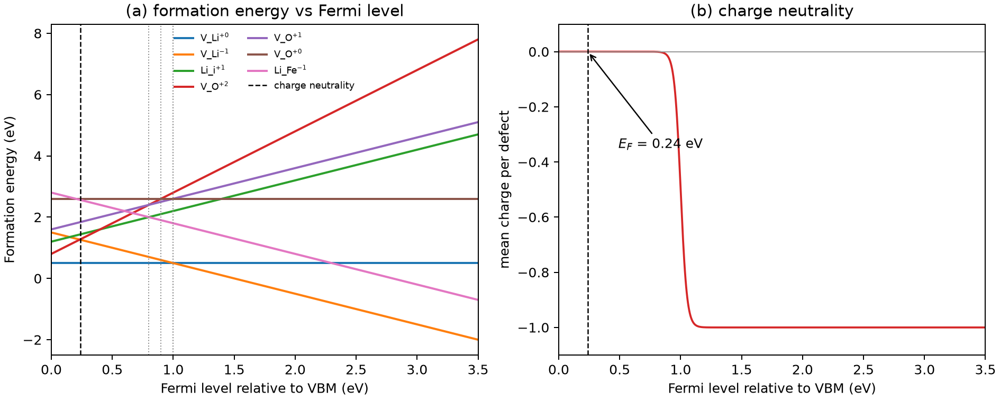

# 锂电池材料的缺陷化学

**适用环境：Linux / macOS / Windows（Python 3 + numpy + matplotlib）；形成能本身来自 DFT 总能量，示例只演示后处理。**

锂离子电池材料的很多性质不由理想晶体决定，而由少量缺陷决定：LiFePO₄ 的电子电导与小极化子跳跃有关，正极的锂空位影响脱锂路径，氧空位改变界面与电解液的反应性。把“缺陷浓度是多少、带什么电荷、费米能级钉在哪里”算清楚，才能把 DFT 总能量变成可比较的热力学量。

本文从形成能公式出发，说明化学势、电荷态、有限尺寸修正和电荷中性怎样进入计算，并给出一个可运行的 Python 后处理示例。示例输入是**为检查代码而构造的示意数值，不是任何真实材料的 DFT 结果**；换成自己的总能量后，流程不变。

## 形成能：把总能量换成可比较的量

对缺陷 $X$ 的电荷态 $q$，形成能写成

$$
E_f(X^q)=E_{\rm tot}(X^q)-E_{\rm tot}({\rm bulk})
-\sum_i n_i\mu_i+q(E_F+E_{\rm VBM})+\Delta E_{\rm corr}.
$$

各项的含义：

- $E_{\rm tot}(X^q)$：含缺陷超胞的总能量；$E_{\rm tot}({\rm bulk})$：同尺寸完美超胞的总能量。两者必须用同一套赝势、截断、k 点和交换关联泛函。
- $n_i$：相对完美超胞增加（正）或减少（负）的原子数；$\mu_i$：对应元素的化学势。
- $q(E_F+E_{\rm VBM})$：电子库的能量。$E_F$ 以价带顶为参考，$q=-1$ 表示多一个电子，形成能随 $E_F$ 升高而降低。
- $\Delta E_{\rm corr}$：带电超胞的有限尺寸修正；中性缺陷也可能需要能带对齐，但不需要静电修正。

化学势不是自由参数。以 LiFePO₄ 为例，满足

$$
\mu_{\rm Li}+\mu_{\rm Fe}+\mu_{\rm P}+4\mu_{\rm O}=E({\rm LiFePO_4}),
$$

并且每个 $\mu_i$ 不能高于对应单质的能量，否则单质会析出。实际计算中通常先取一组满足稳定性条件的 $\mu_i$，再用它算形成能；换一组化学势，不同化学计量变化的缺陷形成能会按各自的 $n_i$ 移动，但**同一化学势下的相对顺序**才有意义。

对电池正极，$\mu_{\rm Li}$ 还与电极电位相连。脱锂时锂的参考态从金属锂变成正极中的锂，$\mu_{\rm Li}$ 的变化对应电压；把 $\mu_{\rm Li}$ 固定成金属锂，相当于在问“这个缺陷在什么条件下会自发形成”，而不是“在工作电位下浓度是多少”。

## 电荷态与跃迁能级

同一缺陷可以有多个电荷态。把每个电荷态的形成能画成 $E_F$ 的直线，斜率就是 $q$；两条线的交点称为跃迁能级（transition level）：

$$
\varepsilon(q_1/q_2)=\frac{E_f(q_1;E_F=0)-E_f(q_2;E_F=0)}{q_2-q_1}.
$$

取 $q_1>q_2$ 时，两条线中 $q_1$ 在交点左侧能量更低，$q_2$ 在右侧能量更低。物理上的热力学跃迁要求交点位于带隙内，并且在所有候选电荷态的形成能下包络上。

只比较“中性缺陷的形成能”不够。带电缺陷的形成能随 $E_F$ 变化，真正稳定的是**包络线**：对每个 $E_F$ 取所有电荷态中的最小值。很多错误来自把某一条线当成全温区的结果。

## 有限尺寸修正

带电缺陷的超胞计算带有周期性镜像电荷。直接做能量差，会得到随超胞尺寸变化的形成能。常用处理：

1. **Makov–Payne 外推**：对立方超胞，修正项近似按 $1/L$ 变化，用几个尺寸外推到无穷大。
2. **Freysoldt–Neugebauer–Van de Walle 方案**：用介电常数和模型电荷密度算镜像势，再做势对齐；各向异性体相与二维体系需要匹配相应介电模型和边界条件的修正方案。
3. **Lany–Zunger 方案**：结合势对齐和镜像电荷修正处理带电超胞的有限尺寸效应。

无论用哪种，都要报告超胞尺寸、介电常数、修正量和残余误差。中性缺陷的静电修正为零，但缺陷态能级相对带边的位置仍可能受超胞尺寸影响，需要检查缺陷态在带隙中的色散。

## 从形成能到浓度与费米能级

在热平衡近似下，缺陷浓度按玻尔兹曼分布：

$$
c(X^q)\propto \exp\left[-\frac{E_f(X^q)}{k_BT}\right].
$$

实际浓度还乘上格点数、自旋/取向简并和振动熵。把各电荷态的浓度代入电中性条件

$$
p-n+\sum_{X,q}q\,c(X^q)+\rho_{\rm fixed}=0,
$$

求平衡费米能级时还应计入空穴浓度 $p$、电子浓度 $n$ 与固定电荷的带符号数密度 $\rho_{\rm fixed}$。下面的示例只取缺陷电荷项，采用相同权重前因子。若缺陷浓度很高或存在缺陷-缺陷相互作用，这个“稀溶液”近似会失效，需要更复杂的统计或直接做超胞扫描。

对电池材料，平衡不一定成立：缺陷可能被合成条件、掺杂和界面反应冻结在亚稳态。形成能回答的是“热力学上倾向什么”，动力学和制备历史决定“实际得到什么”，两者不能混为一谈。

## 示例：读入总能量，算形成能与电荷中性

配套案例在 [battery-defects](../../../examples/materials/battery-defects/README.md)。输入是一个 JSON：

```json
{
  "host": {"E_total_eV": -100.0, "atoms": {"Li": 4, "Fe": 4, "P": 4, "O": 16}},
  "band_gap_eV": 3.5,
  "chemical_potentials_eV": {"Li": -1.9, "Fe": -7.0, "P": -5.0, "O": -4.5},
  "defects": [
    {"name": "V_Li", "charge": 0, "E_total_eV": -97.6,
     "delta_atoms": {"Li": -1}, "correction_eV": 0.0}
  ]
}
```

`delta_atoms` 是相对完美超胞的原子数变化，程序按它算 $\sum n_i\mu_i$。运行：

```bash
cd examples/materials/battery-defects
python3 -m pip install -r requirements.txt
python3 run.py
```

输出 `results.json` 与 `result.png`。左图是各电荷态的形成能直线与跃迁能级，右图是平均电荷随 $E_F$ 的变化；虚线是电中性点。示意输入得到 $E_F=0.24$ eV、$V_{\rm Li}$ 的 $(0/-1)$ 跃迁在 1.0 eV，只用于说明读图方式，不能当作 LiFePO₄ 的真实值。



把输入换成自己的 DFT 总能量时，注意三件事：完美超胞与缺陷超胞应使用相同尺寸、k 点和截断，并按原子数差记录 `delta_atoms`；化学势要满足相稳定约束；带电缺陷要加修正并检查修正前后的变化。程序不会替你判断这些前提。

## 检查清单

- 完美超胞与缺陷超胞是否同尺寸、同截断、同 k 点？总能量差是否在收敛范围内？
- 化学势来自哪个参考相？是否满足 $\mu_i\le\mu_i^{\rm bulk}$ 和化合物稳定条件？
- 带电缺陷的修正量是多少？换一个超胞尺寸，修正后的形成能是否稳定？
- 带隙、VBM 和缺陷态能级是否用同一套计算？有没有用 scissor 或杂化泛函？
- 跃迁能级是否落在带隙内？落在带外时，是否只是外推的数学交点？
- 电中性计算是否包含所有相关电荷态和格点简并？浓度是否已经高到稀溶液近似失效？

## 参考

- 卢侠，李泓．锂电池基础科学问题（Ⅱ）——电池材料缺陷化学．*储能科学与技术*，2013，2(2)．[doi:10.3969/j.issn.2095-4239.2013.02.010](https://doi.org/10.3969/j.issn.2095-4239.2013.02.010)
- C. G. Van de Walle, J. Neugebauer. First-principles calculations for defects and impurities: applications to III-nitrides. *J. Appl. Phys.*, 2004, 95: 3851. [doi:10.1063/1.1682673](https://doi.org/10.1063/1.1682673)
- C. Freysoldt, J. Neugebauer, C. G. Van de Walle. Fully ab initio finite-size corrections for charged-defect supercell calculations. *Phys. Rev. Lett.*, 2009, 102: 016402. [doi:10.1103/PhysRevLett.102.016402](https://doi.org/10.1103/PhysRevLett.102.016402)
- C. Freysoldt, B. Grabowski, T. Hickel, et al. First-principles calculations for point defects in solids. *Rev. Mod. Phys.*, 2014, 86: 253. [doi:10.1103/RevModPhys.86.253](https://doi.org/10.1103/RevModPhys.86.253)
- S. Lany, A. Zunger. Assessment of correction methods for the band-gap problem and for finite-size effects in supercell defect calculations. *Phys. Rev. B*, 2008, 78: 235104. [doi:10.1103/PhysRevB.78.235104](https://doi.org/10.1103/PhysRevB.78.235104)
