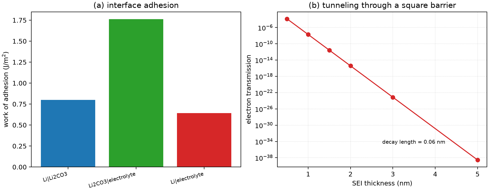

# 锂电池界面与 SEI

**适用环境：Linux / macOS / Windows（Python 3 + numpy + matplotlib）；界面能与势垒来自 DFT，示例只演示黏附功与隧穿估算。**

锂金属负极、石墨负极和正极都会与电解液接触。热力学上不稳定的接触面会分解电解液，生成一层固态电解质界面膜（solid electrolyte interphase，SEI）。SEI 既要传导 Li⁺，又要阻挡电子；它长到多厚、是否致密、会不会反复破裂，决定了库仑效率和循环寿命。

本文从界面黏附功、能带对齐和电子隧穿三个量入手，说明第一性原理能算什么、不能算什么，并给出一个可运行的后处理示例。示例中的能量与势垒是**为检查代码而构造的示意数值，不是真实界面数据**。

## 界面模型：参考态先定清楚

两种常用能量差对应不同的分离过程。

1. **相对自由表面**：分别算两块 slab 的自由表面能，再算拼合后的界面能。黏附功
   $$
   W_{\rm ad}=\frac{E_A+E_B-E_{A/B}}{A}
   $$
   表示“把界面拉开成两个自由表面需要多少能量”。$W_{\rm ad}>0$ 表示界面结合稳定。
2. **相对体相**：用体相能量和原子数算界面形成能
   $$
   \gamma=\frac{E_{A/B}-n_A E_A^{\rm bulk}-n_B E_B^{\rm bulk}}{A}.
   $$
   这个量通常为正，数值上要减去所有体相贡献。

上式取一个面积为 $A$ 的界面。如果周期胞有两个等价界面，按总面积 $2A$ 归一化。相对体相的能量差还需分离残余自由表面与应变的贡献。报告时写清参考态、slab 厚度、真空层和偶极修正。

## 能带对齐与电位

界面两侧的费米能级、价带顶和导带顶要先对齐，才能谈“电子从哪边注入”。常用做法：

- 用真空能级做参考，算功函数和电离势；
- 用宏观平均静电势做界面偶极修正；
- 对带电界面，加背景电荷并做势对齐。

对电池界面，还要把电子能量换算成电极电位。以 Li/Li⁺ 为参考，电化学稳定窗口取决于电解液氧化与还原反应的自由能。最高占据分子轨道（HOMO）与最低未占分子轨道（LUMO）可用于筛查可能的氧化和还原趋势。DFT 的 Kohn–Sham 带隙通常偏小，绝对电位还依赖泛函和溶剂模型；因此“HOMO/LUMO 落在窗口外”只能作为趋势判断，不能直接当实验电位。

## 电子与离子输运

SEI 的电子电导决定它还能不能继续长。最简单的一维模型把 SEI 当成方势垒，电子透射概率近似

$$
T\approx \exp(-2\kappa L),\qquad
\kappa=\frac{\sqrt{2m(V-E)}}{\hbar}.
$$

$L$ 是厚度，$V-E$ 是势垒高度。指数关系意味着厚度增加 1 nm，透射率可能掉几个数量级；这也是“致密薄 SEI”比“厚而疏松 SEI”更重要的原因。真实 SEI 有能带弯曲、缺陷态和空间电荷，方势垒只给数量级。

离子输运则要看 SEI 的组成与结构：Li₂CO₃、LiF、Li₂O、LiOH 和有机组分各自不同，晶界、孔隙和溶剂溶胀都会改变离子电导。DFT 可以算体相迁移势垒，分子动力学可以算非晶结构与扩散，连续模型可以把二者接起来；单靠一个静态界面能无法预测倍率。

## SEI 的形成与演化

SEI 不是一层固定的膜。它经历：

1. **初始分解**：电解液在负极表面得电子，溶剂/盐还原，生成无机与有机产物。
2. **成膜与钝化**：产物覆盖表面，电子隧穿被抑制，膜增长变慢。
3. **重构与破裂**：充放电体积变化、温度、金属枝晶和电解液消耗会让膜破裂、再生长。

热力学上，若电解液还原电位高于负极电位（统一用 Li⁺/Li 标尺），电解液还原在热力学上有利；但动力学上，成膜后电子隧穿变慢，反应可以基本停止。所以“是否分解”看热力学，“分解多快、长多厚”看动力学与输运。

## 示例：黏附功与电子隧穿

配套案例在 [battery-interface](../../../examples/materials/battery-interface/README.md)。输入包含三组 slab 与界面总能量，以及一个方势垒参数：

```json
{"name": "Li|Li2CO3", "E_slab_a_eV": -500.0, "E_slab_b_eV": -480.0,
 "E_interface_eV": -985.0, "area_A2": 100.0}
```

运行：

```bash
cd examples/materials/battery-interface
python3 -m pip install -r requirements.txt
python3 run.py
```

程序按 $W_{\rm ad}=(E_A+E_B-E_{A/B})/A$ 算黏附功，并把 eV/Ų 换成 J/m²；右图用方势垒算电子透射率随 SEI 厚度的变化。示意输入得到 Li|Li₂CO₃ 的黏附功约 0.80 J/m²，3 eV 势垒的衰减长度约 0.056 nm；这些数字只用于验证流程，不能当作真实 SEI 的参数。



换成自己的数据时，先确认 slab 的终止面、厚度、真空层和偶极修正一致；界面总能量要与同一参考态下的 slab 能量匹配。势垒高度应来自能带对齐或电子结构计算，不要直接把带隙当势垒。

## 检查清单

- 界面能与黏附功的参考态是否写清？slab 是否够厚、真空层是否够大？
- 是否做了偶极修正或势对齐？界面两侧的费米能级是否合理？
- 带电界面的背景电荷、有限尺寸修正是否处理？
- 电子势垒来自能带对齐还是带隙？有没有考虑缺陷态和能带弯曲？
- SEI 模型是晶态、非晶还是多孔？离子电导是否来自真实结构？
- 热力学分解与动力学钝化是否分开讨论？有没有把“能分解”直接等同于“会持续生长”？

## 参考

- 郑杰允，李泓．锂电池基础科学问题（Ⅴ）——电池界面．*储能科学与技术*，2013，2(5)．[doi:10.3969/j.issn.2095-4239.2013.05.009](https://doi.org/10.3969/j.issn.2095-4239.2013.05.009)
- E. Peled. The electrochemical behavior of alkali and alkaline earth metals in nonaqueous battery systems—the solid electrolyte interphase model. *J. Electrochem. Soc.*, 1979, 126: 2047. [doi:10.1149/1.2128859](https://doi.org/10.1149/1.2128859)
- A. Wang, S. Kadam, H. Li, et al. Review on modeling of the anode solid electrolyte interphase (SEI) for lithium-ion batteries. *npj Comput. Mater.*, 2018, 4: 15. [doi:10.1038/s41524-018-0064-0](https://doi.org/10.1038/s41524-018-0064-0)
